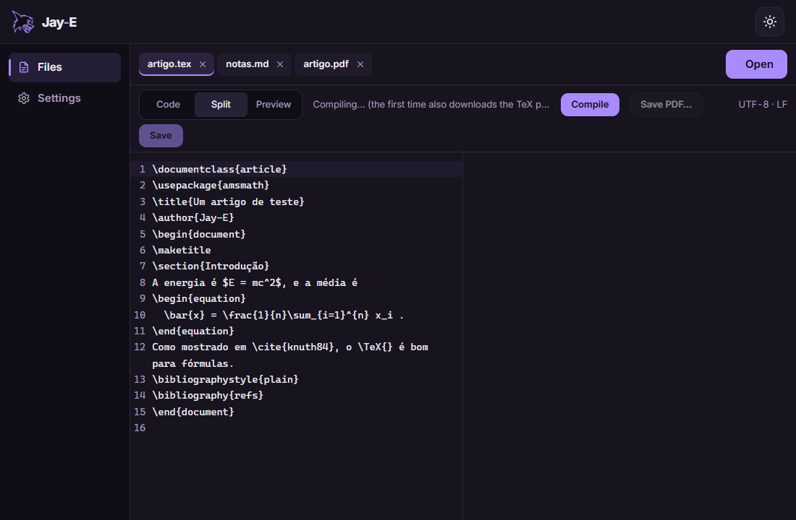
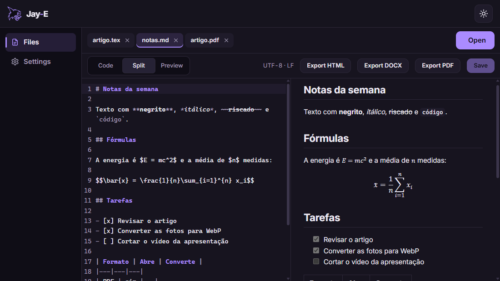
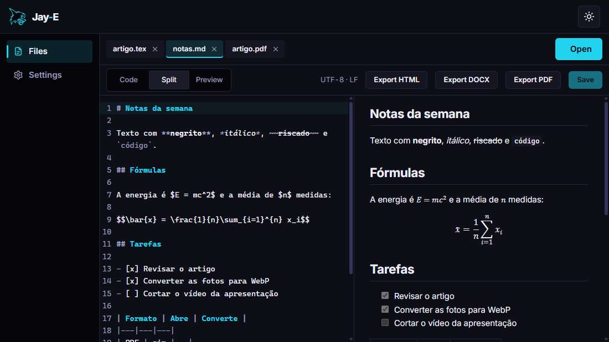
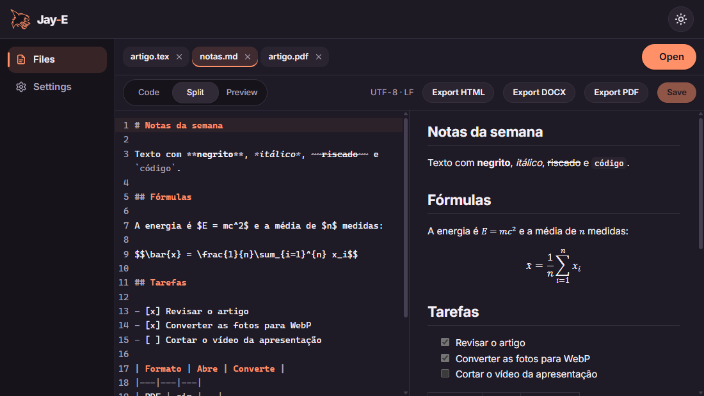

# Jay-E

**English** · [Português](README.pt-BR.md)

The reader and editor of the Jay line: documents (PDF, DOCX, ODT, RTF, Markdown, LaTeX, text), images and videos, with conversion between formats, in one small app that opens them fast. Rust first, Windows first.

<p align="center"></p>

- **Documents:** Jay-E's own PDF reader, drawn in Rust (thumbnails, search, copying text, links, password-protected PDFs); Word, OpenDocument and RTF on an A4 sheet, exported to DOCX, Markdown, HTML, text and PDF.
- **Markdown and LaTeX:** an editor with a live preview, math included. LaTeX compiles to PDF beside the editor with the TeX engine built into Jay-E (Tectonic's), and its errors jump to their line.
- **Images:** rotate, flip, crop and adjust, zoom into 100 MP photos, and convert one or a whole batch to WebP, AVIF, JPEG, PNG and more.
- **Video:** cut and join MP4 without re-encoding (instant, even on a 1 GB file), convert to MP4 or M4A through Windows' Media Foundation, save frames as PNG.

<table>
  <tr>
    <td></td>
    <td></td>
    <td></td>
  </tr>
  <tr align="center"><td>Calm</td><td>Neon</td><td>Soft</td></tr>
</table>

## Download

Install and update Jay-E from **[Jay-H](https://github.com/TyxMatty/Jay-H)**, the Jay line's hub. Or download `Jay-E_<version>_x64-setup.exe` from the **[latest release](https://github.com/TyxMatty/Jay-E/releases/latest)**: it updates an earlier version in place and keeps your settings. Jay-E also checks for a newer release when it opens and offers to update itself. Every version is listed under [releases](https://github.com/TyxMatty/Jay-E/releases).

## Code

| Folder | Contents |
|---|---|
| [`crates/jay-docs/`](crates/jay-docs/) | The engine (Rust, no Tauri): file detection, PDF (hayro), Markdown, DOCX/ODT/RTF, images, video (MP4 stream copy, Media Foundation) and LaTeX (Tectonic's engine) |
| [`frontend/`](frontend/) | Tauri v2 + vanilla JS app (Vite), with CodeMirror 6 for the editors |
| [`docs/ARQUITETURA.md`](docs/ARQUITETURA.md) | Architecture, flows, stages and what was measured (in Portuguese) |
| [`docs/REFERENCIAS.md`](docs/REFERENCIAS.md) | Notes from studying LibreOffice, ONLYOFFICE, MarkText, PhotoCraft and Kdenlive (ideas only, no code) |
| [`ROADMAP.md`](ROADMAP.md) | What's done, what's next and the to-do list |
| [`scripts/`](scripts/) | Development tools: running JS in the real app, the README's screenshots |

## Running the app

```bash
npm install
npm run dev
```

This opens the Jay-E window (Tauri) with hot reload. `jay-e.exe <file>…` opens files; with Jay-E already open, they go to its window. To open only the interface in a browser, without Tauri, use `npm run web` (port 5177; it opens no files).

The build also needs **[vcpkg](https://github.com/microsoft/vcpkg)** with the LaTeX engine's C libraries. The first install takes about 30 minutes (ICU is most of it):

```bash
vcpkg install --triplet x64-windows-static-md icu freetype graphite2 fontconfig libpng
```

The Rust build takes several GB. Create a `.cargo/config.toml` (not tracked by git) that keeps it out of OneDrive and says where vcpkg is:

```toml
[build]
target-dir = "C:/Users/<you>/.cargo-target/jay-e"

[env]
TECTONIC_DEP_BACKEND = "vcpkg"
VCPKG_ROOT = "C:/Users/<you>/vcpkg"
VCPKGRS_TRIPLET = "x64-windows-static-md"
```

## Releases

A version tag (`v*`) builds the installer in GitHub Actions ([`installer.yml`](.github/workflows/installer.yml)) as a draft release; publishing it delivers the update through Jay-H and Jay-E's own updater. Bump the version in `frontend/src-tauri/tauri.conf.json`, `frontend/src-tauri/Cargo.toml` and `frontend/package.json` first: the tag has to match it.

## Tests

```bash
npm test
cd crates/jay-docs && cargo test
cd frontend/src-tauri && cargo test
```

To drive the real app, start it with `WEBVIEW2_ADDITIONAL_BROWSER_ARGUMENTS=--remote-debugging-port=9226`; then `node scripts/cdp-eval.mjs <file.js>` runs that file inside its page, and `node scripts/screenshots.mjs <file.tex> <file.md>` retakes the README's screenshots.
