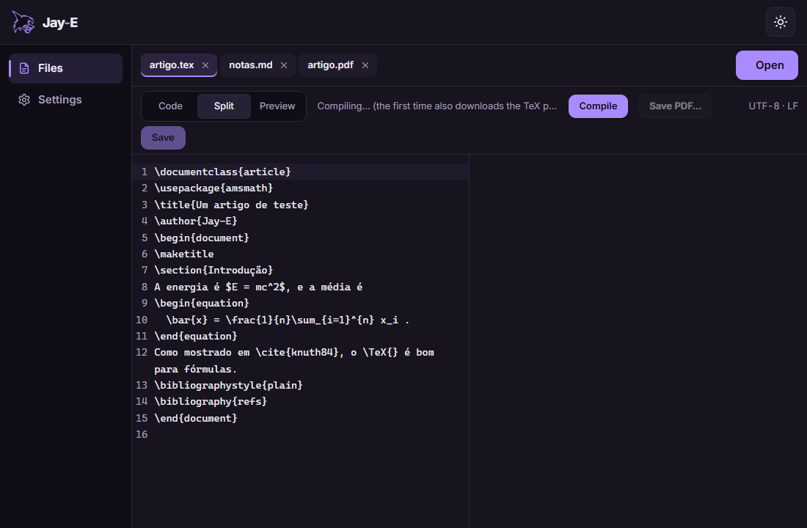
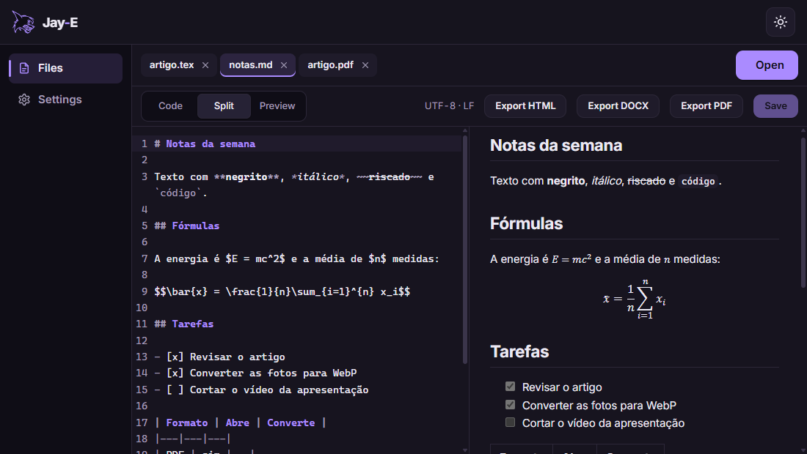
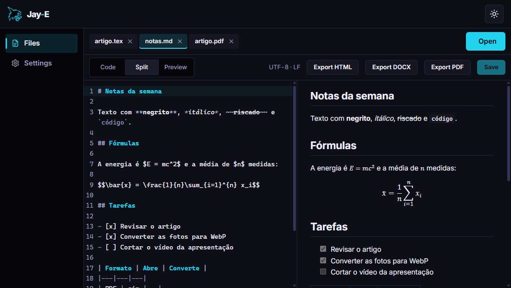
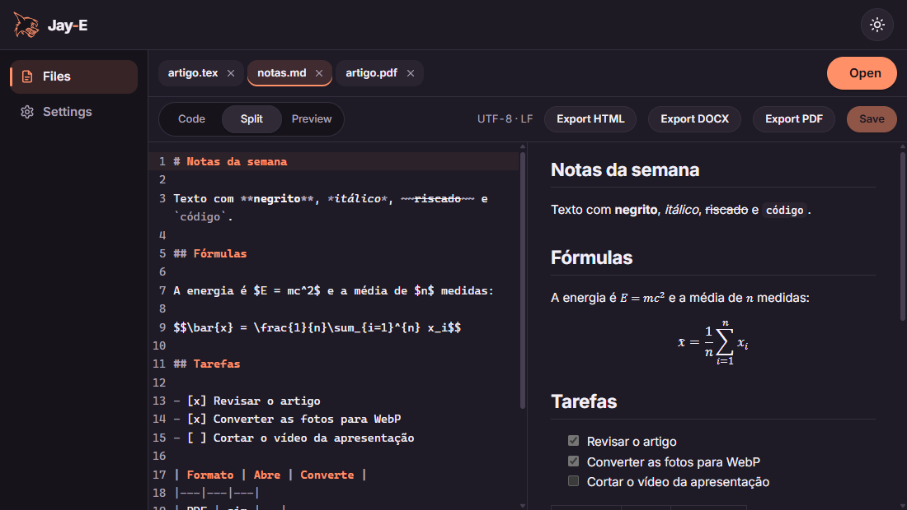

# Jay-E

[English](README.md) · **Português**

O leitor e editor da linha Jay: documentos (PDF, DOCX, ODT, RTF, Markdown, LaTeX, texto), imagens e vídeos, com conversão entre formatos, num app pequeno que abre tudo rápido. Rust primeiro, Windows primeiro.

<p align="center"></p>

- **Documentos:** o leitor de PDF do próprio Jay-E, desenhado no Rust (miniaturas, busca, copiar texto, links, PDFs com senha); Word, OpenDocument e RTF numa folha A4, exportados para DOCX, Markdown, HTML, texto e PDF.
- **Markdown e LaTeX:** um editor com prévia ao vivo, com fórmulas. O LaTeX vira PDF ao lado do editor pelo motor do TeX que vem dentro do Jay-E (o do Tectonic), e os erros levam à linha.
- **Imagens:** girar, espelhar, cortar e ajustar, zoom em fotos de 100 MP, e converter uma ou um lote inteiro para WebP, AVIF, JPEG, PNG e outros.
- **Vídeo:** cortar e juntar MP4 sem recodificar (na hora, mesmo num arquivo de 1 GB), converter em MP4 ou M4A pelo Media Foundation do Windows, salvar quadros em PNG.

<table>
  <tr>
    <td></td>
    <td></td>
    <td></td>
  </tr>
  <tr align="center"><td>Calmo</td><td>Neon</td><td>Suave</td></tr>
</table>

## Download

Instale e atualize o Jay-E pelo **[Jay-H](https://github.com/TyxMatty/Jay-H)**, o hub da linha Jay. Ou baixe o `Jay-E_<versão>_x64-setup.exe` do **[último release](https://github.com/TyxMatty/Jay-E/releases/latest)**: ele atualiza uma versão anterior no lugar e mantém as suas configurações. O Jay-E também confere, ao abrir, se há um release mais novo e oferece se atualizar. Todas as versões estão em [releases](https://github.com/TyxMatty/Jay-E/releases).

## Código

| Pasta | Conteúdo |
|---|---|
| [`crates/jay-docs/`](crates/jay-docs/) | O engine (Rust, sem Tauri): detecção de arquivos, PDF (hayro), Markdown, DOCX/ODT/RTF, imagens, vídeo (cópia de MP4, Media Foundation) e LaTeX (o motor do Tectonic) |
| [`frontend/`](frontend/) | App Tauri v2 + JS puro (Vite), com o CodeMirror 6 nos editores |
| [`docs/ARQUITETURA.md`](docs/ARQUITETURA.md) | Arquitetura, fluxos, etapas e o que foi medido |
| [`docs/REFERENCIAS.md`](docs/REFERENCIAS.md) | Notas do estudo do LibreOffice, ONLYOFFICE, MarkText, PhotoCraft e Kdenlive (só ideias, nenhum código) |
| [`ROADMAP.md`](ROADMAP.md) | O que está feito, o que vem a seguir e as pendências (em inglês) |
| [`scripts/`](scripts/) | Ferramentas de desenvolvimento: rodar JS no app de verdade, os prints do README |

## Rodando o app

```bash
npm install
npm run dev
```

Isso abre a janela do Jay-E (Tauri) com recarregamento automático. `jay-e.exe <arquivo>…` abre arquivos; com o Jay-E já aberto, eles vão para a janela dele. Para abrir só a interface no navegador, sem Tauri, use `npm run web` (porta 5177; não abre arquivos).

O build também precisa do **[vcpkg](https://github.com/microsoft/vcpkg)** com as bibliotecas em C do motor de LaTeX. A primeira instalação leva uns 30 minutos (o ICU é quase tudo):

```bash
vcpkg install --triplet x64-windows-static-md icu freetype graphite2 fontconfig libpng
```

O build do Rust gera vários GB. Crie um `.cargo/config.toml` (fica fora do git) que o deixe fora do OneDrive e diga onde está o vcpkg:

```toml
[build]
target-dir = "C:/Users/<você>/.cargo-target/jay-e"

[env]
TECTONIC_DEP_BACKEND = "vcpkg"
VCPKG_ROOT = "C:/Users/<você>/vcpkg"
VCPKGRS_TRIPLET = "x64-windows-static-md"
```

## Releases

Um tag de versão (`v*`) gera o instalador no GitHub Actions ([`installer.yml`](.github/workflows/installer.yml)) como release em rascunho; publicá-lo entrega a atualização pelo Jay-H e pelo atualizador do próprio Jay-E. Antes, suba a versão em `frontend/src-tauri/tauri.conf.json`, `frontend/src-tauri/Cargo.toml` e `frontend/package.json`: o tag tem que bater com ela.

## Testes

```bash
npm test
cd crates/jay-docs && cargo test
cd frontend/src-tauri && cargo test
```

Para comandar o app de verdade, abra-o com `WEBVIEW2_ADDITIONAL_BROWSER_ARGUMENTS=--remote-debugging-port=9226`; aí `node scripts/cdp-eval.mjs <arquivo.js>` roda esse arquivo dentro da página dele, e `node scripts/screenshots.mjs <arquivo.tex> <arquivo.md>` refaz os prints do README.
