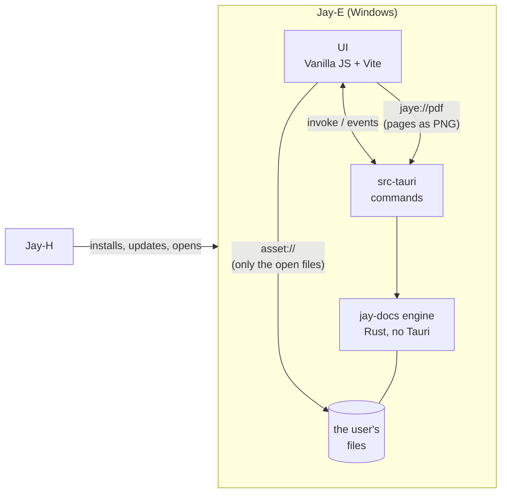
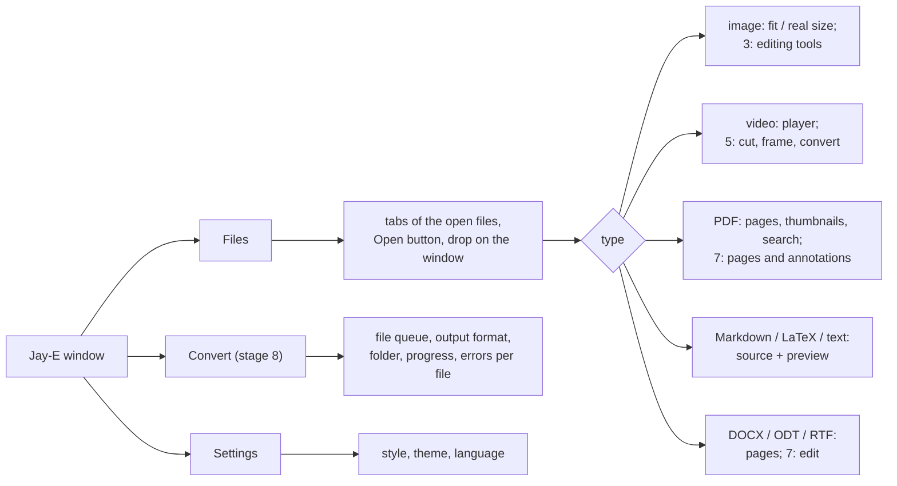
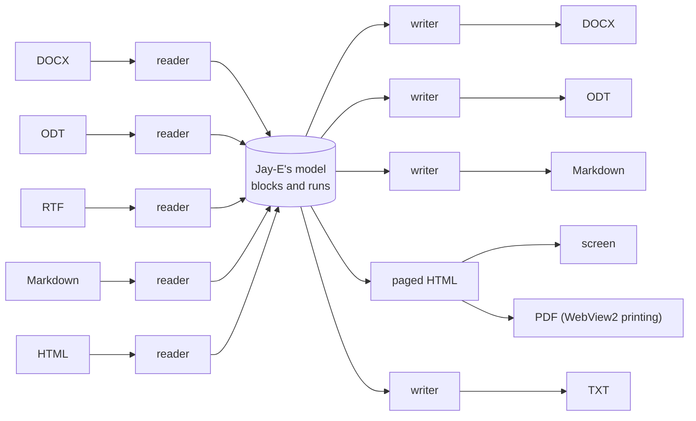

# Jay-E — Architecture

[Português](ARQUITETURA.md) · **English**

> Translation of [ARQUITETURA.md](ARQUITETURA.md). The Portuguese file is the reference and is updated first, so this one may lag behind it.

The file editor and reader of the Jay line: **documents** (PDF, DOCX, ODT, RTF, Markdown, LaTeX, text), **images** and **videos**, with **conversion** between formats. Light, quick to open and draw, and Rust first. Windows first, like the rest of the line.

Written on 2026-11-06, from Jay-A 0.1.0 and Jay-H 0.1.0, and from the study of LibreOffice, ONLYOFFICE, MarkText, PhotoCraft and Kdenlive in [`REFERENCIAS.en.md`](REFERENCIAS.en.md). Stages 0 to 6 are done. License: **MIT** (D1).

## 1. Overview



- **Opening:** with the Open button (Ctrl+O), by dragging onto the window, from the command line (Windows' "Open with") or by a second `jay-e.exe file`, which hands the file to the window already open. Rust always takes the path; the page **never sends a path** (section 7).
- **Reading what WebView2 already reads fast:** common images, video (MP4/H.264, WebM/VP9/AV1), audio and text come straight from disk through Tauri's `asset` protocol, with hardware decoding and range requests (`Range`), without going through Rust. That's stage 0.
- **The rest goes through the engine:** PDF drawn in Rust, documents read into an internal model, images edited and videos cut by `jay-docs` commands.
- Audio only plays: editing audio is Jay-A's job.

### Functional requirements

| # | Requirement | Stage |
|---|---|---|
| RF-0 | Open from the dialog, by dragging, from the command line and by a second launch; several file tabs; the type comes from the content | 0 ✅ |
| RF-1 | View images (PNG, JPEG, GIF, WebP, BMP, ICO, SVG, AVIF), video, audio and text | 0 ✅ |
| RF-P1 | Read PDF: scroll, zoom (width, page, free), thumbnails, go to page, search text, select and copy, internal and external links, password-protected PDF | 1 ✅ |
| RF-M1 | Markdown: edit the source with a preview beside it, CommonMark + GFM (tables, tasks, footnotes), formulas, export HTML and PDF | 2 ✅ |
| RF-I1 | Edit images: crop, rotate, flip, brightness/contrast/saturation; undo and redo; save as (resizing comes when saving, by the "longest side") | 3 ✅ |
| RF-I2 | Batch-convert images: PNG, JPEG, WebP, AVIF, BMP, TIFF, GIF, ICO, QOI, with quality and size | 3 ✅ |
| RF-D1 | Read DOCX, ODT and RTF on an A4 sheet: text, headings, bold/italic, lists, tables, images, links, page breaks (header and footer come later) | 4 ✅ |
| RF-D2 | Convert documents: DOCX/ODT/RTF/Markdown to DOCX, Markdown, HTML, TXT and PDF (reading HTML comes later) | 4 ✅ / 8 ✅ |
| RF-V1 | Video: cut and join without re-encoding, extract a frame as an image, thumbnails on the time bar | 5 ✅ |
| RF-V2 | Convert video (MP4/H.264 + AAC; height, quality, sound only as M4A), with progress and stop | 5 ✅ |
| RF-L1 | LaTeX: edit with highlighting, compile to PDF and see it beside, formula preview | 6 ✅ |
| RF-D3 | Edit DOCX and ODT: text, bold/italic, headings, lists, simple tables, images; save without losing what Jay-E doesn't understand | 7 |
| RF-P2 | Edit PDF: merge, split, reorder, rotate and delete pages; annotate (highlight, note, drawing); fill forms | 7 |
| RF-C1 | One batch conversion screen for every kind, with a queue, progress, cancel and no overwriting without asking | 8 |
| RF-A1 | Jay-C's three styles and themes, English and Portuguese, single instance | 0 ✅ |

### Non-functional requirements

| # | Requirement | How to measure |
|---|---|---|
| RNF-1 Quick to open | Window ready in under **500 ms**; the first page of a 100-page PDF in under **150 ms** after opening; a 24 MP image visible in under **300 ms** | time from the click to the first frame, through remote debugging (performance.now) |
| RNF-2 Smooth scrolling | Scroll a 1,000-page PDF at **60 fps** with no blank page for more than 100 ms; tile cache memory bounded (256 MB by default) | DevTools trace; process memory |
| RNF-3 Light | Installer of at most **15 MB**; no LibreOffice, FFmpeg or TeX packages in the installer (whatever is optional is downloaded only when used). The TeX engine goes inside (D6); measured in stage 6: 16.5 MiB | the installer `.exe` |
| RNF-4 Rust first | Reading, drawing, converting and editing in Rust; the page only shows and sends commands. A C/C++ library only when there's no good one in Rust (e.g. Media Foundation), and isolated behind a module | review |
| RNF-5 Don't lose data | Saving is atomic (`.tmp` and rename); the same encoding and line endings; never overwrite the original without asking; a warning if another program changed the file; what Jay-E doesn't understand in a DOCX/ODT is kept | round-trip tests (open → save → compare) |
| RNF-6 Untrusted input | Every file is hostile: limits on size, pixels (e.g. 256 MP), pages, XML depth and decompression (ZIP bomb); document HTML cleaned before it enters the page; nothing runs a document's script | corrupted and malformed files in each reader's tests |
| RNF-7 Robustness | A corrupted or unsupported file becomes a notice in that tab; nothing brings the app down | each stage's tests |
| RNF-8 Platform | Windows 10 2004 or newer, x64, WebView2 | — |
| RNF-9 License | Jay-E is **MIT**. Permissive dependencies (MIT, BSD, Apache, per-file MPL, Zlib); LGPL only as a replaceable library. GPL/AGPL code (Kdenlive, ONLYOFFICE) doesn't come in | `cargo tree` and `package-lock.json` reviewed with every new dependency |
| RNF-10 Accessibility and language | Everything by keyboard, with labels for screen readers; the contrast of Jay-C's styles; all text in English and Portuguese | `npm test` (the translations test) |

## 2. Technical decisions

| Topic | Choice | Why |
|---|---|---|
| Shell and UI | **Tauri v2 + Vanilla JS + Vite**, like the line | Same stack and look. Copied from Jay-H: `styles/theme.css` (Calm/Neon/Soft), the base of `app.css`, `ui/dom.js`, `ui/tabs.js`, `ui/theme.js`, `core/i18n.js`, `core/style.js`, `store/settings.js`, `scripts/cdp-eval.mjs`, the Inter font, the wolf and Jay-C's icons. |
| Engine | Rust crate **`jay-docs`**, without Tauri | Tests with `cargo test` without building the app, like Jay-A's `jay-audio`. The Tauri commands live in `src-tauri`. |
| Type detection | **Our own** (`detect.rs`, ~150 lines) from the first 4 KB | LibreOffice's idea of type separate from filter. Not worth a dependency (`infer`) for fixed signatures, and this way the DOCX/ODT ZIP and Markdown/LaTeX text are decided Jay-E's way. |
| Serving files to the page | **Tauri's `asset` protocol, empty scope**; Rust allows each opened file (`asset_protocol_scope().allow_file`) | It already does `Range` (seeking in video) and doesn't copy bytes through the IPC. The page can't read anything the person didn't open. |
| Drawn pages (PDF; large images in stage 3) | Our own **`jaye://`** protocol (`register_asynchronous_uri_scheme_protocol`), one URL per page: `pdf/<doc>/<page>/<width>`. The body is a **fast PNG** (Up filter, fdeflate's fastest mode), decoded in the page by `createImageBitmap`, off the main thread | Measured: the protocol moves ~14 ms per MB, and a 1,350 px page in RGBA is 10 MB (146 ms). As PNG it's ~0.8 MB and takes 6 ms to compress. No base64 in the IPC. LibreOfficeKit's `paintTile` idea, a whole page at a time for now. |
| PDF (read and draw) | **hayro** 0.9 (pure Rust, `unsafe` forbidden, MIT/Apache), with the 14 standard fonts and the CMaps embedded | Spike S1 (section 8): the same speed and look as PDFium on the test PDFs, without the 7.8 MB DLL, and it opens truncated PDFs. Text and links come from the interpreter itself (a `Device` that gathers the glyphs). PDFium stays as plan B behind `pdf.rs`. |
| PDF (edit pages) | **`lopdf`** (MIT, pure Rust) | Merge, split, reorder, rotate, delete: it's working on the object tree, without drawing. |
| Markdown | **`pulldown-cmark`** (MIT) → HTML, cleaned by **`ammonia`** (MIT/Apache); formulas as **MathML Core** through **`math-core`** (MIT), which WebView2 draws on its own | All in Rust, without KaTeX (JS + fonts) in the page. Formulas go in after cleaning (`ammonia` would remove the MathML), each one generated by `math-core`, which escapes the text (tested with `\text{}`). |
| Code editor (Markdown, LaTeX, text) | **CodeMirror 6** (MIT) with the **`@lezer/markdown`** grammar directly | `@codemirror/lang-markdown` would bring the HTML, CSS and JS modes with it (the editor bundle went to 574 KB); without it, 352 KB, loaded only when a text opens. The app starts with 19 KB of JS. |
| Documents | **Our own internal model** (`jay_docs::doc`) + readers with **`quick-xml`** (MIT) and **`zip`** (MIT, deflate only, in Rust) for DOCX and ODT, our own RTF reader; shown as HTML on an A4 sheet in WebView2; writers for DOCX, Markdown, HTML and TXT | ONLYOFFICE's star (section 6). No LibreOffice (300 MB) and no layout engine of our own: WebView2's HTML already does fonts, bidi and line breaking. The XML becomes a small tree with limits (depth 512, 5 million nodes, no DTD entity expanded); each ZIP part is at most 256 MB uncompressed. |
| Document → PDF | **`window.print()`** over the preview, with a print CSS: WebView2's dialog already has "Save as PDF" | Zero native code. `PrintToPdfAsync` (saving directly, without the dialog) stays for stage 4 if it's ever needed (S2). |
| LaTeX | **Tectonic's engine** (crate `tectonic` 0.17, MIT; XeTeX in C/C++ inside) **linked into `jay-e.exe`** (D6), running in a child process of the app itself | No outside program: `jay-e.exe --jaye-tex` compiles and exits, so a document that crashes or hangs TeX doesn't take the window with it (10 min time limit, Stop). Only the packages the document uses come from the internet, as data, on the first compile (Tectonic's bundle, 42 MB for an article, cached). The C libraries (ICU, FreeType, Graphite2, fontconfig, libpng) come from vcpkg, static. |
| Images | Decoding: **`image`** 0.25 (PNG, JPEG through `zune-jpeg`, GIF, WebP through `image-webp`, BMP, TIFF, ICO, QOI), pure Rust, with limits. Encoding: `image` itself, **`webp`** (libwebp, C, BSD) for lossy WebP and **`ravif`** (rav1e, Rust, BSD) for AVIF | A user's file is hostile input, so everything that **reads** is Rust. libwebp only **encodes** our own pixels: there's no lossy WebP in Rust with a compatible license (`zenwebp` is AGPL). `ravif` goes without rav1e's assembly (it would need `nasm`): AVIF is slow (2.7 s on a 5.8 MP photo). AVIF, HEIC and SVG aren't read by Rust: AVIF and SVG open in WebView2's viewer, without editing; HEIC doesn't open (S3). Resizing with `image` (Lanczos3 when saving, `thumbnail` for the preview), without `fast_image_resize`: it was enough. |
| Video (watch) | **WebView2's `<video>`** | Hardware decoding, for free. HEVC needs the Windows extension: without it, Jay-E says so. |
| Video (cut, join) | Stream copy in Rust: the `moov` sample tables read and rewritten with **`mp4-atom`** (Apache-2.0), only the stretch's bytes copied, `moov` before `mdat` | Instant and lossless; cuts at the key frame at or before the marked start (the screen says where it started). The `mp4` crate (unmaintained since 2024) was left out. MP4, MOV and M4A; WebM/MKV and fragmented MP4 not (convert first). |
| Video (convert and grab a frame) | Windows' **Media Foundation** (`windows` 0.62, the same version as Tauri) — D3 ✅ | Already in Windows: decodes what Windows plays (WebM/VP9 through the extensions it ships with), scales in the video processor and encodes H.264 + AAC on the GPU when there is one. 0 MB in the installer. The frame comes out through Rust (the page's `<canvas>` is blocked from reading a video from another origin). |
| Undo | **Pairs of commands** (do, undo) per document, merging typing within 1 s, with the selection along | Kdenlive (`undohelper.hpp`) and MarkText (`history`). |
| Long jobs | A queue in Rust, one per core, progress through a `Channel`, cancel deletes the `.tmp` | Kdenlive (`jobs/`), like Jay-A's conversion. |
| Single instance | `tauri-plugin-single-instance`, which hands over the second launch's files | "Open with" on a file with Jay-E open opens a tab, not another window. |
| File dialog | `tauri-plugin-dialog`, **called from Rust** | No dialog permission for the page. |
| Tray | **No** | Nothing runs in the background: closing the window closes the app. |
| Vite port | **5177** | Jay-C uses 5173, Jay-A 5175, Jay-H 5176: all four run in dev at the same time. Remote debugging on **9226**. |
| Settings | `localStorage`, key `jaye.settings` | Only interface preferences (theme, style, language), like Jay-H. |

## 3. Repository layout

```
Jay-E/
├─ package.json                  # npm workspaces: frontend
├─ LICENSE                       # MIT
├─ docs/ARQUITETURA.md, docs/REFERENCIAS.md (and their .en.md)
├─ crates/jay-docs/              # engine: no Tauri, testable with cargo test
│  └─ src/
│     ├─ lib.rs
│     ├─ detect.rs               # 0 ✅: type from the content
│     ├─ pdf/                    # 1: document, pages, tiles, text, search; 7: editing pages (lopdf)
│     ├─ markdown.rs             # 2 ✅: Markdown → clean HTML, formulas as MathML, line marks
│     ├─ text.rs                 # 2 ✅: encoding, line endings, atomic write, stamp
│     ├─ image.rs                # 3 ✅: decode with limits, edits, adjustments, encode, convert
│     ├─ doc/                    # 4 ✅: mod.rs (the model), xml.rs, docx.rs (read and write), odt.rs, rtf.rs,
│     │                          # markdown.rs (read and write), html.rs, text.rs; 10: html_read.rs, compare.rs
│     ├─ pdf_content.rs          # 10: what the page draws: text, pictures, blanks, redaction, compressing
│     ├─ pdf_ocr.rs              # 10: Windows' OCR, invisible text on the pages
│     ├─ video/                  # 5 ✅: mp4.rs (cut and join by copy), mf.rs (convert, frame)
│     ├─ latex.rs                # 6 ✅: Tectonic's engine in a child process of jay-e.exe
│     └─ jobs.rs                 # 5/8: job queue
├─ scripts/cdp-eval.mjs          # runs JS inside the app (remote debugging on 9226)
└─ frontend/
   ├─ index.html, vite.config.js, package.json
   ├─ src/
   │  ├─ main.js
   │  ├─ styles/                 # theme.css and app.css (Jay-C's base)
   │  ├─ core/                   # i18n.js, style.js; files.js, pdf.js, text.js (bridges to Rust)
   │  ├─ ui/                     # dom.js, icons.js, tabs.js, theme.js (from Jay-C); app-shell.js,
   │  │                          # files.js (tabs), viewers.js (one per type), pdf-viewer.js, text-editor.js
   │  ├─ locales/pt-BR.js
   │  └─ store/settings.js
   └─ src-tauri/
      ├─ tauri.conf.json         # productName "Jay-E", identifier io.github.tyxmatty.jaye
      ├─ icons/                  # Jay-C's
      └─ src/main.rs, files.rs   # opening (dialog, drop, command line), single instance
         pdf.rs, text.rs         # PDF and text/Markdown commands; the jaye:// protocol
         spell.rs                # 10: spelling through Windows' spell checker
         update.rs               # updates through the jay-i crate
```

## 4. Interface



- One tab per open file; opening the same file again goes back to its tab. Arrows switch tabs, Ctrl+W closes, Ctrl+O opens.
- Each viewer has its own toolbar on top, with the same positions (zoom on the right, save/export at the end).

## 5. Quick drawing

- **What WebView2 already does, it does:** image, video and audio go from disk to the tag through `asset://`, without a copy in Rust. That's why stage 0 already opens large photos and videos at once.
- **PDF** (stage 1 ✅): each page has a space of the right size from the start, so the scroll bar is right from the beginning; only the pages on screen (and one spare) are requested, at the current zoom, through `jaye://pdf/<doc>/<page>/<width>`. Those more than 4 pages away from the screen give their memory back. Zoom changes a CSS variable: the old picture stretches at once and the sharp one arrives 150 ms after the gesture stops. Text, links and search highlights are layers on top, in points times `--scale`, and aren't redone on zoom.
- **Drawing off the main thread:** each open PDF has two threads in Rust, one that draws and one that takes text and links and does the search (a long search doesn't delay drawing). Requests are served newest first, and a request for a page that left the screen (the page says which are visible) is skipped before it starts.
- *shortcut: one picture per page, at most 4,096 px wide and 25 Mpx; above that (zoom of ~400% on a large screen) the page stretches and loses sharpness. Tiles when that's needed.*
- **Huge images** (over 32 MP, stage 3) use the same tile path, with a pyramid of reductions.
- **Documents** (stage 4): the model becomes HTML once, and the page only lays out what's near the screen (`content-visibility: auto`).

## 6. Documents: the model in the middle



- **Model:** blocks (paragraph, heading 1–6, list item, table, image, page break, code, formula, quote) with text runs (bold, italic, underline, strikethrough, code, link, color, size, font) and named styles. Like Muya's JSON state, with what DOCX needs on top.
- **Each reader** is a tokenizer of the format that calls a common mapper (LibreOffice's `writerfilter`), with input limits (uncompressed size, XML depth, number of parts).
- **Lossless round trip** (stage 7): the DOCX/ODT reader keeps the parts and elements it doesn't understand; the writer writes the model back **only where it changed** and copies the rest byte for byte. Test: opening and saving without editing gives an equivalent file (the same canonical `document.xml`).
- **Fidelity:** Jay-E doesn't promise a page identical to Word's (that would be ONLYOFFICE's layout engine). It promises the right content, structure and order (risk 3).
- **How it came out in stage 4:** headings come from the style's *name* ("heading 1"; in Word files in Portuguese the id is "Ttulo1", and the name is still "heading 1") or from the outline level; lists from the paragraph's or the style's numbering ("List Number"), numbered or not by `numFmt`; tracked-change insertions come in, deletions don't (as if accepted). In ODT, automatic and named styles with inheritance (`parent-style-name`, at most 32 levels). In RTF, the style sheet, `\outlinelevel`, lists by `\ls`/`\ilvl` (numbered when `\listtext` has a number), tables by `\cell`/`\row`, `\uN`, `\'hh` in Windows-1252.
- *shortcut: one continuous sheet, not paged; only explicit page breaks separate sheets on screen (when printing, the pagination is WebView2's). Fonts, sizes, colors, text boxes, notes, headers and footers and merged cells aren't in the model. Images inside RTF aren't read.*

## 7. Security

- **The page never sends a path.** The dialog, drops and the command line are all handled in Rust (`files.rs`), which allows only that file in the `asset` protocol. Even if a document managed to run script in the page, it could only read what the person opened.
- **No document scripts:** a CSP without `unsafe-eval` or outside scripts; the HTML that comes out of Markdown and DOCX goes through `ammonia` in Rust; SVG opens in an `` (which doesn't run script), never embedded in the DOM.
- **Input limits** (RNF-6): per reader, like the `MAX_*` of PhotoCraft's codecs. A read error becomes that tab's notice.
- **Malicious PDF:** hayro is safe Rust (`unsafe` forbidden), so a PDF doesn't corrupt memory; the worst is a panic, which each request catches (`catch_unwind`; the release went from `panic = "abort"` to `"unwind"` for that) and becomes a blank page. What's left is the risk of a PDF that traps the interpreter in a loop: it only hangs that document's thread (D5).
- **PDF links:** only `http`, `https` and `mailto` leave the app (checked in the engine and again in the `open_link` command); `file:`, `javascript:` and the rest are ignored.
- **Commands that take a path** (`pdf_open`, `text_open`, `text_save`, `markdown_render`…) only accept files the person opened (`OpenedPaths` in `files.rs`).
- **Images in Markdown:** only image files in the `.md`'s folder or below it, allowed one by one in the `asset` protocol. Images from the web don't load (the CSP only allows `asset:`): no tracking pixels. An `` written in raw HTML loses its address in the cleaning.
- **Links in the preview** never navigate the window: `http`, `https` and `mailto` open in the browser; the rest is ignored.
- **Don't lose edits:** closing a tab or the window with something unsaved asks first (text and image).
- **Documents:** the screen's HTML is generated by `jay_docs::doc::html`, which escapes all text and only keeps `http`, `https` and `mailto` links; images are served by `jaye://` from memory, as they are in the file (in an ``, which doesn't run script, not even from an SVG). Exporting uses the save dialog; the images of an exported Markdown get another prefix if the name already exists in the folder.
- **Images:** decoded in Rust, with at most 300 megapixels, 65,535 px per side and 3 GB of memory for the decoder; EXIF orientation is applied. The original never changes: "Save as" uses the dialog (which asks before replacing) and batch conversion writes `name (2).ext` instead of overwriting. Metadata (EXIF, GPS) isn't copied to the new file.
- **Updates** (`src-tauri/src/update.rs`, through the line's `jay-i` crate): on opening, the `latest` release of `TyxMatty/Jay-E`; the installer only comes from `https://github.com/TyxMatty/Jay-E/releases/download/…`, with the size and SHA-256 equal to GitHub's (`digest`). It runs with `/P /UPDATE /R` (passive, keeps the settings, reopens) only after asking about unsaved edits. The release file is Jay-I's setup, which carries the NSIS installer. The release is born as a draft in CI (`.github/workflows/installer.yml`) and is only seen after being published by hand. The 10 points are in the subsection "Jay-I's setup and the update through the jay-i crate (0.2.2)", at the end of this section.
- **Optional downloads** (FFmpeg, if it comes in): only from fixed addresses in the code, with the SHA-256 checked, like the installers in Jay-H.
- **LaTeX:** the engine runs in Tectonic's untrusted mode (no *shell escape*, no extra search folders), in a separate process without a window; it reads only the `.tex`'s folder and writes the PDF into the app's cache. TeX packages come from Tectonic's bundle (data only, nothing that executes).
- **Saving:** atomic, and never over the original unless the person asks.

### Jay-I's setup and the update through the jay-i crate (0.2.2)

Two changes. **(a)** `update.rs` no longer has its own copy of the updater (release lookup, version compare with `semver`, installer picking, download with SHA-256 through `sha2`/`ureq`) and uses the line's `jay-i` crate, a git dependency pinned at commit `60de872dee82c5be37d2ea15c5f94d0dddffde26` of `TyxMatty/Jay-I`: `jay_i::latest`, `newer`, `pick_installer`, `download` and `run` with `Mode::Update { relaunch: true }` (`/P /UPDATE /R`). The three commands (`update_check`, `update_download` with the progress channel, `update_install`), the page, the question about unsaved edits before quitting (`confirmQuit`, in `ui/update.js`) and the button that is disabled while it works stay the same. `semver`, `sha2` and `ureq` left the app's `Cargo.toml` (they come in through `jay-i`). The crate brings what the copy lacked: HTTPS only, timeouts (10 s to resolve and connect, 30 s to send, receive and each read) and the JSON response capped at 1 MB. Version compare reads only plain-digit parts (`v`/`V` prefix and `-pre`/`+build` dropped) and a tag it can't read is never newer; Jay-E's tags are always `v<version of tauri.conf.json>` (the workflow refuses anything else), so nothing Jay-E relied on changed. The three Rust tests that re-tested what is now in the crate were deleted; one remains for what is Jay-E's own (`offer`: `v`/`V` prefix trimmed, only a newer version is offered, "nightly" never). `src-tauri` has 13 tests. **(b)** The release file becomes Jay-I's setup: `installer.yml` builds Tauri's NSIS installer as before (`npm run build`), checks out `TyxMatty/Jay-I` at the same commit (`persist-credentials: false`) and runs its `scripts/build-setup.ps1` with the NSIS inside (name Jay-E, version from `tauri.conf.json`, `jay-e.exe`, `icons/icon.ico`, `icons/128x128@2x.png`). Out comes `setup-out/Jay-E_<version>_x64-setup.exe`: a small window with the line's look that runs the NSIS installer silently (`/S`) when WebView2 is present; with `/P` (what the updater passes) it goes straight to "Installing" and closes itself; `/UPDATE /R /NS` are passed on to the NSIS; its exit code is the installer's. Only that file is uploaded as the artifact and goes into the release (a draft, generated notes, `permissions: contents: write` as before). The raw NSIS has the same name and stays in `bundle/nsis`, from where nothing is uploaded (the hub, Jay-H and the updater take any file ending in `_x64-setup.exe`). The step fails if the setup is over 30 MB or has the raw NSIS's size. RNF-3's goal is 15 MB, but the NSIS alone is 17.59 MiB (18,446,431 bytes, measured on 0.2.2) because of the TeX engine; the setup measured 20.67 MiB (21,674,496 bytes, built here with the same step as the workflow; the NSIS installer is inside it, byte for byte). An already-installed Jay-E 0.2.1 that updates to 0.2.2 downloads the new file (the setup) and runs it with `/P /UPDATE /R`; the setup understands those flags, so the old updater works with the new file. The "Open with" file associations stay: Tauri's NSIS template writes them in silent mode too (in the `installer.nsi` Tauri generates in `<target-dir>/release/nsis/x64/`, the 24 `APP_ASSOCIATE` calls, lines 693–716, sit in `Section Install` (lines 676–783) with no mode condition; in that section only the desktop shortcut depends on `/P` or silent mode (lines 768–782), and `/R` works in silent mode (`.onInstSuccess`, lines 786–795)).

By the 10 points:

1. **Attack surface.** No new command or event on the page (the same three as before); one request to `api.github.com` per opening; the setup download, from `github.com/TyxMatty/Jay-E/releases/download/`, only after the click; one process, the setup, run only after the download is checked. In CI: the checkout of another repository and running a script from it. *Checked:* the commands in the code and `installer.test.js`. *Not checked:* a real update (see point 10).
2. **Access control / IDOR.** The page sends no address, path or repository: `REPO` is a constant in Rust and `update_download` only receives the progress channel.
3. **Data permissions.** The update reads and writes nothing of the person's documents. The downloaded setup goes to a fresh folder in `%TEMP%` (`jay-i-<pid>-<time>-<n>`); if the check fails it is removed; if the setup runs it stays (it runs from there; Windows' cleanup takes it). The update (`/UPDATE`) keeps the settings. The files the person opened are not touched.
4. **Untrusted input to a sensitive operation.** GitHub's response is JSON capped at 1 MB; the setup only runs if its size and SHA-256 match GitHub's `digest` (`jay_i::download`, tested in the crate). The version reaches the page only as text (`textContent`). **Limit:** the installers are **not code-signed**, and the SHA-256 comes from GitHub itself (the file's `digest`), not pinned in the code: whoever controls the project's GitHub account controls what runs.
5. **Exposed credentials.** None: the GitHub API is called without a token; the Jay-I checkout uses `persist-credentials: false`; `GH_TOKEN` exists only in the step that creates the draft release, and `contents: write` is the same as before (`gh release create` needs it).
6. **Authentication.** Not applicable (public repository, no account).
7. **Resource abuse and races.** Timeouts on every network step (in the crate); download capped at 200 MB (`MAX_INSTALLER`); one check per opening. The button is disabled while it works, and two downloads, if there were any, would each get their own fresh folder (no stepping on each other). The app only quits after the question about unsaved edits.
8. **Dependency chain.** One git dependency, `jay-i`, pinned by the full commit in `Cargo.toml` **and** a second checkout in CI pinned to the same commit; `installer.test.js` requires the two to be equal and every `uses:` to be a 40-hex SHA (all Actions are pinned, with the version in a comment). Bumping Jay-I means changing both together. `cargo audit`: `cargo audit` 0.23.0 on `frontend/src-tauri/Cargo.lock` (2026-11-10): 6 vulnerabilities and 6 warnings, **the same** as the `Cargo.lock` from before the change (run on both). The 6 are in `quick-xml` 0.39.4 (RUSTSEC-2026-0194 and -0195) and `zip` 8.6.0 (RUSTSEC-2026-0367, -0368, -0369 and -0429), which come in only through `tectonic`; the warnings are `paste`, `proc-macro-error`, `zbus_names`, `zvariant` and `zvariant_derive` (unmaintained) and `glib` 0.18.5 (*unsound*). `jay-i` brought in only `winreg`, and `semver` left. **Pending, outside this change:** the `tectonic` ones; whether Tectonic calls the affected paths (`ZipArchive::extract`, `NsReader`) was not checked.
9. **Network and exposure.** Only `api.github.com` (the release) and `github.com` (the download, which GitHub redirects to its own file storage), always over HTTPS. The request reveals to GitHub the IP, the *user agent* (with the installed version) and the time; nothing of the person's documents goes along. The CSP did not change.
10. **Adversarial tests and release criteria.** In the `jay-i` crate: a download address from another repository, a missing or different `digest`, a wrong size and odd versions/tags. In Jay-E: the Rust `offer` test and `installer.test.js` (Actions by SHA, the same Jay-I commit in the workflow and in `Cargo.toml`, `build-setup.ps1` used, the 30 MB cap, the upload and `gh release create` taking `setup-out/` and never `bundle/nsis`, the release `--draft`). **Blocks the release:** `installer.test.js` failing; the tag differing from the version; the setup over 30 MB or with the raw NSIS's size (the workflow fails). **Not verified:** an update end to end (it needs a published release newer than the installed one); the workflow on GitHub Actions; the setup was built locally but never run.

## 8. Stages

Every stage ends with something testable.

| # | Stage | Done when |
|---|---|---|
| 0 ✅ | Scaffold: window, styles, theme, language, single instance; open from the dialog, by dropping, from the command line and by a second launch; type detection; tabs; image, video, audio and text through WebView2 | `npm test` and `cargo test` pass; in the app, a photo, a video and a `.md` open, each in its own tab ✅ |
| 1 ✅ | PDF reader (S1): pages through `jaye://`, only the visible ones, zoom, thumbnails, go to page, search and copy text, links, password | a 1,000-page PDF scrolls smoothly (RNF-2); the first page in < 150 ms (RNF-1); a corrupted PDF shows the notice |
| 2 ✅ | Markdown: CodeMirror + a `pulldown-cmark` preview cleaned by `ammonia`, synced scrolling, KaTeX; safe saving (encoding, line endings, atomic, watching); export HTML and PDF | opening, editing and saving a `.md` in CP1252 with CRLF keeps both; `<script>` in Markdown doesn't run; the exported PDF opens in the stage 1 reader |
| 3 ✅ | Images: edit (crop, rotate, flip, resize, adjustments) non-destructively, with undo; batch convert (S3); huge images in tiles | 10 mixed images become WebP and AVIF; a decompression bomb is refused; a 100 MP photo opens in tiles |
| 4 ✅ | Documents: the model; DOCX, ODT, RTF, HTML and Markdown readers; paged view; export to PDF, Markdown, HTML and TXT | a DOCX with headings, lists, a table and an image shows everything; DOCX → Markdown → DOCX keeps the text and the headings |
| 5 ✅ | Video (S4): cut and join by copy, extract a frame, thumbnails on the time bar; convert through Media Foundation, with a queue and cancel | cutting 10 s from a 1 GB MP4 takes < 2 s and plays; a WebM converted to MP4 plays in the player |
| 6 ✅ | LaTeX: CodeMirror + compiling with Tectonic's engine inside Jay-E (D6), the PDF beside it in the stage 1 reader, errors on the right line | an article with formulas and a bibliography compiles; a syntax error points to its line |
| 7 | Editing: DOCX and ODT (text, styles, lists, simple tables, images) with a lossless round trip; PDF: merge, split, reorder, rotate, delete pages, annotations, forms | opening and saving a DOCX without editing gives the same canonical `document.xml`; edited, it opens in Word and LibreOffice; two merged PDFs open in both |
| 8 ✅ | Convert: a batch screen for every kind, with a queue, progress, cancel and asking before overwriting | a batch of 20 mixed files; a corrupted one fails on its own and the others come out |
| 9 ✅ | Release: NSIS installer in `%LOCALAPPDATA%\Jay-E`, file associations ("Open with"), Jay-E in Jay-H's catalog, the version published on GitHub | install on a clean machine, open a PDF with a double click; Jay-H installs and updates Jay-E |
| 10 ✅ | More tools: images (curves and levels, filters, straighten, mark up, red eye, export with a preview, batch edits, HEIC/RAW through WIC, metadata), video (timeline, razor, speed, sound, fades, text on top, presets, shrink to a size, GIF, subtitles), PDF (edit the text, fill in blanks without a form, replace pictures, compress, sign, real redaction, Windows OCR), documents (find and replace, word count, spelling, compare), converter (HTML, LaTeX, watched folder). Ideas from PhotoCraft and OpenShot (`REFERENCIAS.en.md` section 6) | a photo with curves, text and an arrow undoes step by step and exports as on screen; a video cut into three pieces, with the middle one out, a fade and text, plays in the player and in Windows; a scanned PDF becomes searchable |

**Stage 0, measured (2026-11-06):**
- **Tests:** `npm test` (6: translations, UTF-8/UTF-16 text, sizes), `cargo test` in `jay-docs` (8: signatures, MP4/MOV/AVIF/HEIC by brand, WebM/MKV, ODT by `mimetype`, DOCX by extension, text that starts like a signature — "BMW…", "ID3 …" — stays text, UTF-16 with BOM, binary) and in `src-tauri` (1: command-line paths; today there are 13).
- **In the dev app, through remote debugging:** a second `jay-e.exe` with 7 files opened 7 tabs in the window that was already open. A PNG (128×2048) fits the window and a click shows the real size; a 16 s MP4 plays (`readyState` 4); a `.md` shows as text; PDF and DOCX say which stage their viewer comes in; a binary says "can't open this type"; a file that doesn't exist shows Windows' error. The URLs are `http://asset.localhost/…`, allowed one by one by Rust.
- **Not seen:** the Open dialog and dropping on the window (they can't be automated through remote debugging; they use the same `files::open` as a second launch). In a first run, the `doc.docx` tab appeared with another tab's video; the file was being rewritten during the test, and on the repeat everything matched. Keep an eye on it.

**Spike S1 (2026-11-06):** PDFium (`pdfium-render` 0.9.5 with PDFium `chromium/8138` from bblanchon/pdfium-binaries, SHA-256 checked) against hayro 0.9.0, release build, each in its own process, the page at 1,240 px wide (A4 at ~150%), Ryzen 5 5600G:

| PDF | Pages | PDFium: open / 1st page / average | hayro: open / 1st page / average |
|---|---|---|---|
| Résumé (Word → PDF) | 2 | 0.9 / 16.5 / 6.0 ms | 1.0 / 16.5 / 5.4 ms |
| "Attention Is All You Need" (arXiv, LaTeX) | 15 | 1.2 / 38.3 / 23.3 ms | 1.9 / 12.0 / 23.5 ms |
| PDF 1.7 standard (ISO 32000, 22 MB) | 756 | 16.0 / 4.7 / 8.1 ms | 20.9 / 3.6 / 6.2 ms |
| Synthetic, 1,000 pages of text | 1,000 | 1.1 / 8.2 / 7.6 ms | 5.4 / 7.7 / 7.2 ms |
| Synthetic "scanned" (a 2,480×3,508 image per page, 26 MB) | 3 | 0.7 / 57.1 / 55.6 ms | 8.8 / 40.5 / 40.0 ms |
| The 1,000-page one cut at a third | — | **doesn't open** (`FormatError`) | opens 336 pages |
| Process memory peak | | 63 MB | 52 MB |

- **Look:** the 1st page of the article and of the standard came out the same in both, compared by eye.
- **Size:** PDFium would be a 7.8 MB `pdfium.dll` in the installer; hayro goes into the `.exe`.
- **Choice: hayro.** Pure Rust and no `unsafe`, the same speed and look, it opens truncated PDFs and reads password-protected PDFs (RC4/AES). Text, links and search were written on top of it (PDFium would have had them ready).
- **Not tested in S1:** fillable forms, complex transparency, non-embedded CJK fonts, a real password-protected PDF.

**Stage 1, measured (2026-11-06):**
- **Tests:** `cargo test` in `jay-docs` (17: the 8 for detection and 9 for PDF — opening and drawing, the PNG, bitmap limits, pages far from the screen skipped but thumbnails not, text lines with position, internal/external/named links with `file:` refused, search page by page to the end, a new search cancels the old one, case-insensitive search, broken and truncated PDF) and in `src-tauri` (2); `npm test` (6).
- **Text:** the first way of separating words (a gap larger than ¼ em) glued the arXiv article's words together ("Providedproperattribution"), because TeX adjusts word spacing by position; with 0.12 em it came out right.
- **Transfer:** in raw RGBA, a 1,350 px page (10 MB) took 146 ms to reach the page, and the 1st page opened in 270–620 ms. As a fast PNG (6 ms to compress, ~0.8 MB), it fell to what's below.
- **In the dev app (`npm run dev`), through remote debugging, from the click on the tab to the 1st page drawn,** counting opening the PDF: the 756-page standard 123 ms, the synthetic 1,000-page 118 ms, the truncated one 79 ms, the arXiv article 177 ms, the "scanned" one 158 ms. The 150 ms goal (RNF-1) passes in 3 of the 5; the dev build optimizes the dependencies but not the app itself. Still to measure in release.
- **Scrolling (RNF-2):** the first 100 pages of the 1,000-page PDF in 4 s: 72 fps on average, the longest frame 50 ms, no visible page blank for more than 50 ms; at the end, only 7 pages still had a picture in memory.
- **Search:** "cross-reference" in the 756-page standard: 1st result in 93 ms, all pages in 1.5 s, 220 results.
- **Selection and links:** selecting a line of the article copies the right text, with the selection over the drawn line, also at 200%; a citation link went to page 11.
- **Seen in the screenshot:** thumbnails with the current page marked, search highlights aligned with the text, a sharp page at 200% (a 1,632 px canvas for 1,632 CSS px).
- **Not seen:** the password form (no PDF with a user password yet), an external link opening the browser, the light theme in the reader, a screen reader on the pages.

**Stage 2, measured (2026-11-06):**
- **Tests:** `cargo test` in `jay-docs` (28): text (5: the five encodings and a Shift-JIS read as 1252 come back byte for byte; editing keeps the encoding and CRLF; a character that doesn't fit is refused without touching the file or leaving a `.tmp`; a file changed outside isn't overwritten without `force`; the stamp fits a JS number), Markdown (5: CommonMark/GFM, line marks, `<script>`/`onerror`/`javascript:`/`<iframe>`/`style`/form field blocked, formulas as MathML with HTML inside escaped and a broken formula as code, images only through the filter), detection (8) and PDF (10). `src-tauri` (4: images only from the `.md`'s folder, the URL equal to `convertFileSrc`'s). `npm test` (5).
- **In the dev app, through remote debugging:**
  - **Opening** a 4 KB `.md` until the preview is ready: 96 ms. Typing until the preview changes: 158 ms (120 ms of deliberate wait).
  - **Preview:** inline and block formulas as MathML, a task list, a table, a local image loaded; the image with `../` outside the folder and the `` don't load; `<script>` and the `javascript:` link don't show; no code ran.
  - **Synced scrolling:** with the editor on "Paragraph 33", the preview shows Section 34 just below the top. The first version was two sections ahead (the marks' `offsetTop` was measured from another element).
  - **CP1252 with CRLF:** opens as "Windows-1252 · CRLF"; adding "Fim com ç." and saving with Ctrl+S writes `e7` and `0d 0a`, with the rest equal byte for byte. Adding "日本" and saving shows "doesn't fit in Windows-1252" with "Save as UTF-8", and the file stays as it was.
  - **Changed by another program:** with no edit here, it reloads on its own within 3 s (and the line ending becomes CRLF, like the new file); with an edit, it asks "Reload the one on disk" or "Keep mine".
  - **Export PDF:** with `window.print` swapped for nothing, the button builds just the print preview with the file name as title; the PDF generated (through remote debugging, in print mode) has 10 pages and opens in the stage 1 reader, with text and formulas.
- **Defects found and fixed on the way:**
  - Stage 0's detection required UTF-8: a `.md` in CP1252 opened as binary. Now it's text if it has no NUL and almost no control characters.
  - The file stamp in nanoseconds (~1.8×10¹⁸) went past 2⁵³ and changed on the round trip through JavaScript: the second save complained "changed on disk". Now it's in microseconds.
  - Chromium's PDF uses Type 3 fonts, and stage 1's `pdf.rs` guessed their width: the text came out "R eport". Now it uses the font's width (with a test that fails on the old code).
  - A stage 0 script had written real NUL bytes inside `detect.rs`; swapped for the escapes.
- **Not seen:** "Export HTML" (opens the save dialog, which can't be automated; the HTML is the same tested `to_html`), the real print dialog, the confirmation when closing with an unsaved edit, the light theme in the editor, a 50 MB file in the editor.

**Spike S3 (2026-11-06):** NASA's "Earthrise" photo (2,400×2,400, public domain, Wikimedia), release build, quality 80:

| Format | Time | Size |
|---|---|---|
| decoding the JPEG | 14 ms | — |
| JPEG | 100 ms | 347 KB |
| WebP (libwebp) | 247 ms | 93 KB |
| AVIF (ravif, no assembly) | 2.7 s | 82 KB |
| PNG | 35 ms | 1.9 MB |
| QOI | 26 ms | 2.0 MB |
| GIF (256 colors) | 3.8 s | 1.0 MB |

The same photo enlarged to 10,000×10,000 (100 MP, a 3.9 MB JPEG): **decodes in 275 ms**, and the 2,048 px preview comes out in 406 ms.

**Stage 3, measured (2026-11-06):**
- **Tests:** `cargo test` in `jay-docs` (36; the 8 new ones: rotate, flip and crop, also at a different resolution; crops that go outside the image or with NaN; brightness/contrast/saturation equal to the CSS filters, alpha intact; the 9 formats with and without alpha back and forth; the longest side shrinks but doesn't grow; never overwrite, no `.tmp` left over; the 60,000×60,000 bomb refused from its header; EXIF orientation 6 becomes 20×40) and in `src-tauri` (6).
- **Batch (RF-I2):** 10 images (PNG, JPEG, WebP, BMP, TIFF, GIF, ICO, QOI, the photo and the 100 MP one) plus the bomb, through the app's own `convert_file` (`cargo run --release --example convert`): to WebP in 4.3 s, to AVIF in 41.6 s (almost all in the 100 MP one); the bomb fails on its own ("60000 × 60000") and the others come out.
- **In the dev app, through remote debugging:** 13 files opened at once. The 9 formats Rust reads open in the editor in 40–230 ms; the 100 MP photo in 991 ms; AVIF and SVG open in WebView2's viewer; the bomb shows "too big (60000 × 60000)".
  - **On the 100 MP photo:** rotating 144 ms until the new preview, cropping by keyboard (Shift+arrows and Enter) 83 ms, leaving 5,000×8,000; brightness 83 ms; undo brings the size back; at 100% the sharp region arrives in 209 ms with 920×500 pixels for 921×501 CSS px (1:1).
  - **Dialog:** quality only for JPEG, WebP and AVIF; "lossless" only for WebP; the buttons "Save this image as…" and "Convert all open images (3)…".
- **Defects found and fixed on the way:**
  - The ICO Jay-E itself made from an image without transparency didn't open (the PNG inside an icon must be RGBA). The format test only used an image with alpha; now it runs with and without, and fails on the old code.
  - The adjustment slider only kept the undo if the gesture started with the mouse or a key; changed some other way (a screen reader), undo skipped the adjustment.
  - The darkening outside the crop area didn't show: Chromium drops a shadow that large when nothing clips it. The crop layer now clips (`overflow: hidden`).
  - A `cargo fmt` of mine reformatted the whole crate (the Jay line doesn't use `rustfmt`); undone in the old files, the new `image.rs` stayed formatted.
- **Size:** the release `jay-e.exe` (with hayro, rav1e, libwebp and the rest) is 16.2 MB; compressed with LZMA (the NSIS installer's), 4.6 MB. Within RNF-3 (a 15 MB installer), the real installer not measured yet.
- **Not seen:** the save and folder dialogs (they can't be automated; the batch was measured through the example), the batch's progress and "Stop" in the app, the light theme in the image editor, ICC color profiles (ignored: the image comes out in sRGB as the file's numbers).

**Stage 4, measured (2026-11-06):**
- **Tests:** `cargo test` in `jay-docs` (53; the 17 new ones: merging runs, XML with entities, `CDATA`, an entity bomb not expanded and depth refused; escaped HTML, no `javascript:`; a DOCX written and read back the same (headings, link, break, tab, a numbered list nested inside bullets, a table with an image, code, page break); a ZIP without `word/document.xml`; the localized style "Ttulo1", a Word list, an insertion accepted and a deletion out; ODT with styles, lists by level, a table and a link; RTF like Word's (style sheet, `荤`, lists, table) and hostile RTF (100,000 groups, cut in the middle); Markdown read, written and read again the same; Markdown images become files; plain text) and in `src-tauri` (7: base64 equal to the standard).
- **Real files:** 5 DOCX made by Word (from the `python-docx` project, MIT), 2 ODT and 4 RTF test files from LibreOffice (MPL), only for local testing, outside the repository. All open in 0.5–3.3 ms in `cargo run --release --example doc_probe`. The 5 DOCX go **DOCX → Markdown → DOCX with the same headings and the same text**. The first test found that lists defined in the paragraph's *style* ("List Number") came out as plain paragraphs; fixed.
- **In real Word:** a DOCX written by Jay-E (headings, link, a list with a sub-item, a numbered list, a table, an image, a page break) opened in Word 2016+ (by automation, read-only): 2 pages, the headings as H1/H2, the numbered list "1.", 3 items in the list with the sub-item, a 2×3 table, 1 image, the right link.
- **In the dev app, through remote debugging:** 6 documents (DOCX from Word and from Jay-E, ODT and RTF from LibreOffice) open in 10–34 ms with headings, lists, tables, the images through `jaye://` and the page breaks. "Export PDF" (with `window.print` swapped) makes a 2-page PDF, the break respected, read by the stage 1 reader.
- **Defects found and fixed on the way:** a paragraph with only the page break came back as "empty paragraph + break"; in RTF, the bold of `{\b …}` was written after the group closed and lost the bold.
- **Not seen:** documents saved by Word as ODT and RTF (Word's automation hung on an invisible dialog while saving; the test files came from LibreOffice), the export dialogs for DOCX, Markdown, HTML and TXT (each writer's content is what's tested), a large document (hundreds of pages), the light theme.

**Stage 5, measured (2026-11-06):** test videos: Big Buck Bunny (CC-BY, from test-videos.co.uk) as MP4/H.264 360p and 720p and as WebM/VP9, and a WhatsApp video from this PC (H.264 + AAC), outside the repository.
- **Tests:** `cargo test` in `jay-docs` (60; the 7 new ones: sample tables read; the cut starts on the key frame and copies the right bytes, with `moov` before `mdat`; joining puts the parts in sequence with the key frames in their places; a file cut in the middle and garbage become errors; cancel leaves no file; even sizes and frame-rate fractions reduced for H.264; a file Windows can't read becomes an error) and in `src-tauri` (7); `npm test` (6, the new one is the "1:02.500" clock).
- **Cutting and joining (Rust):** 32 copies of the 720p joined into a **1,026 MB** MP4 in 0.8 s; **cutting 10 s of it took 42 ms** (the goal was < 2 s), and the frame at 2:33 of the cut decodes right in Media Foundation. Cutting the WhatsApp video: 49 ms; the cut re-encoded by Media Foundation (H.264 + AAC) proves Windows reads the file.
- **Conversion (Media Foundation):** 720p → 360p in 2.1 s; sound only (M4A) in 0.7 s; **WebM/VP9 → MP4 in 1.7 s**, and the MP4's frame at 5 s equals the WebM's.
- **Defects found and fixed in the WebM conversion:** Windows' VP9 decoder hands over the frame with the buffer's length at 0 (the encoder refused "incorrect parameter", then "no sample"): a buffer of exactly one NV12 frame gets that length. The WebM frame rate comes as 3,000,000,000/100,000,000: reduced. Sample times now start at 0.
- **In the dev app, through remote debugging:** the 1 GB MP4, the WebM, the MP4 converted from it, the WhatsApp video and the M4A open and play (`readyState` ≥ 2 within 21 ms); the WebM has "Cut" off with the explanation; marking 2:30 and 2:40 by keyboard (I and O) shows the stretch on the thumbnail strip; see the screenshot. A spare scroll bar was fixed.
- **Not seen:** the save dialogs (cut, join, convert and save frame in the app use the same code measured by `cargo run --release --example video_probe`), the conversion's progress and "Stop" in the app, HEVC, a video with rotation (a phone held upright recorded sideways), the light theme. The M4A made by Media Foundation opens as a video (its `ftyp` brand doesn't say M4A) and plays only the sound.

**Stage 6, measured (2026-11-07):** a test article with `amsmath`, a numbered equation, `\cite` and `\bibliography` (outside the repository).
- **Tests:** `cargo test` in `jay-docs` (63; the LaTeX ones: Tectonic's messages and the TeX log become a line and text, and an engine that doesn't exist is an error, not a wait) and in `src-tauri` (10); `npm test` (6).
- **Engine:** `jay-e.exe --jaye-tex` (release) compiles the article in **1.4 s**; the bibliography comes out resolved (BibTeX reads the `.bib` from the `.tex`'s folder). The first time, with an empty cache, takes **98 s** and downloads 42 MB of packages. A command that doesn't exist on line 12 comes out as `error: artigo.tex:12: Undefined control sequence`.
- **Size:** `jay-e.exe` went to 66 MB (ICU alone has ~30 MB of data) and the **installer to 16.5 MiB** (it was 4.6 MB): 1.5 MiB over RNF-3, accepted so as not to depend on an outside program.
- **Build:** vcpkg takes about 30 min the first time (ICU is almost all of it); CI uses the vcpkg that comes with GitHub's Windows and caches the packages.
- **In the dev app, through remote debugging:** the `.tex` opens and compiles on its own (1.6 s), the PDF appears beside it; `\today` comes out with today's date (the engine was missing the date: fixed). An error typed on line 12, without saving, and Ctrl+Enter: "Line 12 · Undefined control sequence", and clicking takes the cursor to line 12; the file on disk doesn't change. The messages came with terminal colors, which the list didn't read: the child process runs with `TERM=dumb`.
- **Not seen:** compiling offline after the first time, "Save PDF…" (dialog), "Stop" and the time limit in the app, a document with images, the installer on a clean PC. fontconfig warns on stderr that it can't find its configuration file; XeTeX uses the bundle's fonts, and the message doesn't show in the list.

**Stage 7 (in progress), DOCX, measured (2026-11-07):** a report made by `python-docx` with Word's template (theme, styles, title, subtitle, bulleted and numbered lists, a "Table Grid" table, an image), outside the repository.
- **How it works:** `jay_docs::doc::edit` builds the page with the file's own size, margins, fonts, sizes, colors, spacing and indents (styles, theme and numbering become CSS). Each paragraph, table, row and cell knows where it is in `document.xml`. When saving, the page sends only the paragraphs that changed; Rust rewrites those and copies all the rest byte for byte (the package's other parts go with `raw_copy_file`). A rewritten paragraph keeps its `w:pPr`, bookmarks, images and fields, and each text run keeps the properties of the run it came from; only what the toolbar knows (font, size, bold, italic, underline, strikethrough, color, highlight) is swapped. Text whose content alone changed keeps its `w:rPr` as it was.
- **A toolbar like the usual editors':** undo, redo, print, zoom, paragraph style, font, size (− and +), bold, italic, underline, strikethrough, text color, highlight, link (Ctrl+K), alignment, line spacing, lists, indent, clear formatting; Save (Ctrl+S) and Export.
- **Tests:** `cargo test` in `jay-docs` (71; the 7 new ones: saving without editing gives back the same file; an edited paragraph changes and the others stay the same byte for byte; a new paragraph, a deleted one and a cell left empty; a new list creates the numbering; a new link gets a relationship and `javascript:` is refused; removing the bold of a bold run; and the XML spans) and `npm test` (15; the 5 new ones: list markers, Word numbers, colors and comparing the text with the style).
- **In the dev app, through remote debugging:** the report opens looking like Word (Cambria, blue headings, bullets, table). Edited (typed text, Enter, bold, "Heading 2" style, a number removed from an item, a deleted paragraph, an edited cell, Verdana 16 blue, a link) and saved twice: only `document.xml` changed, only the edited paragraphs changed, and **Word opens the file without repairing it**, with the right styles, font, color and link. Enter at the end of a heading starts "Normal text", as in Word. With the file changed by another program, Save asks first.
- **Second round on DOCX (2026-11-07):**
  - **Pictures loose on the page:** clicking a picture shows the frame with handles; the corners change its size (Shift frees the proportion), and dragging takes the picture **anywhere on the page**, without sticking to the text. Dropped, it becomes a floating picture (`wp:anchor`, in front of the text) attached to the paragraph where it landed, so many points from the page's edge and from that paragraph's top. Measured: in Word, `Left` 359.8 pt from the page and `Top` 1.2 pt from the paragraph, equal to what Jay-E shows. A defect caught by Word: `python-docx` declares `a:` and `pic:` on the `wp:inline` itself, and the picture that became floating lost those declarations (Word refused the file). Now they go along, and every save checks that each XML prefix is declared before writing.
  - **Inserting a picture and a table:** a picture from a file or pasted with Ctrl+V (it goes to `word/media`, with a relationship and a content type); a table from the rows × columns grid, with the file's "Table Grid" style (or borders, if it doesn't have one).
  - **Ctrl+Z and Ctrl+Y for everything:** the history keeps the whole page, so alignment, lists, styles, pictures and tables come back too; typing becomes steps of up to a second.
  - **Pasting with formatting:** pasted HTML (from Word, from a website) is rebuilt from scratch with bold, italic, underline, color, highlight, font, size and links; scripts and the rest are left out. In Word: Georgia 14 red, italic and the link arrived right.
  - **Pages and header/footer:** the sheet is split into the file's pages (its size and margins); a paragraph that would go past the bottom margin starts on the next page, and so does a page break. The default header and footer appear on every page and are edited on the first; they live in other parts of the package (`header1.xml`), and only those change. Measured: a long document gives 5 pages in Jay-E and 5 in Word.
- **PDF edited (2026-11-07):** `jay_docs::pdf_edit`, with **lopdf** (MIT): each change makes a new PDF, which hayro opens and the viewer shows (undo goes back to the previous version; save writes the current one over it, if nobody changed the file).
  - **Pages:** an organizer with thumbnails: select, drag to reorder, rotate, delete, insert another PDF and save chosen pages to a new file. Pages inherit size, resources and rotation before moving.
  - **Annotations:** highlight text, draw by hand, a note and text on the page, with their own appearance (`/AP`), so every reader draws them the same (hayro included); the eraser deletes any annotation. On a rotated page, the position is converted and the text stays upright.
  - **Forms:** text fields, check boxes, radio buttons and lists become fields on the page; the new value gets a redrawn appearance.
  - **Tests:** 4 new in `jay-docs` (78 in all): reorder, rotate, delete, insert and extract, read back by lopdf and drawn by hayro; the coordinates' round trip in the four rotations; annotations created, listed and deleted; a form listed and filled.
  - **In the dev app:** on a 3-page PDF with a form: a name typed, a box checked, a drawing, a note, text, a highlight, page 3 dragged to the start and page 1 rotated; saved, and hayro draws everything from the saved file. On a LaTeX PDF (with object streams): highlight and saving right.
- **ODT edited (2026-11-07):** `jay_docs::doc::odt_edit`, with the same contract as DOCX (the same page, the same changes), so the toolbar, loose pictures, tables, Ctrl+Z and pasting work the same. The page comes from the file's page layout, styles (named and automatic), lists and tables; the header and footer come from `styles.xml`. When saving, a changed paragraph or run gets a new automatic style (`JP…`, `JT…`) that copies what it had and changes only what the toolbar knows; a paragraph entering or leaving a list closes and reopens the list around it (`text:continue-numbering`), and the empty leftovers go; consecutive spaces become `text:s`, as ODF wants; `mimetype` stays the first entry, uncompressed. Tests: 5 new (look and saving without change; automatic styles copied; lists split, joined and continued; header, empty cell, table and picture; spaces). In the app, on an ODT Word itself wrote: text, bold and color, alignment, a new list item, a paragraph leaving the list and another entering, a new table, a dragged picture; Word opens the result with everything in place (the picture 269.8 pt from the margin, 1.2 pt below the paragraph, as on screen). Only `content.xml` changed.
- **Interface and icon (2026-11-07):** a pass over the Jay line's brand (Jay-C's). The editing toolbars (DOCX, ODT and PDF) now group their controls into segments like Jay-C's (border, `--bg` background, each style's control radius: corners in Calm and Neon, a pill in Soft), without loose separators, and a pressed button takes the accent color (before, only a 14% background). The window and taskbar icon is the wolf in the style's colors and changes with it, as in Jay-C (`ui/window-icon.js`, `src-tauri/src/taskbar_icon.rs`: `ICON_BIG`, its own AppUserModelID and the "relaunch" icon). Found by measuring: a process opened from inside another app's MSIX package (the dev build opened by a packaged desktop app) has its AppData writes redirected to that package's private copy (`Packages\<package>\LocalCache\Local\…`) even without its identity, and Explorer doesn't find the .ico; now the .ico is looked for in those copies and the taskbar gets the real file. Measured on the taskbar: Jay-E's wolf went from cyan (Neon) to orange (Soft) and back to purple (Calm). Jay-A has the same code without this fix.
- **Tables, a new header and table breaks (2026-11-07):** with the cursor in a table, the "Table" group appears (row above/below, column left/right, delete row/column), in DOCX and ODT. A new row copies the properties of the row it came from (`w:trPr`/`w:tcPr` without merging; in ODT the row's and cells' tags); a new or deleted column also changes the grid (`w:gridCol`; in ODT the column's `number-columns-repeated`). A header or footer where the file has none: the empty area in the margin says "Header"/"Footer" on hover and becomes one when you write; in DOCX it's a new part (`header1.xml`, relationship, content type and the reference in `w:sectPr`), in ODT a `style:header`/`style:footer` in the master page. A table that goes past the bottom margin continues on the next page row by row, after an empty borderless row that isn't saved. Measured: the test table (45 rows in the middle of the page) goes to page 2 at row 31 in Jay-E and in Word, 2 pages in both; the edited table (new row and column, a deleted column) and the new header open right in Word, in DOCX and ODT. Tests: 3 new (rows and columns with the grid, a new header in DOCX; rows, columns and a new footer in ODT).
- **First page, even pages and the header row (2026-11-07):** the "Page" group has "Different first page" and "Different odd & even pages"; each header and footer (default, first, even) is edited on the first page that uses it and copied onto the others, and one no page uses (the even ones in a one-page file) is kept, without showing. In DOCX they're `w:sectPr`'s `w:titlePg`, `settings.xml`'s `w:evenAndOddHeaders` (created if the file doesn't have it) and the `first`/`even` references; turning it off removes only the switch, the parts stay. In ODT they're the master page's `style:header-first`/`style:header-left` (and the footers), in the order ODF wants; turning it off removes those elements, and turning it on without writing anything puts an empty one (ODF has no switch). In the "Table" group, "Repeat the header row on each page" marks the first row (`w:tblHeader`; in ODT the row goes into `table:table-header-rows`), and in a table that continues on the next page it shows again at the top, as a picture that isn't saved. Measured: the 45-row table with the first row marked shows row 1 at the top of page 2, before row 31; Word opens the DOCX and the ODT with the different first page, the even pages' footer and the repeated header row. Tests: 2 new (DOCX and ODT: turn on, create, turn off and reopen).
- **Not yet:** RTF stays read-only (export to DOCX); a password-protected PDF isn't edited; signed PDFs lose their signature when saved; the "Insert picture" dialog (the rest of the path was tested by pasting).

**Stage 8, converter, measured (2026-11-07):**
- **How it works:** the "Convert" section (`ui/convert.js`, `core/convert.js`) gathers files of any kind ("Add files…" or "Add the open files") and shows one format per kind: images (stage 3's 9), documents and Markdown (DOCX, Markdown, HTML, TXT), PDF (TXT), video (MP4 or the sound alone as M4A) and audio (M4A); the choice is saved. LaTeX, text and whatever Jay-E doesn't read show with the notice and are left out. "Convert…" asks for the folder (Rust keeps it; the page never sends one), asks about those that already exist there or repeat in the batch ("Keep both" gives `name (2).ext`, "Replace", "Skip those") and runs the queue in order on a thread (`src-tauri/src/convert.rs`), reporting each file through the channel: started, progress (video and PDF), done, skipped, error. Each output is written to a temporary file and renamed at the end, and never over its own original. "Stop" cuts a video in the middle; the other kinds finish the file they're on. An error, or even a decoder panic, stays in that file.
- **Reuse:** images through stage 3's `decode`/`encode` (with the quality saved in Settings), documents through `export_to`, which the viewer's export now also uses (`src-tauri/src/doc.rs`), video through stage 5's `mf::convert` ("Medium" quality), PDF through the stage 1 reader's text.
- **In the app:** 20 files (9 images, one of them cut at 60 bytes; 3 DOCX, 1 ODT, 3 Markdown, 2 PDF, 1 WhatsApp video, 1 `.tex`) in 3.0 s: 18 converted, the damaged image failed on its own ("unexpected end of file"), the `.tex` was left out with the notice. The DOCX and the ODT with the same name were asked about first and came out as `relatorio-original.html` and `relatorio-original (2).html`. The WebP files and the MP4 have the right header; the Markdown's HTML keeps the heading and italics; no temporary file was left.
- **Tests:** `src-tauri` (2 new: what each kind becomes; a batch with a damaged image, free names, a repeated output and a wrong kind refused) and `npm test` (3 new).

- **Not seen:** "Stop" in the middle of a batch in the app; "Replace" with a file open in another program.
- **Not yet:** reading HTML as a document, PDF pages as images and LaTeX to PDF in the batch (done in stage 10); document to PDF (still through the viewer's print).

**Stage 9, launch (2026-11-07):** [v0.1.0](https://github.com/TyxMatty/Jay-E/releases/tag/v0.1.0) is out, made by `installer.yml` from a tag: a 17 MB installer with the SHA-256 on GitHub. Installed, a PDF opened with a double click and Jay-H found Jay-E (checked by the user).
- **Open with:** the installer registers Jay-E for PDF, DOCX/ODT/RTF, Markdown, LaTeX, TXT, images (PNG, JPEG, WebP, GIF, BMP, TIFF, ICO, QOI), video (MP4, MOV, WebM) and audio (M4A, MP3, WAV), through `tauri.conf.json`'s `bundle.fileAssociations`; the file arrives on the command line (`files::paths_from_args`), as in a second launch. A type that already has an app the person chose stays with it (Windows protects that choice); Jay-E shows up in "Open with".
- **Jay-H:** its catalog already has Jay-E (`products.json`), and it finds `Jay-E_<version>_x64-setup.exe` in the latest published release.
- **Convert in the Jay brand:** the section became cards like Settings' ("Files" and "Formats"), with a dashed area to drop files (dropping on the window with the section open adds them to the list), an icon per kind, the output format in a tag in the accent color, aligned columns and a bar for the whole batch.
- **Jay-E's taskbar icon:** the wolf stopped changing with the style; the taskbar showed `jay-e.exe`'s icon (orange) for any `.ico`, even a red square, with the window's properties right (read from outside) and the file valid in an ordinary path. Windows keeps the icon it found for an AppUserModelID: after a dev run left `….window` on the `.exe`'s icon, deleting and restoring the ID no longer brought ours back. Now dev and the installed app have their own new IDs (`io.github.tyxmatty.jaye.dev` and `….app`), and the `.ico` files have separate names (`window-icon-v2-dev|app-…`, like Jay-A); dev keeps its own next to the `.exe`, outside the redirected AppData. Measured: Calm → Neon → Soft turns the wolf purple → cyan → orange on the taskbar.

**Stage 10, more tools (2026-11-07 to 2026-11-09):** shipped in v0.2.0.
- **Tone and color in images:** `jay_docs::image`'s `Adjust` gained exposure (±2 stops), shadows, highlights, temperature, tint, vibrance, black and white, levels per channel (black point, white point, midtones) and a tone curve (monotone cubic, Fritsch–Carlson, which never overshoots the points). It's all still an edit list: undo, redo, it goes to "Save as" and to the batch, and an old list (only brightness, contrast and saturation) still opens. Order: exposure, levels, curve and white balance in a per-channel table; shadows and highlights by luma; brightness, contrast and saturation as before (stage 3's numbers didn't change); vibrance; black and white. The "Adjust" panel has Light, Color, Levels (with the image's histogram after crops and rotations, `image_histogram`) and Curve (drag a point, click the line to add another, double-click or Delete to remove; arrows by keyboard). "Auto tone" stretches each channel (0.1% clip), "Auto contrast" stretches all three the same, "Auto color" stretches and neutralizes the average with temperature and tint (at most half a control). Tests: `jay-docs` (2 new: each adjustment, the monotone curve, the old list; the histogram) and `npm test` (2 new: auto levels and the curve equal to Rust's). In the app: Auto color, a new point on the curve dragged and +20 exposure change the preview, one undo step per drag.
- **Filters in images:** denoise (smooths the grain and spares the edges: each value moves to its neighborhood's average except where it differs a lot from it), sharpen (unsharp mask), blur and vignette (darker or lighter corners, nothing changes in the middle 40%), with radii as a fraction of the longer side, so the preview and the file come out the same; all on top of the `image` crate's `fast_blur`, no new dependency. A color look from a `.cube` file (3D LUT up to 128³, `DOMAIN_MIN/MAX`, trilinear interpolation; 1D is refused): Rust opens the dialog and checks the table (`image_pick_lut`), and only a file chosen that way can go in the edit list (`image_set_edits` and the batch refuse any other path). Tables read are kept by path, so moving a control doesn't reread the file. Tests: `jay-docs` (1 new: each filter, a table that swaps red and blue, broken tables, a path that doesn't exist changes nothing). In the app: the four change the preview; a `.cube` not chosen is refused ("not an opened file").
- **Drawing on images:** "Draw" in the editor's bar opens pen and highlighter (40% opacity, three times wider), color and size. Each stroke goes into the edit list (`Edits.strokes`) as points and width in fractions of the image as it was when drawn (`at`: how many operations there were), and Rust carries it through the operations done afterwards (rotate, flip, crop) and paints it on top of everything: a round brush, antialiased, one coverage per pixel (a stroke that crosses itself doesn't get darker there). On screen, the stroke being made shows in an SVG on top until the preview with it arrives. One Ctrl+Z removes a stroke; "Erase the drawing" removes all of them. Tests: `jay-docs` (1 new: pen, highlighter, a stroke before and after flipping, rotating, cropping keeping the thickness, an invalid color, an old list). In the app, with a real mouse: a red wave and a green highlight show drawn by Rust; rotating right takes both along; two Ctrl+Z (the rotation and the highlight) leave only the wave.
- **Geometry in images:** in "Crop", a bar with Aspect (free, original, 1:1, 4:3, 3:4, 3:2, 16:9, 9:16: the crop area keeps the proportion when dragged and with Shift+arrows), Straighten (±45°, with a fine grid; `Op::Rotate`, which rotates and keeps the largest image of the same aspect inside, with no empty corners; straightening again replaces the rotation instead of adding to it) and Perspective (four draggable corners, also by the arrows; `Op::Perspective`, Heckbert's homography, the output with the average of opposite sides). The size, the pixels and the strokes go through the same functions (`op_size`, `op_point`), so a drawing made before follows along. On screen, the rotation shows at once by rotating the image with CSS, and Rust sends the final version on release. Tests: `jay-docs` (1 new: size and direction of the rotation, no transparent corners, 0° and NaN, perspective of the right half, the corners' round trip, corners in a line refused, a stroke carried by the perspective). In the app: 8° become 914 × 599 with no corners; "1:1" makes the area square (581×581) and dragging stays square; a corner pulled and "Apply crop" straightens the photographed screen.
- **Marking up images:** the "Draw" bar gained Arrow, Rectangle, Ellipse (made by the page as strokes, so they follow the same rules), Text (written on the image, drawn by the page with the app's font and placed by Rust as a PNG stamp that rotates and flips with the image) and Blur/Pixelate an area (to hide data; the blur is strong enough that small text doesn't come back). The areas live in `Edits.areas`, with the center carried as a point and the size in pixels; the hidden ones come before the text, and the strokes on top. Tests: `jay-docs` (1 new: blur and pixelate only inside, base64, a stamp in place, flipped and rotated 20×10 → 10×20, an old list). In the app, with a real mouse and keyboard: an arrow, a rectangle, an ellipse, a blurred line, a pixelated area and "Olá, Jay-E!" drawn by Rust, and all follow the flip.
- **Retouch, compare, export and details in images:** the "Draw" bar gained Red eye (only strongly red pixels, by how much the red exceeds the other two; the skin around doesn't change) and Remove blemish (the ellipse filled from the edge inward, repeated averages, and blended at the border; good for dust and small marks: a large area loses its texture). "Compare with the original" puts the preview with no edits on top (`jaye://…/original/<width>`). "Save as" shows the file size before saving (`image_estimate`: exact when the preview is the saved image; otherwise the preview's, scaled by the pixels, "about") and, for JPEG, lossy WebP and AVIF, the preview already compressed; and it has "Use this image's edits on all the open ones" for the batch. "Photo details" reads the EXIF (camera, date and the GPS location, each offset checked) and warns that saving leaves it out; a test confirms the saved JPEG has no EXIF. HEIC and camera RAW (CR2, CR3, NEF, ARW, DNG, ORF, RW2, RAF, SRW, PEF; before, TIFF RAWs were read as the embedded thumbnail) go to Windows' WIC, which uses the Microsoft Store's HEIF and Raw Image extensions, with the file's orientation; a format Rust doesn't read (AVIF) also tries WIC; without the extension, the message says which one to install. Tests: `jay-docs` (4 new: red eye and blemish; EXIF details, cut or garbage without a panic, the saved JPEG without EXIF; WIC reads a PNG the same as Rust, a real HEIC written by Windows' own HEIF encoder comes back at its size and color, a fake `.heic` gives a clear error; RAW detected). In the app: details ("no camera, date or location" on a PNG), a blemish filled, compare shows the original, JPEG "45.3 KB" with a preview and PNG "65.0 KB" without.
- **Timeline and razor in video:** below the player, a bar with frame by frame (`,` and `.`, by the MP4's own frames per second), Split here (`S`), Remove/keep piece (`Delete`), Move earlier/later (`Alt`+arrows, skipping the removed ones) and "Save pieces…"; the pieces show on the strip with the output order numbered and the removed ones hatched. Saving copies without re-encoding (`mp4::Movie::splice`: each piece starts on the key frame at or before its start, like the cut, and goes in the given order; the earlier cut became a case of it). Under the thumbnails, the sound's waveform (`mf::peaks`: Media Foundation decodes at 8 kHz mono and keeps only each slice's peak, without holding the whole sound in memory), and the strip zooms up to 32× (buttons or Ctrl+wheel) with scrolling. Tests: `jay-docs` (1 new: pieces 4–5 s and 1.5–2 s in that order, the second going back to the 1 s key frame, the right bytes, an empty or reversed list refused; frames per second). In the app, on a 16 s WhatsApp video: the waveform drawn, three pieces with the middle one out and the last moved to the start ("2 of 3 pieces kept"), one frame = 1/60 s, 4× zoom with scrolling.
- **Editing and exporting the video:** a panel in the video editor with Picture (rotate, flip, upside down, a 1:1, 9:16, 16:9 or 4:5 Aspect cropped in the middle, brightness, contrast, saturation), Speed and sound (0.25× to 4×, volume up to 200%, no sound, gradual fade in and out of black and silence), Text and picture (text drawn by the page with the app's font, white with a dark outline, in the marked stretch; a picture/logo chosen in Rust, `video_pick_picture`, in the corner) and Export (best quality, WhatsApp 720p, YouTube 1080p, small file 480p, sound only as M4A, or shrink to a size in MB: the bit rate comes from the size and the duration with the speed already applied, and the height goes down too if the rate gets small). The preview is the player itself: CSS filters with Rust's formulas, rotation and flip by CSS, the aspect as a crop, the player's speed and volume (the pitch changes with the speed, as in the export), the texts on top at their times; with the picture rotated, the player's controls hide and "Play / pause" and the space bar take that role. The export (`mf::render`) decodes each frame to RGB32, passes it through the same edit list as the image editor (`image::apply`, with the texts and the logo as stamps), applies the fade and hands RGB32 back to the writer, which encodes in H.264; faster drops the frames that would come before one frame's interval; the sound (16-bit PCM, 48 kHz) gets volume, fade and the speed by resampling. Tests: `jay-docs` (2 new: speed, volume, no sound, fades and an old list; texts only at their time; one more with a real video, `JAYE_TEST_VIDEO`, `--ignored`: the 16.13 s WhatsApp video rotated, cropped, 2×, with a fade and a box on top comes out at 8.08 s in 11 s, the first frame black and the box in the middle at 1 s). In the app: rotate, 1:1, brightness +30, 2× and a text show in the player.
- **Video, the rest:** the export ended up with a single core (`mf::render`): the razor's pieces in its order (or the whole video), "Play in reverse" (the pieces in reverse order, each from its end to its start: the piece's sound stays in memory, up to 20 min, and the frames in a temporary JPEG file, read back to front), "Dissolve between pieces" (up to 3 s and a third of the shortest piece: the end of a piece is kept and blends with the start of the next, frames and sound), and music chosen in Rust (`video_pick_music`; only that path gets through), mixed or in place of the video's sound. The sound goes first, whole, to a temporary PCM file (small: 192 KB/s) and is written together with the frames. "Blur an area" draws a box on the preview (already blurred there) that becomes a `Blur` area in the marked stretch. `.srt`/`.vtt` subtitles (`core/subtitles.js`) show in the player as a WebVTT track and, if checked, are written into the video as text at the bottom. An animated GIF of the marked stretch or of the pieces (`mf::render_gif`, up to a minute, 480 px, 12 frames/s, on a fixed time grid) and "One frame every N s" as PNG in a folder (`mf::frames_every`, names with the time, never over another file). Tests: `jay-docs` (1 new: pieces, reverse order, overlap, timeline, crossfade, music in place; one more with a real video: 2–6 s and 8–12 s in reverse with a 1 s dissolve and music → 7.02 s, the first frame equal to the original's at 12 s; a 2 s GIF → 20 frames of 318×568; a GIF over a minute refused; one frame every 4 s → 5 PNGs) and `npm test` (1 new: SRT and WebVTT, round trip). In the app: the blurred box drawn with the mouse, and the new options in the panel.
- **Editing the PDF:** three new tools in the PDF bar, on what the page itself draws (`jay_docs::pdf_content`). A small interpreter of the content stream (graphics and text state, paths, `Do`) finds each piece of text with its place, font and size, joins the pieces of a line, and finds the pictures and the form's blanks. "Edit the page's text": clicking a line opens a box in its place; the new text goes in place of the first piece (keeping position, color and clipping), the other pieces go, and the old stream is pruned from the file, so the old text is really gone. The file's font stays for every letter the page already shows in it (an embedded font may hold only those) or that it has because it isn't embedded; the other letters go in the closest standard font (Helvetica, Times or Courier, bold and italic from the name), letter by letter, and a space the font doesn't have becomes a move in the `TJ`. "Move, replace or delete pictures": dragging moves, the corner sizes (Shift frees the shape); a moved picture is drawn again at the end, outside the clip Word puts it in; "Replace…" picks a picture in Rust and fits it in the old one's box, centered. "Fill in": printed lines and runs of underscores become blanks (not those that touch a vertical line, as in a table, nor those with text already on them), small squares become boxes; clicking a blank or anywhere writes there (a text annotation, sitting on the line), "Date" puts today's date, and a box gets a drawn ✓ or ✗. Tests: `jay-docs` (3 new: lines, picture and blanks found, without the heading's rule or the table's line; text replaced in place with the old one out of the file, the embedded font's letters kept and the missing ones in Times-Bold, a line deleted; a picture moved, deleted and replaced with a mask; one more with a real PDF, `JAYE_TEST_PDF`, `--ignored`). On a PDF Word exported (subset Calibri and Cambria): the 8 lines, the logo and the 7 blanks found; "Ficha de inscrição" became "Ficha de matrícula 2027" in the same blue font; a line with "é", which the font didn't have, stayed in Cambria with only the "é" outside it. In the app, with a real mouse and keyboard: the heading edited, "Maria Souza" in the name blank, "São Paulo, " and the date on the signature line, the logo dragged and enlarged by its corner, deleted, saved and read back from disk without it.
  - **Not seen:** "Replace…" (the dialog can't be automated; the path was tested in `replace_image`), the ✓/✗ boxes in the app (Word draws no squares in this form), text inside Form XObjects (not listed), Type 3 fonts and text turned on screen (shown as a line, not joined).
- **More in the PDF:** four new tools in the PDF bar. "Redact": dragging a box takes out of the file what's under it and paints the box black (`ContentOp::Redact`): the covered letters (a third of their width at least) leave the `Tj`/`TJ` and become an equal move in the `TJ`, so the rest of the line doesn't shift; the pixels of pictures under it turn black in a new picture (8-bit, gray or RGB, raw, Flate or JPEG; a picture Jay-E can't read goes whole, and so does an image inside the content, `BI`); annotations that touch the box go; text that can't be placed (an unknown font) or inside groups (Form XObjects) makes the redaction refused, changing nothing, instead of leaving text that looks removed. "Sign": a pad to draw the signature on (mouse, pen or finger), kept in the settings; clicking the page puts it there, 150 pt wide, as ink strokes. "Compress" (`pdf_content::compress`): each picture goes to 150 dpi at the largest size a page shows it (2,000 px a side if it only appears inside groups), saved as JPEG when that's 10% smaller; masks stay as they are; unused objects go and every stream is compressed; the result shows "before → after". "Make searchable" (`pdf_ocr.rs`): each page without text is drawn at 300 dpi and read by Windows' OCR (`Windows.Media.Ocr`, in the languages of the person's Windows); the words go in as invisible text (mode 3), in Helvetica stretched to each word's box, so searching, selecting and copying work. Tests: `jay-docs` (4 new: redacting the whole heading, "Name:" without moving the underscores, and half a picture; compressing a 2,000 px photo shown at 100 pt to 208 px in JPEG; pictures become pages, the JPEG going in as it was; a page that's only a picture of "HELLO WORLD" becomes searchable and then stays as it is). In the app: the form Word exported, scanned (the page as a picture) and read by the OCR in 0.5 s, every line right, "Ficha de inscrição" with its accent; the name line redacted and out of the text layer; a signature drawn and put on the signature line.
- **Documents:** in the DOCX and ODT editor, a "Review" group in the bar. "Find and replace" (`ui/docx-find.js`, Ctrl+F and Ctrl+H): matches marked through the CSS highlight API (the page doesn't change until something is replaced), previous and next, match case, "Replace" and "Replace all" through the editor's own typing (`execCommand`), which keeps the formatting and marks the paragraph changed; one Ctrl+Z undoes a whole "Replace all". A word count beside Save (characters without spaces in the tooltip). Spelling (`ui/docx-spell.js`, `src-tauri/src/spell.rs`): in the file's language (the DOCX's default `w:lang`, the ODT's `fo:language`/`fo:country`), through Windows' spell checker (`ISpellCheckerFactory`, the one Word and Edge use), not the window's: the words go to Rust, the wrong ones get a wavy underline (also through CSS highlights), and right-clicking shows Windows' suggestions, "Ignore" and "Add to dictionary"; without a dictionary for that language, the window's spell checker is used. "Compare with an older version" (`doc::compare`): the saved file against another the person picks (DOCX, ODT, RTF, Markdown or HTML), paragraph by paragraph (longest common subsequence, with equal starts and ends cut first) and word by word in the ones that changed, in a dialog with what was added in green, what was removed struck through in red, and "Only the changes". Tests: `jay-docs` (1 new: paragraphs changed, removed and added, and the words of a changed one, which put both texts back together) and `src-tauri` (1 new: words checked in the language asked, with the right suggestion, in English or Portuguese, whichever Windows has). In the app: a pt-BR DOCX with two mistakes, both underlined (and "Jay-E"); right-clicking "sentralizado" offered "centralizado" and swapped it; "ponto" found 4 times, replaced by "item" and undone with one Ctrl+Z; comparing with the original showed only the two changed paragraphs, word by word.
- **Converter:** PDF becomes DOCX (`pdf_content::to_document`: each page's lines, found by the PDF editing interpreter, become paragraphs again, a line that reaches the right margin or ends in a broken word goes on in the next one, and the broken word is put back together; the text size most characters have is the body and bigger ones become headings 1 to 3; bold and italic from the font's name; lines in the middle of the page centered; subscripts and superscripts stay on their line; pictures Jay-E can read go in as PNG where they were; a page break between pages; formulas on a line of their own and tables come out as loose text); HTML pages come in as documents (`doc::html_read`: `ammonia` cleans the page down to the tags the model has, no scripts, styles or attributes but links and pictures, and the result is read as a tree; pictures only from `data:` addresses, nothing is downloaded); LaTeX becomes PDF (the same engine as stage 6, in a folder of its own); PDF becomes PNG or JPEG, a picture per page at 150 dpi ("name 1.png", "name 2.png"…); "Pictures into one PDF…" joins the pictures in the list, one per A4 page turned the picture's way (never bigger than at 96 dpi), JPEGs going in as they are; "Watch a folder…" asks for the folder and the output folder (different ones) and converts each new file, once it stops growing, to the format chosen for its kind (the ones already there stay; download and Office temporary files are ignored; a damaged file fails alone). Tests: `jay-docs` (2 new: a page with a heading, link, list, table, quote, code and a `data:` picture becomes the model, without the tab title, script, style or `onclick`; empty tags closed without breaking quotes) and `src-tauri` (the earlier batch, plus HTML to Markdown, a two-page PDF to PNG, pictures into a PDF, temporary files ignored). In the app: a batch with PDF→PNG, HTML→DOCX, LaTeX→PDF and two pictures, 5 of 5; three pictures into one PDF; the watched folder converted a JPEG and an HTML that arrived, left the PNG that was already there, failed a cut picture alone and stopped on "Stop watching".
- **Jay brand:** Jay-C's animations, through Settings › Appearance › Animations (On/Off, `core/motion.js`, `<html data-motion>`; it doesn't follow Windows' "reduce motion", as in Jay-C): the tour and the dialogs rise and appear (and disappear) with `@starting-style`, the tour's drawings move, the dots grow, the sections and the Convert rows come in smoothly. The accent glow of every Jay (two radial lights in `--accent` and `--accent-2`, as in Jay-C's lobby and in Jay-A's and Jay-H's panels) sits behind the sections. Measured: with Animations on, the tour is at 59% opacity 60 ms after opening and the drawings run `wa-pop`; off, it opens at once and still.

## 9. Risks and spikes

| # | Spike | Done when |
|---|---|---|
| S1 ✅ | PDFium (`pdfium-render`) against hayro | done with 6 PDFs instead of 30 (section 8, "Spike S1"). Choice: hayro |
| S2 | WebView2's `PrintToPdfAsync` from Tauri (`webview2-com`), to save a PDF without the dialog | only if stage 4 needs it; stage 2 uses `window.print()` |
| S3 ✅ | AVIF, lossy WebP and HEIC | done: see "Spike S3" in section 8. AVIF encodes (ravif, no assembly); lossy WebP through libwebp; HEIC is left out (there's only libheif, LGPL, with libde265, and WebView2 doesn't show it either) |
| S4 ✅ | Cutting without re-encoding in Rust and conversion through Media Foundation | done: see stage 5 in section 8. WebM is for converting (the Rust cut is for MP4/MOV) |
| S5 | Tectonic: download size, first compile time, working offline afterwards | measured in stage 6: 42 MB and 98 s the first time, 1.4 s afterwards. Offline still to check |

Risks:
1. **Huge scope.** "An editor for everything" is LibreOffice + Kdenlive + PhotoCraft. The plan cuts on purpose: no spreadsheets and presentations (D2), single-track video, images without layers. Each stage delivers a useful reader before the editor.
2. **hayro is new** (0.9), and its own author lists what's missing: blend modes, isolated and *knockout* transparency groups, color-key masking. In a PDF that uses those, the drawing comes out different. S1 had only 6 PDFs; if failures show up, PDFium goes into the same `pdf.rs` (the interface doesn't change).
3. **DOCX fidelity.** Without ONLYOFFICE's layout engine, complex documents (anchored text boxes, columns, fields) come out different from Word. The reader warns when the document has something Jay-E doesn't draw.
4. **Video codecs.** Media Foundation doesn't output VP9/AV1, and HEVC depends on Microsoft's extension. Formats outside that: an optional FFmpeg download (D3) or "not supported".
5. **Folder in OneDrive.** As in Jay-A and Jay-H, the Rust build goes outside it through the local `.cargo/config.toml`.
6. **Code copied by mistake.** Reading LibreOffice, ONLYOFFICE and Kdenlive is allowed; copying pieces isn't (RNF-9).

## 10. Open decisions

| # | Question | Options (recommended first) |
|---|---|---|
| D1 ✅ | License | **MIT**, like the line. LibreOffice, ONLYOFFICE and Kdenlive only as study. |
| D2 | Spreadsheets (XLSX/ODS/CSV) and presentations (PPTX/ODP) | **(a)** out of v1: opening shows "not supported" · (b) read-only, after stage 8 (the block model doesn't fit; it would be a cell model) |
| D3 ✅ | Video conversion engine | **(a)**, done in stage 5: Media Foundation (0 MB). FFmpeg downloaded on demand only if a format Windows can't read shows up |
| D4 ✅ | Markdown editor | **(a)**, done in stage 2: code + preview (with the Code, Side by side and Preview modes). Block WYSIWYG, like Muya, later, if it's missed |
| D5 | Readers in a separate process | With hayro (safe Rust, panics caught): **(a)** in the same process, one thread per document · (b) separate, only if a PDF shows up that hangs the interpreter |
| D6 ✅ | Where TeX comes from | **(d)**, done in stage 6: Tectonic's engine inside Jay-E, only the packages downloaded. Refused: (a) downloading Tectonic's program (a 21 MB outside executable), (b)/(c) depending on an installed MiKTeX/TeX Live |
| D7 ✅ | An English version of this documentation | done: this file, `ARQUITETURA.en.md`, as in Jay-C; the Portuguese one is the reference |
