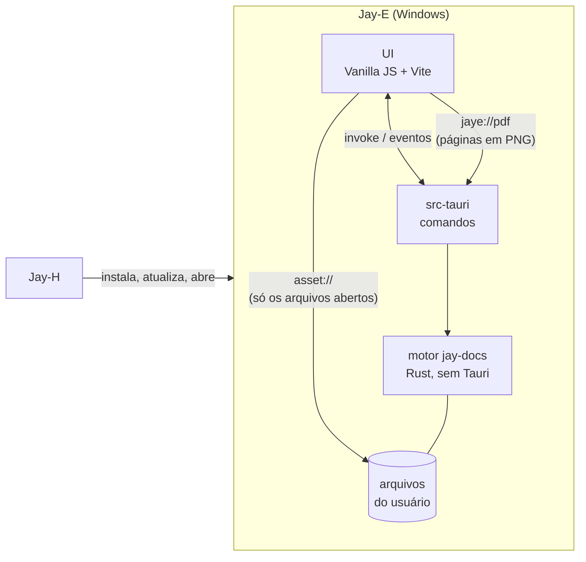
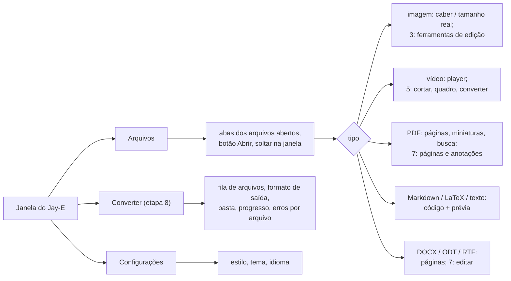
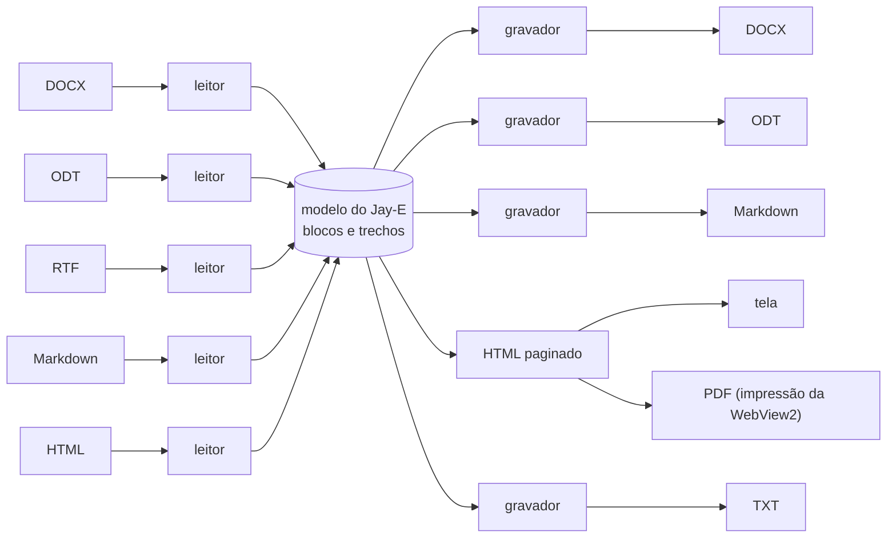

# Jay-E — Arquitetura

**Português** · [English](ARQUITETURA.en.md)

O editor e leitor de arquivos da linha Jay: **documentos** (PDF, DOCX, ODT, RTF, Markdown, LaTeX, texto), **imagens** e **vídeos**, com **conversão** entre formatos. Leve, rápido para abrir e desenhar, e Rust primeiro. Windows primeiro, como o resto da linha.

Escrito em 2026-11-06, a partir do Jay-A 0.1.0 e do Jay-H 0.1.0, e do estudo do LibreOffice, ONLYOFFICE, MarkText, PhotoCraft e Kdenlive em [`REFERENCIAS.md`](REFERENCIAS.md). As etapas 0 a 6 estão prontas. Licença: **MIT** (D1).

## 1. Visão geral



- **Abrir:** pelo botão Abrir (Ctrl+O), arrastando para a janela, pela linha de comando ("Abrir com" do Windows) ou por um segundo `jay-e.exe arquivo`, que entrega o arquivo à janela já aberta. Quem pega o caminho é sempre o Rust; a página **nunca manda um caminho** (seção 7).
- **Ler o que a WebView2 já lê rápido:** imagens comuns, vídeo (MP4/H.264, WebM/VP9/AV1), áudio e texto vêm direto do disco pelo protocolo `asset` do Tauri, com decodificação de hardware e busca por intervalo (`Range`), sem passar pelo Rust. É a etapa 0.
- **O resto passa pelo motor:** PDF desenhado no Rust, documentos lidos para um modelo interno, imagens editadas e vídeos cortados por comandos do `jay-docs`.
- Áudio só toca: editar áudio é do Jay-A.

### Requisitos funcionais

| # | Requisito | Etapa |
|---|---|---|
| RF-0 | Abrir pelo diálogo, arrastando, pela linha de comando e por um segundo lançamento; várias abas de arquivo; o tipo vem do conteúdo | 0 ✅ |
| RF-1 | Ver imagens (PNG, JPEG, GIF, WebP, BMP, ICO, SVG, AVIF), vídeo, áudio e texto | 0 ✅ |
| RF-P1 | Ler PDF: rolar, zoom (largura, página, livre), miniaturas, ir para página, buscar texto, selecionar e copiar, links internos e externos, PDF com senha | 1 ✅ |
| RF-M1 | Markdown: editar o código com prévia ao lado, CommonMark + GFM (tabelas, tarefas, notas de rodapé), fórmulas, exportar HTML e PDF | 2 ✅ |
| RF-I1 | Editar imagens: cortar, girar, espelhar, brilho/contraste/saturação; desfazer e refazer; salvar como (redimensionar entra ao salvar, pelo "lado maior") | 3 ✅ |
| RF-I2 | Converter imagens em lote: PNG, JPEG, WebP, AVIF, BMP, TIFF, GIF, ICO, QOI, com qualidade e tamanho | 3 ✅ |
| RF-D1 | Ler DOCX, ODT e RTF numa folha A4: texto, títulos, negrito/itálico, listas, tabelas, imagens, links, quebras de página (cabeçalho e rodapé ficam para depois) | 4 ✅ |
| RF-D2 | Converter documentos: DOCX/ODT/RTF/Markdown para DOCX, Markdown, HTML, TXT e PDF (ler HTML fica para depois) | 4 ✅ / 8 ✅ |
| RF-V1 | Vídeo: cortar e juntar sem recodificar, extrair um quadro como imagem, miniaturas na barra de tempo | 5 ✅ |
| RF-V2 | Converter vídeo (MP4/H.264 + AAC; altura, qualidade, só o áudio em M4A), com progresso e parar | 5 ✅ |
| RF-L1 | LaTeX: editar com realce, compilar para PDF e ver ao lado, prévia de fórmulas | 6 ✅ |
| RF-D3 | Editar DOCX e ODT: texto, negrito/itálico, títulos, listas, tabelas simples, imagens; salvar sem perder o que o Jay-E não entende | 7 |
| RF-P2 | Editar PDF: juntar, separar, reordenar, girar e apagar páginas; anotar (destaque, nota, desenho); preencher formulário | 7 |
| RF-C1 | Uma tela de conversão em lote para todos os tipos, com fila, progresso, cancelar e sem sobrescrever sem perguntar | 8 |
| RF-A1 | Os três estilos e os temas do Jay-C, inglês e português, instância única | 0 ✅ |

### Requisitos não funcionais

| # | Requisito | Como medir |
|---|---|---|
| RNF-1 Abrir rápido | Janela pronta em menos de **500 ms**; a primeira página de um PDF de 100 páginas em menos de **150 ms** depois de abrir; uma imagem de 24 MP visível em menos de **300 ms** | tempo do clique até o primeiro quadro, pela depuração remota (performance.now) |
| RNF-2 Rolar liso | Rolar um PDF de 1 000 páginas a **60 quadros/s** sem página em branco por mais de 100 ms; memória do cache de tiles limitada (256 MB padrão) | trace do DevTools; memória do processo |
| RNF-3 Leve | Instalador de até **15 MB**; nada de LibreOffice, FFmpeg ou pacotes do TeX no instalador (o que for opcional é baixado só quando usado). O motor do TeX vai dentro (D6); medido na etapa 6: 16,5 MiB | o `.exe` do instalador |
| RNF-4 Rust primeiro | Leitura, desenho, conversão e edição no Rust; a página só mostra e manda comandos. Biblioteca em C/C++ só quando não houver em Rust com qualidade (ex.: Media Foundation), e isolada atrás de um módulo | revisão |
| RNF-5 Não perder dados | Salvar é atômico (`.tmp` e renomear); a mesma codificação e fim de linha; nunca sobrescrever o original sem pedir; aviso se outro programa mudou o arquivo; o que o Jay-E não entende num DOCX/ODT é mantido | testes de ida e volta (abrir → salvar → comparar) |
| RNF-6 Entrada não confiável | Todo arquivo é hostil: limites de tamanho, de pixels (ex.: 256 MP), de páginas, de profundidade de XML e de descompressão (bomba ZIP); HTML de documento limpo antes de entrar na página; nada roda script de um documento | arquivos corrompidos e malformados nos testes de cada leitor |
| RNF-7 Robustez | Arquivo corrompido ou sem suporte vira um aviso naquela aba; nada derruba o app | os testes de cada etapa |
| RNF-8 Plataforma | Windows 10 2004 ou mais novo, x64, WebView2 | — |
| RNF-9 Licença | O Jay-E é **MIT**. Dependências permissivas (MIT, BSD, Apache, MPL por arquivo, Zlib); LGPL só como biblioteca trocável. Código GPL/AGPL (Kdenlive, ONLYOFFICE) não entra | `cargo tree` e `package-lock.json` revisados a cada dependência nova |
| RNF-10 Acessibilidade e idioma | Tudo pelo teclado, com rótulos para leitor de tela; contraste dos estilos do Jay-C; todo texto em inglês e em português | `npm test` (o teste de traduções) |

## 2. Decisões técnicas

| Tema | Escolha | Motivo |
|---|---|---|
| Shell e UI | **Tauri v2 + Vanilla JS + Vite**, como a linha | Mesmo stack e estética. Copiados do Jay-H: `styles/theme.css` (Calmo/Neon/Suave), a base do `app.css`, `ui/dom.js`, `ui/tabs.js`, `ui/theme.js`, `core/i18n.js`, `core/style.js`, `store/settings.js`, `scripts/cdp-eval.mjs`, a fonte Inter, o lobo e os ícones do Jay-C. |
| Motor | Crate Rust **`jay-docs`**, sem Tauri | Testes com `cargo test` sem compilar o app, como o `jay-audio` do Jay-A. Os comandos Tauri ficam em `src-tauri`. |
| Detecção de tipo | **Própria** (`detect.rs`, ~150 linhas) pelos primeiros 4 KB | A ideia de tipo separado de filtro do LibreOffice. Não vale uma dependência (`infer`) para assinaturas fixas, e assim o ZIP de DOCX/ODT e o texto Markdown/LaTeX são decididos do jeito do Jay-E. |
| Servir arquivos à página | **Protocolo `asset` do Tauri, escopo vazio**; o Rust libera cada arquivo aberto (`asset_protocol_scope().allow_file`) | Já faz `Range` (busca no vídeo) e não copia bytes pelo IPC. A página não consegue ler nada que a pessoa não abriu. |
| Páginas desenhadas (PDF; imagens grandes na etapa 3) | Protocolo próprio **`jaye://`** (`register_asynchronous_uri_scheme_protocol`), uma URL por página: `pdf/<doc>/<página>/<largura>`. O corpo é um **PNG rápido** (filtro Up, modo mais rápido do fdeflate), decodificado na página por `createImageBitmap`, fora da thread principal | Medido: o protocolo move ~14 ms por MB, e uma página de 1 350 px em RGBA tem 10 MB (146 ms). Em PNG fica com ~0,8 MB e custa 6 ms para comprimir. Nada de base64 no IPC. A ideia do `paintTile` do LibreOfficeKit, por página inteira por enquanto. |
| PDF (ler e desenhar) | **hayro** 0.9 (Rust puro, `unsafe` proibido, MIT/Apache), com as 14 fontes padrão e os CMaps embutidos | Spike S1 (seção 8): mesma velocidade e mesma aparência que o PDFium nos PDFs de teste, sem a DLL de 7,8 MB, e abre PDF truncado. Texto e links saem do próprio interpretador (um `Device` que junta os glifos). O PDFium fica como plano B atrás do `pdf.rs`. |
| PDF (editar páginas) | **`lopdf`** (MIT, Rust puro) | Juntar, separar, reordenar, girar, apagar: é mexer na árvore de objetos, sem desenhar. |
| Markdown | **`pulldown-cmark`** (MIT) → HTML, limpo por **`ammonia`** (MIT/Apache); fórmulas em **MathML Core** pelo **`math-core`** (MIT), que a WebView2 desenha sozinha | Tudo no Rust, sem KaTeX (JS + fontes) na página. As fórmulas entram depois da limpeza (o `ammonia` tiraria o MathML), cada uma gerada pelo `math-core`, que escapa o texto (testado com `	ext{}`). |
| Editor de código (Markdown, LaTeX, texto) | **CodeMirror 6** (MIT) com a gramática do **`@lezer/markdown`** direto | O `@codemirror/lang-markdown` traria os modos de HTML, CSS e JS junto (o pacote do editor ia a 574 KB); sem ele, 352 KB, carregados só quando um texto abre. O app inicia com 19 KB de JS. |
| Documentos | **Modelo interno próprio** (`jay_docs::doc`) + leitores com **`quick-xml`** (MIT) e **`zip`** (MIT, só deflate em Rust) para DOCX e ODT, leitor de RTF próprio; visualização em HTML numa folha A4 na WebView2; gravadores de DOCX, Markdown, HTML e TXT | A estrela do ONLYOFFICE (seção 6). Sem LibreOffice (300 MB) nem motor de layout próprio: o HTML da WebView2 já faz fontes, bidi e quebra de linha. O XML vira uma árvore pequena com limites (profundidade 512, 5 milhões de nós, nenhuma entidade de DTD expandida); cada parte do ZIP tem no máximo 256 MB descompactada. |
| Documento → PDF | **`window.print()`** sobre a prévia, com um CSS de impressão: o diálogo da WebView2 já tem "Salvar como PDF" | Zero código nativo. O `PrintToPdfAsync` (salvar direto, sem diálogo) fica para a etapa 4 se fizer falta (S2). |
| LaTeX | **Motor do Tectonic** (crate `tectonic` 0.17, MIT; o XeTeX em C/C++ dentro) **ligado ao `jay-e.exe`** (D6), rodando num processo filho do próprio app | Nenhum programa de fora: o `jay-e.exe --jaye-tex` compila e sai, então um documento que derrube ou prenda o TeX não leva a janela junto (tempo limite de 10 min, Parar). Só os pacotes que o documento usa vêm da internet, como dados, na primeira compilação (o bundle do Tectonic, 42 MB para um artigo, em cache). As bibliotecas em C (ICU, FreeType, Graphite2, fontconfig, libpng) vêm do vcpkg, estáticas. |
| Imagens | Decodificar: **`image`** 0.25 (PNG, JPEG pelo `zune-jpeg`, GIF, WebP pelo `image-webp`, BMP, TIFF, ICO, QOI), Rust puro, com limites. Codificar: o próprio `image`, **`webp`** (libwebp, C, BSD) para WebP com perda e **`ravif`** (rav1e, Rust, BSD) para AVIF | Arquivo do usuário é entrada hostil, então tudo que **lê** é Rust. A libwebp só **codifica** pixels nossos: não há WebP com perda em Rust com licença compatível (o `zenwebp` é AGPL). O `ravif` vai sem o assembly do rav1e (pediria `nasm`): AVIF fica lento (2,7 s numa foto de 5,8 MP). AVIF, HEIC e SVG não são lidos pelo Rust: AVIF e SVG abrem no visualizador da WebView2, sem edição; HEIC não abre (S3). Redimensionar com o `image` (Lanczos3 ao salvar, `thumbnail` na prévia), sem o `fast_image_resize`: bastou. |
| Vídeo (ver) | **`<video>` da WebView2** | Decodificação de hardware, de graça. HEVC precisa da extensão do Windows: sem ela, o Jay-E avisa. |
| Vídeo (cortar, juntar) | Cópia de stream em Rust: as tabelas de amostras do `moov` lidas e regravadas com o **`mp4-atom`** (Apache-2.0), só os bytes do trecho copiados, `moov` antes do `mdat` | Instantâneo e sem perda; corta no quadro-chave no início marcado ou antes dele (a tela diz onde começou). O `mp4` crate (parado desde 2024) ficou de fora. MP4, MOV e M4A; WebM/MKV e MP4 fragmentado não (converter antes). |
| Vídeo (converter e tirar quadro) | **Media Foundation** do Windows (`windows` 0.62, a mesma versão do Tauri) — D3 ✅ | Já vem no Windows: decodifica o que o Windows toca (WebM/VP9 pelas extensões que vêm com ele), escala no processador de vídeo e codifica H.264 + AAC na GPU quando há. 0 MB no instalador. O quadro sai pelo Rust (o `<canvas>` da página fica bloqueado para leitura com vídeo de outra origem). |
| Desfazer | **Pares de comandos** (fazer, desfazer) por documento, juntando digitação de até 1 s, com a seleção junto | Kdenlive (`undohelper.hpp`) e MarkText (`history`). |
| Tarefas longas | Fila no Rust, uma por núcleo, progresso por `Channel`, cancelar apaga o `.tmp` | Kdenlive (`jobs/`), igual à conversão do Jay-A. |
| Instância única | `tauri-plugin-single-instance`, que entrega os arquivos do segundo lançamento | "Abrir com" num arquivo com o Jay-E aberto abre uma aba, não outra janela. |
| Diálogo de arquivo | `tauri-plugin-dialog`, **chamado pelo Rust** | Sem permissão de diálogo para a página. |
| Bandeja | **Não** | Nada roda em segundo plano: fechar a janela fecha o app. |
| Porta do Vite | **5177** | Jay-C usa 5173, Jay-A 5175, Jay-H 5176: os quatro rodam em dev ao mesmo tempo. Depuração remota na **9226**. |
| Configurações | `localStorage`, chave `jaye.settings` | Só preferências da interface (tema, estilo, idioma), como o Jay-H. |

## 3. Estrutura do repositório

```
Jay-E/
├─ package.json                  # npm workspaces: frontend
├─ LICENSE                       # MIT
├─ docs/ARQUITETURA.md, docs/REFERENCIAS.md (e os .en.md)
├─ crates/jay-docs/              # motor: sem Tauri, testável com cargo test
│  └─ src/
│     ├─ lib.rs
│     ├─ detect.rs               # 0 ✅: tipo pelo conteúdo
│     ├─ pdf/                    # 1: documento, páginas, tiles, texto, busca; 7: editar páginas (lopdf)
│     ├─ markdown.rs             # 2 ✅: Markdown → HTML limpo, fórmulas em MathML, marcas de linha
│     ├─ text.rs                 # 2 ✅: codificação, fim de linha, gravação atômica, carimbo
│     ├─ image.rs                # 3 ✅: decodificar com limites, edições, ajustes, codificar, converter
│     ├─ doc/                    # 4 ✅: mod.rs (o modelo), xml.rs, docx.rs (ler e gravar), odt.rs, rtf.rs,
│     │                          # markdown.rs (ler e gravar), html.rs, text.rs
│     ├─ video/                  # 5 ✅: mp4.rs (cortar e juntar por cópia), mf.rs (converter, quadro)
│     ├─ latex.rs                # 6 ✅: motor do Tectonic num processo filho do jay-e.exe
│     └─ jobs.rs                 # 5/8: fila de tarefas
├─ scripts/cdp-eval.mjs          # roda JS dentro do app (depuração remota na 9226)
└─ frontend/
   ├─ index.html, vite.config.js, package.json
   ├─ src/
   │  ├─ main.js
   │  ├─ styles/                 # theme.css e app.css (base do Jay-C)
   │  ├─ core/                   # i18n.js, style.js; files.js, pdf.js, text.js (pontes com o Rust)
   │  ├─ ui/                     # dom.js, icons.js, tabs.js, theme.js (do Jay-C); app-shell.js,
   │  │                          # files.js (abas), viewers.js (um por tipo), pdf-viewer.js, text-editor.js
   │  ├─ locales/pt-BR.js
   │  └─ store/settings.js
   └─ src-tauri/
      ├─ tauri.conf.json         # productName "Jay-E", identifier io.github.tyxmatty.jaye
      ├─ icons/                  # os do Jay-C
      └─ src/main.rs, files.rs   # abrir (diálogo, soltar, linha de comando), instância única
         pdf.rs, text.rs         # comandos do PDF e do texto/Markdown; o protocolo jaye://
```

## 4. Interface



- Uma aba por arquivo aberto; abrir o mesmo arquivo de novo volta à aba dele. Setas trocam de aba, Ctrl+W fecha, Ctrl+O abre.
- Cada visualizador tem a barra de ferramentas dele em cima, com as mesmas posições (zoom à direita, salvar/exportar no fim).

## 5. Desenho rápido

- **O que a WebView2 já faz, ela faz:** imagem, vídeo e áudio vão do disco para a tag por `asset://`, sem cópia no Rust. Por isso a etapa 0 já abre fotos e vídeos grandes na hora.
- **PDF** (etapa 1 ✅): cada página tem desde o começo um espaço do tamanho certo, então a barra de rolagem já nasce certa; só as páginas na tela (e uma de folga) são pedidas, no zoom atual, por `jaye://pdf/<doc>/<página>/<largura>`. As que ficam a mais de 4 páginas da tela devolvem a memória. O zoom muda uma variável CSS: a imagem velha estica na hora e a nítida chega 150 ms depois do gesto parar. Texto, links e destaques da busca são camadas por cima, em pontos vezes `--scale`, e não são refeitos no zoom.
- **Desenho fora da thread principal:** cada PDF aberto tem duas threads no Rust, uma que desenha e outra que tira texto, links e faz a busca (uma busca longa não atrasa o desenho). Os pedidos são atendidos do mais novo para o mais velho, e o pedido de uma página que saiu da tela (a página avisa quais estão visíveis) é pulado antes de começar.
- *shortcut: uma imagem por página, com no máximo 4 096 px de largura e 25 Mpx; acima disso (zoom de ~400% numa tela grande) a página estica e perde nitidez. Tiles quando isso fizer falta.*
- **Imagens enormes** (acima de 32 MP, etapa 3) usam o mesmo caminho de tiles, com uma pirâmide de reduções.
- **Documentos** (etapa 4): o modelo vira HTML uma vez, e a página só pagina o que está perto da tela (`content-visibility: auto`).

## 6. Documentos: o modelo no meio



- **Modelo:** blocos (parágrafo, título 1–6, item de lista, tabela, imagem, quebra de página, código, fórmula, citação) com trechos de texto (negrito, itálico, sublinhado, tachado, código, link, cor, tamanho, fonte) e estilos com nome. Igual ao estado em JSON do Muya, com o que o DOCX precisa a mais.
- **Cada leitor** é um tokenizador do formato que chama um mapeador comum (`writerfilter` do LibreOffice), com limites de entrada (tamanho descompactado, profundidade de XML, número de partes).
- **Ida e volta sem perda** (etapa 7): o leitor de DOCX/ODT guarda as partes e os elementos que não entende; o gravador escreve o modelo de volta **só onde mudou** e copia o resto byte a byte. Teste: abrir e salvar sem editar dá um arquivo equivalente (mesmo `document.xml` canônico).
- **Fidelidade:** o Jay-E não promete página igual ao Word (seria o motor de layout do ONLYOFFICE). Promete o conteúdo, a estrutura e a ordem certos (risco 3).
- **Como ficou na etapa 4:** os títulos vêm do *nome* do estilo ("heading 1"; nos arquivos do Word em português o id é "Ttulo1", e o nome continua "heading 1") ou do nível de tópico; listas pela numeração do parágrafo ou do estilo ("List Number"), numeradas ou não pelo `numFmt`; inserções do controle de alterações entram, exclusões não (como aceitas). No ODT, os estilos automáticos e nomeados com herança (`parent-style-name`, no máximo 32 níveis). No RTF, a folha de estilos, `\outlinelevel`, listas por `\ls`/`\ilvl` (numeradas quando o `\listtext` tem número), tabelas por `\cell`/`\row`, `\uN`, `\'hh` em Windows-1252.
- *shortcut: uma folha contínua, sem paginar; só as quebras de página explícitas separam folhas na tela (na impressão, a paginação é a da WebView2). Fontes, tamanhos, cores, caixas de texto, notas, cabeçalhos e rodapés e células mescladas não entram no modelo. Imagens dentro de RTF não são lidas.*

## 7. Segurança

- **A página nunca manda um caminho.** O diálogo, o soltar e a linha de comando são todos tratados no Rust (`files.rs`), que libera no protocolo `asset` só aquele arquivo. Mesmo que um documento conseguisse rodar script na página, ela só leria o que a pessoa abriu.
- **Nada de script de documento:** CSP sem `unsafe-eval` nem scripts de fora; o HTML que sai do Markdown e do DOCX passa pelo `ammonia` no Rust; SVG abre em `` (que não roda script), nunca embutido no DOM.
- **Limites de entrada** (RNF-6): por leitor, como os `MAX_*` dos codecs do PhotoCraft. Um erro de leitura vira o aviso daquela aba.
- **PDF malicioso:** o hayro é Rust seguro (`unsafe` proibido), então um PDF não corrompe memória; o pior é um pânico, que cada pedido captura (`catch_unwind`; o release passou de `panic = "abort"` para `"unwind"` por isso) e vira página em branco. Sobra o risco de um PDF que prende o interpretador num laço: trava só aquela thread daquele documento (D5).
- **Links de PDF:** só `http`, `https` e `mailto` saem do app (conferido no motor e de novo no comando `open_link`); `file:`, `javascript:` e o resto são ignorados.
- **Comandos que recebem caminho** (`pdf_open`, `text_open`, `text_save`, `markdown_render`…) só aceitam arquivos que a pessoa abriu (`OpenedPaths` em `files.rs`).
- **Imagens no Markdown:** só arquivos de imagem na pasta do `.md` ou abaixo dela, liberados um a um no protocolo `asset`. Imagens da web não carregam (a CSP só deixa `asset:`): nada de pixel de rastreio. Uma `` escrita em HTML cru perde o endereço na limpeza.
- **Links na prévia** nunca navegam a janela: `http`, `https` e `mailto` abrem no navegador; o resto é ignorado.
- **Não perder edição:** fechar uma aba ou a janela com algo não salvo pergunta antes (texto e imagem).
- **Documentos:** o HTML da tela é gerado pelo `jay_docs::doc::html`, que escapa todo texto e só mantém links `http`, `https` e `mailto`; as imagens são servidas pelo `jaye://` a partir da memória, como estão no arquivo (num ``, que não roda script nem de um SVG). Exportar usa o diálogo de salvar; as imagens de um Markdown exportado ganham outro prefixo se o nome já existir na pasta.
- **Imagens:** decodificadas em Rust, com no máximo 300 megapixels, 65 535 px de lado e 3 GB de memória para o decodificador; a orientação EXIF é aplicada. O original nunca muda: "Salvar como" usa o diálogo (que pergunta antes de substituir) e a conversão em lote escreve `nome (2).ext` em vez de sobrescrever. Os metadados (EXIF, GPS) não são copiados para o arquivo novo.
- **Atualizações** (`src-tauri/src/update.rs`): ao abrir, a release `latest` de `TyxMatty/Jay-E`; o instalador só vem de `https://github.com/TyxMatty/Jay-E/releases/download/…`, com tamanho e SHA-256 iguais aos do GitHub (`digest`), como no Jay-H. Roda com `/P /UPDATE /R` (passivo, mantém as configurações, reabre) só depois de perguntar sobre edições não salvas. A release nasce como rascunho na CI (`.github/workflows/installer.yml`) e só é vista depois de publicada à mão.
- **Downloads opcionais** (FFmpeg, se entrar): só de endereços fixos no código, com SHA-256 conferido, como os instaladores no Jay-H.
- **LaTeX:** o motor roda no modo não confiável do Tectonic (sem *shell escape*, sem pastas de busca extras), num processo à parte sem janela; lê só a pasta do `.tex` e escreve o PDF no cache do app. Os pacotes do TeX vêm do bundle do Tectonic (só dados, nada que se execute).
- **Salvar:** atômico, e nunca por cima do original sem a pessoa pedir.

## 8. Etapas

Cada etapa termina com algo testável.

| # | Etapa | Pronto quando |
|---|---|---|
| 0 ✅ | Scaffold: janela, estilos, tema, idioma, instância única; abrir pelo diálogo, soltando, pela linha de comando e por um segundo lançamento; detecção do tipo; abas; imagem, vídeo, áudio e texto pela WebView2 | `npm test` e `cargo test` passam; no app, uma foto, um vídeo e um `.md` abrem, cada um na sua aba ✅ |
| 1 ✅ | Leitor de PDF (S1): páginas pelo `jaye://`, só as visíveis, zoom, miniaturas, ir para página, buscar e copiar texto, links, senha | um PDF de 1 000 páginas rola liso (RNF-2); a primeira página em < 150 ms (RNF-1); um PDF corrompido mostra o aviso |
| 2 ✅ | Markdown: CodeMirror + prévia do `pulldown-cmark` limpa pelo `ammonia`, rolagem sincronizada, KaTeX; salvar seguro (codificação, fim de linha, atômico, vigiar); exportar HTML e PDF | abrir, editar e salvar um `.md` em CP1252 com CRLF mantém os dois; `<script>` no Markdown não roda; o PDF exportado abre no leitor da etapa 1 |
| 3 ✅ | Imagens: editar (cortar, girar, espelhar, redimensionar, ajustes) sem destruir, com desfazer; converter em lote (S3); imagens enormes em tiles | 10 imagens mistas viram WebP e AVIF; uma bomba de descompressão é recusada; uma foto de 100 MP abre em tiles |
| 4 ✅ | Documentos: o modelo; leitores de DOCX, ODT, RTF, HTML e Markdown; visualização paginada; exportar para PDF, Markdown, HTML e TXT | um DOCX com títulos, listas, tabela e imagem aparece com tudo; DOCX → Markdown → DOCX mantém o texto e os títulos |
| 5 ✅ | Vídeo (S4): cortar e juntar por cópia, extrair quadro, miniaturas na barra de tempo; converter pelo Media Foundation, com fila e cancelar | cortar 10 s de um MP4 de 1 GB leva < 2 s e toca; converter um WebM em MP4 toca no player |
| 6 ✅ | LaTeX: CodeMirror + compilar com o motor do Tectonic dentro do Jay-E (D6), o PDF ao lado no leitor da etapa 1, erros na linha certa | um artigo com fórmulas e bibliografia compila; um erro de sintaxe aponta a linha |
| 7 | Edição: DOCX e ODT (texto, estilos, listas, tabelas simples, imagens) com ida e volta sem perda; PDF: juntar, separar, reordenar, girar, apagar páginas, anotações, formulários | abrir e salvar um DOCX sem editar dá o mesmo `document.xml` canônico; editado, abre no Word e no LibreOffice; dois PDFs juntados abrem em ambos |
| 8 ✅ | Converter: tela de lote para todos os tipos, com fila, progresso, cancelar e perguntar antes de sobrescrever | lote de 20 arquivos mistos; um corrompido falha sozinho e os outros saem |
| 9 ✅ | Release: instalador NSIS em `%LOCALAPPDATA%\Jay-E`, associações de arquivo ("Abrir com"), o Jay-E no catálogo do Jay-H, a versão publicada no GitHub | instalar numa máquina limpa, abrir um PDF com dois cliques; o Jay-H instala e atualiza o Jay-E |
| 10 | Mais ferramentas: imagens (curvas e níveis, filtros, endireitar, anotar, olhos vermelhos, exportar com prévia, edições em lote, HEIC/RAW pelo WIC, metadados), vídeo (linha do tempo, navalha, velocidade, som, fades, texto por cima, predefinições, encolher para um tamanho, GIF, legendas), PDF (comprimir, assinar, tarja de verdade, OCR do Windows), documentos (localizar e substituir, contar palavras, ortografia, comparar), conversor (HTML, LaTeX, pasta vigiada). Ideias do PhotoCraft e do OpenShot (`REFERENCIAS.md` seção 6) | uma foto com curvas, texto e seta desfaz passo a passo e exporta igual à tela; um vídeo cortado em três trechos, com o do meio fora, fade e texto, toca no player e no Windows; um PDF escaneado vira pesquisável |

**Etapa 0, medido (2026-11-06):**
- **Testes:** `npm test` (6: traduções, texto UTF-8/UTF-16, tamanhos), `cargo test` no `jay-docs` (8: assinaturas, MP4/MOV/AVIF/HEIC pela marca, WebM/MKV, ODT pelo `mimetype`, DOCX pela extensão, texto que começa como assinatura — "BMW…", "ID3 …" — continua texto, UTF-16 com BOM, binário) e no `src-tauri` (1: caminhos da linha de comando).
- **No app de dev, pela depuração remota:** um segundo `jay-e.exe` com 7 arquivos abriu 7 abas na janela que já estava aberta. PNG (128×2048) cabe na janela e o clique mostra o tamanho real; MP4 de 16 s toca (`readyState` 4); `.md` aparece como texto; PDF e DOCX dizem a etapa do visualizador; um binário diz "não abre esse tipo"; um arquivo que não existe mostra o erro do Windows. As URLs são `http://asset.localhost/…`, liberadas uma a uma pelo Rust.
- **Não visto:** o diálogo Abrir e o soltar na janela (não dá para automatizar pela depuração remota; usam o mesmo `files::open` do segundo lançamento). Numa primeira rodada, a aba do `doc.docx` apareceu com o vídeo de outra aba; o arquivo estava sendo regravado durante o teste, e na repetição tudo bateu. Fica de olho.

**Spike S1 (2026-11-06):** PDFium (`pdfium-render` 0.9.5 com o PDFium `chromium/8138` de bblanchon/pdfium-binaries, SHA-256 conferido) contra hayro 0.9.0, build release, cada um no seu processo, página a 1 240 px de largura (A4 a ~150%), Ryzen 5 5600G:

| PDF | Páginas | PDFium: abrir / 1ª página / média | hayro: abrir / 1ª página / média |
|---|---|---|---|
| Currículo (Word → PDF) | 2 | 0,9 / 16,5 / 6,0 ms | 1,0 / 16,5 / 5,4 ms |
| "Attention Is All You Need" (arXiv, LaTeX) | 15 | 1,2 / 38,3 / 23,3 ms | 1,9 / 12,0 / 23,5 ms |
| Norma PDF 1.7 (ISO 32000, 22 MB) | 756 | 16,0 / 4,7 / 8,1 ms | 20,9 / 3,6 / 6,2 ms |
| Sintético, 1 000 páginas de texto | 1 000 | 1,1 / 8,2 / 7,6 ms | 5,4 / 7,7 / 7,2 ms |
| Sintético "digitalizado" (imagem de 2 480×3 508 por página, 26 MB) | 3 | 0,7 / 57,1 / 55,6 ms | 8,8 / 40,5 / 40,0 ms |
| O de 1 000 páginas cortado num terço | — | **não abre** (`FormatError`) | abre 336 páginas |
| Pico de memória do processo | | 63 MB | 52 MB |

- **Aparência:** a 1ª página do artigo e da norma saiu igual nos dois, comparada a olho.
- **Tamanho:** o PDFium seria uma `pdfium.dll` de 7,8 MB no instalador; o hayro entra no `.exe`.
- **Escolha: hayro.** Rust puro e sem `unsafe`, mesma velocidade e aparência, abre PDF truncado e lê PDF com senha (RC4/AES). Texto, links e busca foram escritos sobre ele (o PDFium os teria prontos).
- **Não testado no S1:** formulários preenchíveis, transparência complexa, fontes CJK não embutidas, um PDF com senha de verdade.

**Etapa 1, medido (2026-11-06):**
- **Testes:** `cargo test` no `jay-docs` (17: os 8 da detecção e 9 do PDF — abrir e desenhar, o PNG, limites do bitmap, páginas longe da tela puladas mas miniaturas não, linhas de texto com posição, links internos/externos/nomeados com o `file:` recusado, busca página a página até o fim, busca nova cancela a velha, busca sem diferenciar maiúsculas, PDF quebrado e truncado) e no `src-tauri` (2); `npm test` (6).
- **Texto:** o primeiro jeito de separar palavras (vão maior que ¼ em) juntava as palavras do artigo do arXiv ("Providedproperattribution"), porque o TeX ajusta o espaço entre palavras por posição; com 0,12 em saiu certo.
- **Transferência:** em RGBA cru, uma página de 1 350 px (10 MB) levava 146 ms para chegar à página, e a 1ª página abria em 270–620 ms. Em PNG rápido (6 ms para comprimir, ~0,8 MB), caiu para o que está abaixo.
- **No app de dev (`npm run dev`), pela depuração remota, do clique na aba até a 1ª página desenhada,** contando abrir o PDF: norma de 756 páginas 123 ms, sintético de 1 000 páginas 118 ms, truncado 79 ms, artigo do arXiv 177 ms, "digitalizado" 158 ms. A meta de 150 ms (RNF-1) passa em 3 dos 5; o build de dev otimiza as dependências, mas não o próprio app. Falta medir no release.
- **Rolagem (RNF-2):** as 100 primeiras páginas do PDF de 1 000 em 4 s: 72 quadros/s em média, o quadro mais longo com 50 ms, nenhuma página visível em branco por mais de 50 ms; no fim, só 7 páginas seguiam com imagem na memória.
- **Busca:** "cross-reference" na norma de 756 páginas: 1º resultado em 93 ms, todas as páginas em 1,5 s, 220 resultados.
- **Seleção e links:** selecionar uma linha do artigo copia o texto certo, com a seleção em cima da linha desenhada, também em 200%; um link de citação levou à página 11.
- **Visto no print:** miniaturas com a página atual marcada, destaques da busca alinhados ao texto, página nítida em 200% (canvas de 1 632 px para 1 632 px de CSS).
- **Não visto:** o formulário de senha (falta um PDF com senha de usuário), um link externo abrindo o navegador, o tema claro no leitor, o leitor de tela nas páginas.

**Etapa 2, medido (2026-11-06):**
- **Testes:** `cargo test` no `jay-docs` (28): texto (5: as cinco codificações e um Shift-JIS lido como 1252 voltam byte a byte; editar mantém codificação e CRLF; caractere que não cabe é recusado sem tocar no arquivo nem deixar `.tmp`; arquivo mudado por fora não é sobrescrito sem `force`; o carimbo cabe num número JS), Markdown (5: CommonMark/GFM, marcas de linha, `<script>`/`onerror`/`javascript:`/`<iframe>`/`style`/campo de formulário barrados, fórmulas em MathML com HTML dentro escapado e fórmula quebrada como código, imagens só pelo filtro), detecção (8) e PDF (10). `src-tauri` (4: imagens só da pasta do `.md`, URL igual à do `convertFileSrc`). `npm test` (5).
- **No app de dev, pela depuração remota:**
  - **Abrir** um `.md` de 4 KB até a prévia pronta: 96 ms. Digitar até a prévia mudar: 158 ms (120 ms de espera de propósito).
  - **Prévia:** fórmula na linha e em bloco em MathML, lista de tarefas, tabela, imagem local carregada; a imagem com `../` de fora da pasta e a `` não carregam; `<script>` e o link `javascript:` não aparecem; nenhum código rodou.
  - **Rolagem sincronizada:** com o editor no "Parágrafo 33", a prévia mostra a Seção 34 logo abaixo do topo. A primeira versão ficava duas seções adiantada (o `offsetTop` das marcas era medido a partir de outro elemento).
  - **CP1252 com CRLF:** abre como "Windows-1252 · CRLF"; acrescentar "Fim com ç." e salvar com Ctrl+S grava `e7` e `0d 0a`, com o resto byte a byte igual. Acrescentar "日本" e salvar mostra "não cabe em Windows-1252" com "Salvar em UTF-8", e o arquivo fica como estava.
  - **Mudado por outro programa:** sem edição aqui, recarrega sozinho em até 3 s (e o fim de linha passa a CRLF, como o arquivo novo); com edição, pergunta "Recarregar o do disco" ou "Ficar com o meu".
  - **Exportar PDF:** com o `window.print` trocado por nada, o botão monta só a prévia para impressão com o nome do arquivo como título; o PDF gerado (pela depuração remota, no modo de impressão) tem 10 páginas e abre no leitor da etapa 1, com texto e fórmulas.
- **Defeitos achados e corrigidos no caminho:**
  - A detecção da etapa 0 exigia UTF-8: um `.md` em CP1252 abria como binário. Agora é texto se não tem NUL e quase nenhum caractere de controle.
  - O carimbo do arquivo em nanossegundos (~1,8×10¹⁸) passava de 2⁵³ e mudava na ida e volta pelo JavaScript: o segundo salvamento acusava "mudou no disco". Agora é em microssegundos.
  - O PDF do Chromium usa fontes Type 3, e o `pdf.rs` da etapa 1 chutava a largura delas: o texto saía "R elatório". Agora usa a largura da fonte (com teste que falha no código antigo).
  - Um script da etapa 0 tinha gravado bytes NUL de verdade dentro do `detect.rs`; trocados pelos escapes.
- **Não visto:** o "Exportar HTML" (abre o diálogo de salvar, que não dá para automatizar; o HTML é o mesmo do `to_html` testado), o diálogo de impressão de verdade, a confirmação ao fechar com edição não salva, o tema claro no editor, um arquivo de 50 MB no editor.

**Spike S3 (2026-11-06):** a foto "Earthrise" da NASA (2 400×2 400, domínio público, Wikimedia), build release, qualidade 80:

| Formato | Tempo | Tamanho |
|---|---|---|
| decodificar o JPEG | 14 ms | — |
| JPEG | 100 ms | 347 KB |
| WebP (libwebp) | 247 ms | 93 KB |
| AVIF (ravif, sem assembly) | 2,7 s | 82 KB |
| PNG | 35 ms | 1,9 MB |
| QOI | 26 ms | 2,0 MB |
| GIF (256 cores) | 3,8 s | 1,0 MB |

A mesma foto ampliada para 10 000×10 000 (100 MP, JPEG de 3,9 MB): **decodifica em 275 ms**, e a prévia de 2 048 px sai em 406 ms.

**Etapa 3, medido (2026-11-06):**
- **Testes:** `cargo test` no `jay-docs` (36; os 8 novos: girar, espelhar e cortar, também numa resolução diferente; cortes que saem da imagem ou com NaN; brilho/contraste/saturação iguais aos filtros CSS, alfa intacto; os 9 formatos com e sem alfa indo e voltando; o lado maior encolhe mas não aumenta; nunca sobrescrever, sem `.tmp` sobrando; a bomba de 60 000×60 000 recusada pelo cabeçalho; orientação EXIF 6 vira 20×40) e no `src-tauri` (6).
- **Lote (RF-I2):** 10 imagens (PNG, JPEG, WebP, BMP, TIFF, GIF, ICO, QOI, a foto e a de 100 MP) mais a bomba, pelo mesmo `convert_file` do app (`cargo run --release --example convert`): para WebP em 4,3 s, para AVIF em 41,6 s (quase tudo na de 100 MP); a bomba falha sozinha ("60000 × 60000") e as outras saem.
- **No app de dev, pela depuração remota:** 13 arquivos abertos de uma vez. Os 9 formatos que o Rust lê abrem no editor em 40–230 ms; a foto de 100 MP em 991 ms; AVIF e SVG abrem no visualizador da WebView2; a bomba mostra "grande demais (60000 × 60000)".
  - **Na foto de 100 MP:** girar 144 ms até a prévia nova, cortar pelo teclado (Shift+setas e Enter) 83 ms, ficando 5 000×8 000; brilho 83 ms; desfazer volta o tamanho; no 100% a região nítida chega em 209 ms com 920×500 pixels para 921×501 de CSS (1:1).
  - **Diálogo:** qualidade só para JPEG, WebP e AVIF; "sem perda" só para WebP; os botões "Salvar esta imagem como…" e "Converter todas as imagens abertas (3)…".
- **Defeitos achados e corrigidos no caminho:**
  - O ICO que o próprio Jay-E gerava de uma imagem sem transparência não abria (o PNG dentro de um ícone tem de ser RGBA). O teste de formatos só usava imagem com alfa; agora roda com e sem, e falha no código antigo.
  - O slider de ajuste só guardava o desfazer se o gesto começasse com mouse ou tecla; mudado por outro meio (um leitor de tela), o desfazer pulava o ajuste.
  - O escurecimento fora da área de corte não aparecia: o Chromium descarta uma sombra tão grande quando nada a recorta. A camada do corte agora recorta (`overflow: hidden`).
  - Um `cargo fmt` meu reformatou o crate inteiro (a linha Jay não usa `rustfmt`); desfeito nos arquivos antigos, o `image.rs` novo ficou formatado.
- **Tamanho:** o `jay-e.exe` release (com hayro, rav1e, libwebp e o resto) tem 16,2 MB; comprimido com LZMA (o do instalador NSIS), 4,6 MB. Dentro do RNF-3 (15 MB de instalador), ainda sem medir o instalador de verdade.
- **Não visto:** os diálogos de salvar e de escolher pasta (não dá para automatizar; o lote foi medido pelo exemplo), o progresso e o "Parar" do lote no app, o tema claro no editor de imagem, perfis de cor ICC (ignorados: a imagem sai em sRGB como os números do arquivo).

**Etapa 4, medido (2026-11-06):**
- **Testes:** `cargo test` no `jay-docs` (53; os 17 novos: juntar trechos, XML com entidades, `CDATA`, bomba de entidades sem expandir e profundidade recusada; HTML escapado, sem `javascript:`; DOCX gravado e lido de volta igual (títulos, link, quebra, tab, lista aninhada numerada dentro de marcadores, tabela com imagem, código, quebra de página); ZIP sem `word/document.xml`; estilo localizado "Ttulo1", lista do Word, inserção aceita e exclusão fora; ODT com estilos, listas por nível, tabela e link; RTF parecido com o do Word (folha de estilos, `\u8364`, listas, tabela) e RTF hostil (100 000 grupos, cortado no meio); Markdown lido, gravado e lido de novo igual; imagens do Markdown viram arquivos; texto puro) e no `src-tauri` (7: base64 igual ao padrão).
- **Arquivos reais:** 5 DOCX gerados pelo Word (do projeto `python-docx`, MIT), 2 ODT e 4 RTF de teste do LibreOffice (MPL), só para teste local, fora do repositório. Todos abrem em 0,5–3,3 ms no `cargo run --release --example doc_probe`. Os 5 DOCX fazem **DOCX → Markdown → DOCX com os mesmos títulos e o mesmo texto**. O primeiro teste achou que listas definidas no *estilo* do parágrafo ("List Number") saíam como parágrafo comum; corrigido.
- **No Word de verdade:** um DOCX gravado pelo Jay-E (títulos, link, lista com subitem, lista numerada, tabela, imagem, quebra de página) aberto no Word 2016+ (por automação, só leitura): 2 páginas, os títulos como H1/H2, a lista numerada "1.", 3 itens na lista com o subitem, tabela 2×3, 1 imagem, o link certo.
- **No app de dev, pela depuração remota:** 6 documentos (DOCX do Word e do Jay-E, ODT e RTF do LibreOffice) abrem em 10–34 ms com títulos, listas, tabelas, as imagens pelo `jaye://` e as quebras de página. "Exportar PDF" (com o `window.print` trocado) gera um PDF de 2 páginas, a quebra respeitada, lido pelo leitor da etapa 1.
- **Defeitos achados e corrigidos no caminho:** um parágrafo só com a quebra de página voltava como "parágrafo vazio + quebra"; no RTF, o negrito de `{\b …}` era gravado depois de o grupo fechar e perdia o negrito.
- **Não visto:** documentos salvos pelo Word em ODT e RTF (a automação do Word travou num diálogo invisível ao salvar; os arquivos de teste vieram do LibreOffice), os diálogos de exportar DOCX, Markdown, HTML e TXT (o conteúdo de cada gravador é o testado), um documento grande (centenas de páginas), o tema claro.

**Etapa 5, medido (2026-11-06):** vídeos de teste: o Big Buck Bunny (CC-BY, do test-videos.co.uk) em MP4/H.264 360p e 720p e em WebM/VP9, e um vídeo do WhatsApp do próprio PC (H.264 + AAC), fora do repositório.
- **Testes:** `cargo test` no `jay-docs` (60; os 7 novos: tabelas de amostras lidas; o corte começa no quadro-chave e copia os bytes certos, com `moov` antes do `mdat`; juntar põe as partes em sequência com os quadros-chave nos lugares; arquivo cortado no meio e lixo viram erro; cancelar não deixa arquivo; tamanhos pares e frações de taxa de quadros reduzidas para o H.264; arquivo que o Windows não lê vira erro) e no `src-tauri` (7); `npm test` (6, o novo é o relógio "1:02.500").
- **Corte e junção (Rust):** 32 cópias do 720p juntadas num MP4 de **1 026 MB** em 0,8 s; **cortar 10 s dele levou 42 ms** (a meta era < 2 s), e o quadro em 2:33 do corte decodifica certo no Media Foundation. Cortar o vídeo do WhatsApp: 49 ms; o corte recodificado pelo Media Foundation (H.264 + AAC) prova que o arquivo é lido pelo Windows.
- **Conversão (Media Foundation):** 720p → 360p em 2,1 s; só o áudio (M4A) em 0,7 s; **WebM/VP9 → MP4 em 1,7 s**, e o quadro de 5 s do MP4 é igual ao do WebM.
- **Defeitos achados e corrigidos na conversão do WebM:** o decodificador de VP9 do Windows entrega o quadro com o comprimento do buffer em 0 (o codificador recusava "parâmetro incorreto", depois "nenhuma amostra"): um buffer com exatamente um quadro NV12 ganha esse comprimento. A taxa de quadros do WebM vem como 3 000 000 000/100 000 000: reduzida. O tempo das amostras passou a começar em 0.
- **No app de dev, pela depuração remota:** o MP4 de 1 GB, o WebM, o MP4 convertido dele, o vídeo do WhatsApp e o M4A abrem e tocam (`readyState` ≥ 2 em até 21 ms); o WebM tem o "Cortar" desligado com a explicação; marcar 2:30 e 2:40 pelo teclado (I e O) mostra o trecho na faixa de miniaturas; ver o print. Uma barra de rolagem sobrando foi corrigida.
- **Não visto:** os diálogos de salvar (cortar, juntar, converter e salvar quadro no app usam o mesmo código medido pelo `cargo run --release --example video_probe`), o progresso e o "Parar" da conversão no app, HEVC, um vídeo com rotação (celular na vertical gravado de lado), o tema claro. O M4A gerado pelo Media Foundation abre como vídeo (a marca do `ftyp` dele não diz M4A) e toca só o som.

**Etapa 6, medido (2026-11-07):** um artigo de teste com `amsmath`, uma equação numerada, `\cite` e `\bibliography` (fora do repositório).
- **Testes:** `cargo test` no `jay-docs` (63; os do LaTeX: as mensagens do Tectonic e do log do TeX viram linha e texto, e um motor que não existe é erro, não espera) e no `src-tauri` (10); `npm test` (6).
- **Motor:** o `jay-e.exe --jaye-tex` (release) compila o artigo em **1,4 s**; a bibliografia sai resolvida (o BibTeX lê o `.bib` da pasta do `.tex`). A primeira vez, com o cache vazio, leva **98 s** e baixa 42 MB de pacotes. Um comando inexistente na linha 12 sai como `error: artigo.tex:12: Undefined control sequence`.
- **Tamanho:** o `jay-e.exe` foi a 66 MB (o ICU sozinho tem ~30 MB de dados) e o **instalador a 16,5 MiB** (era 4,6 MB): 1,5 MiB acima do RNF-3, aceito para não depender de um programa de fora.
- **Build:** o vcpkg leva uns 30 min na primeira vez (o ICU é quase tudo); a CI usa o vcpkg que vem no Windows do GitHub e guarda os pacotes em cache.
- **No app de dev, pela depuração remota:** o `.tex` abre e compila sozinho (1,6 s), o PDF aparece ao lado; o `\today` sai com a data de hoje (faltava a data no motor: corrigido). Um erro digitado na linha 12, sem salvar, e Ctrl+Enter: "Linha 12 · Undefined control sequence", e clicar leva o cursor à linha 12; o arquivo no disco não muda. As mensagens vinham com cores de terminal, que a lista não lia: o processo filho roda com `TERM=dumb`.
- **Não visto:** compilar sem internet depois da primeira vez, o "Salvar PDF…" (diálogo), o "Parar" e o tempo limite no app, um documento com imagens, o instalador num PC limpo. O fontconfig avisa no stderr que não acha o arquivo de configuração; o XeTeX usa as fontes do bundle, e a mensagem não aparece na lista.

**Etapa 7 (em andamento), DOCX, medido (2026-11-07):** um relatório feito pelo `python-docx` com o modelo do Word (tema, estilos, título, subtítulo, listas com marcadores e numeradas, tabela "Table Grid", imagem), fora do repositório.
- **Como funciona:** `jay_docs::doc::edit` monta a página com o tamanho, as margens, as fontes, os tamanhos, as cores, o espaçamento e os recuos do próprio arquivo (estilos, tema e numeração viram CSS). Cada parágrafo, tabela, linha e célula sabe onde está no `document.xml`. Ao salvar, a página manda só os parágrafos que mudaram; o Rust reescreve esses e copia todo o resto byte a byte (as outras partes do pacote vão com `raw_copy_file`). Um parágrafo reescrito mantém o `w:pPr`, os marcadores, as imagens e os campos dele, e cada trecho de texto mantém as propriedades do run de onde veio; só o que a barra conhece (fonte, tamanho, negrito, itálico, sublinhado, tachado, cor, destaque) é trocado. Texto que só mudou de conteúdo guarda o `w:rPr` como estava.
- **Barra no estilo dos editores de sempre:** desfazer, refazer, imprimir, zoom, estilo do parágrafo, fonte, tamanho (− e +), negrito, itálico, sublinhado, tachado, cor do texto, destaque, link (Ctrl+K), alinhamento, espaçamento entre linhas, listas, recuo, limpar formatação; Salvar (Ctrl+S) e Exportar.
- **Testes:** `cargo test` no `jay-docs` (71; os 7 novos: salvar sem editar devolve o mesmo arquivo; um parágrafo editado muda e os outros ficam iguais byte a byte; parágrafo novo, apagado e célula que ficou vazia; lista nova cria a numeração; link novo ganha relacionamento e `javascript:` é recusado; tirar o negrito de um run negrito; e os spans do XML) e `npm test` (15; os 5 novos: marcadores de lista, números do Word, cores e a comparação do texto com o estilo).
- **No app de dev, pela depuração remota:** o relatório abre com a cara do Word (Cambria, títulos azuis, marcadores, tabela). Editado (texto digitado, Enter, negrito, estilo "Título 2", número tirado de um item, parágrafo apagado, célula editada, Verdana 16 azul, link) e salvo duas vezes: só o `document.xml` mudou, só os parágrafos editados mudaram, e o **Word abre o arquivo sem reparar**, com os estilos, a fonte, a cor e o link certos. Enter no fim de um título começa "Texto normal", como no Word. Com o arquivo mudado por outro programa, Salvar pergunta antes.
- **Segunda rodada no DOCX (2026-11-07):**
  - **Imagens soltas na página:** clicar numa imagem mostra a moldura com alças; os cantos mudam o tamanho (Shift solta a proporção), e arrastar leva a imagem para **qualquer lugar da página**, sem prender no texto. Solta, ela vira uma imagem flutuante (`wp:anchor`, na frente do texto) presa ao parágrafo onde caiu, a tantos pontos da borda da página e do topo desse parágrafo. Medido: no Word, `Left` 359,8 pt da página e `Top` 1,2 pt do parágrafo, igual ao que o Jay-E mostra. Um defeito pego pelo Word: o `python-docx` declara `a:` e `pic:` no próprio `wp:inline`, e a imagem que virava flutuante perdia essas declarações (o Word recusava o arquivo). Agora elas vão junto, e todo salvamento confere se cada prefixo do XML está declarado antes de escrever.
  - **Inserir imagem e tabela:** imagem de um arquivo ou colada com Ctrl+V (vai para `word/media`, com relacionamento e tipo de conteúdo); tabela pela grade de linhas × colunas, com o estilo "Table Grid" do arquivo (ou bordas, se ele não tiver).
  - **Ctrl+Z e Ctrl+Y para tudo:** o histórico guarda a página inteira, então alinhamento, listas, estilos, imagens e tabelas voltam também; digitação vira passos de até um segundo.
  - **Colar com formatação:** o HTML colado (do Word, de um site) é refeito do zero com negrito, itálico, sublinhado, cor, destaque, fonte, tamanho e links; scripts e o resto ficam de fora. No Word: Georgia 14 vermelha, itálico e o link chegaram certos.
  - **Páginas e cabeçalho/rodapé:** a folha é dividida nas páginas do arquivo (tamanho e margens dele); um parágrafo que passaria da margem de baixo começa na página seguinte, e uma quebra de página também. O cabeçalho e o rodapé padrão aparecem em todas as páginas e são editados na primeira; eles moram em outras partes do pacote (`header1.xml`), e só elas mudam. Medido: um documento longo dá 5 páginas no Jay-E e 5 no Word.
- **PDF editado (2026-11-07):** `jay_docs::pdf_edit`, com o **lopdf** (MIT): cada mudança gera um PDF novo, que o hayro abre e o visualizador mostra (desfazer volta à versão anterior; salvar grava a atual por cima, se ninguém mudou o arquivo).
  - **Páginas:** organizador com miniaturas: selecionar, arrastar para reordenar, girar, apagar, inserir outro PDF e salvar páginas escolhidas num arquivo novo. As páginas herdam tamanho, recursos e rotação antes de mudar de lugar.
  - **Anotações:** destacar texto, desenhar à mão, nota e texto na página, com aparência própria (`/AP`), então todo leitor desenha igual (o hayro inclusive); a borracha apaga qualquer anotação. Em página girada, a posição é convertida e o texto fica de pé.
  - **Formulários:** campos de texto, caixas de seleção, rádios e listas viram campos na página; o valor novo ganha aparência redesenhada.
  - **Testes:** 4 novos no `jay-docs` (78 no total): reordenar, girar, apagar, inserir e extrair, lidos de volta pelo lopdf e desenhados pelo hayro; ida e volta das coordenadas nas quatro rotações; anotações criadas, listadas e apagadas; formulário listado e preenchido.
  - **No app de dev:** num PDF de 3 páginas com formulário: nome digitado, caixa marcada, desenho, nota, texto, destaque, página 3 arrastada para o começo e página 1 girada; salvo, e o hayro desenha tudo do arquivo salvo. Num PDF do LaTeX (com fluxos de objetos): destaque e salvamento certos.
- **ODT editado (2026-11-07):** `jay_docs::doc::odt_edit`, com o mesmo contrato do DOCX (a mesma página, as mesmas mudanças), então a barra, as imagens soltas, as tabelas, o Ctrl+Z e o colar valem igual. A página sai do layout de página, dos estilos (nomeados e automáticos), das listas e das tabelas do arquivo; o cabeçalho e o rodapé vêm do `styles.xml`. Ao salvar, um parágrafo ou trecho mudado ganha um estilo automático novo (`JP…`, `JT…`) que copia o que tinha e muda só o que a barra conhece; parágrafo que entra ou sai de uma lista fecha e reabre a lista em volta (`text:continue-numbering`), e as sobras vazias saem; espaços seguidos viram `text:s`, como o ODF pede; o `mimetype` continua a primeira entrada, sem compressão. Testes: 5 novos (aparência e salvar sem mudar; estilos automáticos copiados; listas divididas, unidas e continuadas; cabeçalho, célula vazia, tabela e imagem; espaços). No app, num ODT que o próprio Word escreveu: texto, negrito e cor, alinhamento, um item novo de lista, um parágrafo saindo da lista e outro entrando, tabela nova, imagem arrastada; o Word abre o resultado com tudo no lugar (a imagem a 269,8 pt da margem, 1,2 pt abaixo do parágrafo, igual à tela). Só o `content.xml` mudou.
- **Interface e ícone (2026-11-07):** revisão pela marca da linha Jay (a do Jay-C). As barras de edição (DOCX, ODT e PDF) passam a agrupar os controles em segmentos como os do Jay-C (borda, fundo `--bg`, o raio de controle de cada estilo: cantos no Calmo e no Neon, pílula no Suave), sem os separadores soltos, e o botão ligado ganha a cor de destaque (antes só um fundo de 14 %). O ícone da janela e da barra de tarefas é o lobo nas cores do estilo e muda com ele, como no Jay-C (`ui/window-icon.js`, `src-tauri/src/taskbar_icon.rs`: `ICON_BIG`, um AppUserModelID próprio e o ícone de "relançar"). Achado medindo: um processo aberto de dentro do pacote MSIX de outro app (o build de dev aberto por um app de desktop empacotado) tem as gravações no AppData redirecionadas para a cópia privada desse pacote (`Packages\<pacote>\LocalCache\Local\…`) mesmo sem a identidade dele, e o Explorer não acha o .ico; agora o .ico é procurado nessas cópias e a barra recebe o arquivo real. Medido na barra de tarefas: o lobo do Jay-E foi de ciano (Neon) a laranja (Suave) e de volta ao roxo (Calmo). O Jay-A tem o mesmo código sem essa correção.
- **Tabelas, cabeçalho novo e quebra de tabela (2026-11-07):** com o cursor numa tabela aparece o grupo "Tabela" (linha acima/abaixo, coluna à esquerda/direita, apagar linha/coluna), em DOCX e ODT. Uma linha nova copia as propriedades da linha de onde veio (`w:trPr`/`w:tcPr` sem mesclagem; no ODT a tag da linha e das células); uma coluna nova ou apagada mexe também na grade (`w:gridCol`; no ODT o `number-columns-repeated` da coluna). Um cabeçalho ou rodapé onde o arquivo não tem: a área vazia na margem diz "Cabeçalho"/"Rodapé" ao passar o mouse e vira um ao escrever; no DOCX é uma parte nova (`header1.xml`, relacionamento, tipo de conteúdo e a referência no `w:sectPr`), no ODT um `style:header`/`style:footer` na página-mestra. Uma tabela que passa da margem de baixo continua na página seguinte linha por linha, depois de uma linha vazia sem bordas que não é salva. Medido: a tabela de teste (45 linhas no meio da página) passa para a página 2 na linha 31 no Jay-E e no Word, 2 páginas nos dois; a tabela editada (linha e coluna novas, uma coluna apagada) e o cabeçalho novo abrem certos no Word, em DOCX e ODT. Testes: 3 novos (linhas e colunas com a grade, cabeçalho novo no DOCX; linhas, colunas e rodapé novo no ODT).
- **Primeira página, páginas pares e linha de título (2026-11-07):** o grupo "Página" tem "Primeira página diferente" e "Páginas pares e ímpares diferentes"; cada cabeçalho e rodapé (padrão, primeira, pares) é editado na primeira página que o usa e copiado nas outras, e o que nenhuma página usa (as pares num arquivo de uma página) fica guardado, sem aparecer. No DOCX são o `w:titlePg` do `w:sectPr`, o `w:evenAndOddHeaders` do `settings.xml` (criado se o arquivo não tem) e as referências `first`/`even`; desligar tira só a chave, as partes ficam. No ODT são o `style:header-first`/`style:header-left` (e os rodapés) da página-mestra, na ordem que o ODF pede; desligar tira esses elementos, e ligar sem escrever nada põe um vazio (o ODF não tem a chave). No grupo "Tabela", "Repetir a linha de cabeçalho em cada página" marca a primeira linha (`w:tblHeader`; no ODT a linha vai para `table:table-header-rows`), e numa tabela que continua na página seguinte ela aparece de novo no topo, como figura que não é salva. Medido: a tabela de 45 linhas com a primeira linha marcada mostra a linha 1 no topo da página 2, antes da 31; o Word abre o DOCX e o ODT com a primeira página diferente, o rodapé das pares e a linha de título repetida. Testes: 2 novos (DOCX e ODT: ligar, criar, desligar e voltar a abrir).
- **Ainda não:** RTF continua só leitura (exportar para DOCX); PDF protegido por senha não é editado; PDFs assinados perdem a assinatura ao salvar; o diálogo de "Inserir imagem" (o resto do caminho foi testado colando).

**Etapa 8, conversor, medido (2026-11-07):**
- **Como funciona:** a seção "Converter" (`ui/convert.js`, `core/convert.js`) junta arquivos de qualquer tipo ("Adicionar arquivos…" ou "Adicionar os arquivos abertos") e mostra um formato por tipo: imagens (os 9 da etapa 3), documentos e Markdown (DOCX, Markdown, HTML, TXT), PDF (TXT), vídeo (MP4 ou só o som em M4A) e áudio (M4A); a escolha fica salva. LaTeX, texto e o que o Jay-E não lê aparecem com o aviso e ficam de fora. "Converter…" pede a pasta (o Rust guarda; a página nunca manda uma), pergunta pelos que já existem lá ou se repetem no lote ("Manter os dois" dá `nome (2).ext`, "Substituir", "Pular esses") e roda a fila em ordem numa thread (`src-tauri/src/convert.rs`), contando cada arquivo pelo canal: começou, progresso (vídeo e PDF), pronto, pulado, erro. Cada saída é gravada num temporário e renomeada no fim, e nunca por cima do próprio original. "Parar" corta um vídeo no meio; os outros tipos terminam o arquivo em que estão. Um erro, ou até um pânico de decodificador, fica naquele arquivo.
- **Reuso:** imagens pelo `decode`/`encode` da etapa 3 (com a qualidade salva em Configurações), documentos pelo `export_to` que a exportação do visualizador também usa agora (`src-tauri/src/doc.rs`), vídeo pelo `mf::convert` da etapa 5 (qualidade "Média"), PDF pelo texto do leitor da etapa 1.
- **No app:** 20 arquivos (9 imagens, uma delas cortada em 60 bytes; 3 DOCX, 1 ODT, 3 Markdown, 2 PDF, 1 vídeo do WhatsApp, 1 `.tex`) em 3,0 s: 18 convertidos, a imagem estragada falhou sozinha ("unexpected end of file"), o `.tex` ficou de fora com o aviso. O DOCX e o ODT de mesmo nome foram perguntados antes e saíram como `relatorio-original.html` e `relatorio-original (2).html`. Os WebP e o MP4 têm o cabeçalho certo; o HTML do Markdown guarda título e itálico; nenhum temporário sobrou.
- **Testes:** `src-tauri` (2 novos: o que cada tipo vira; um lote com uma imagem estragada, nomes livres, saída igual repetida e tipo errado recusado) e `npm test` (3 novos).
- **Não visto:** o "Parar" no meio de um lote no app; "Substituir" com um arquivo aberto em outro programa.
- **Ainda não:** ler HTML como documento; páginas de PDF como imagens; LaTeX para PDF no lote; documento para PDF (continua pelo imprimir do visualizador).

**Etapa 9, lançamento (2026-11-07):** o [v0.1.0](https://github.com/TyxMatty/Jay-E/releases/tag/v0.1.0) saiu, feito pelo `installer.yml` a partir de um tag: instalador de 17 MB com o SHA-256 no GitHub. Instalado, um PDF abriu com dois cliques e o Jay-H achou o Jay-E (conferido pelo usuário).
- **Abrir com:** o instalador registra o Jay-E para PDF, DOCX/ODT/RTF, Markdown, LaTeX, TXT, imagens (PNG, JPEG, WebP, GIF, BMP, TIFF, ICO, QOI), vídeo (MP4, MOV, WebM) e áudio (M4A, MP3, WAV), pelo `bundle.fileAssociations` do `tauri.conf.json`; o arquivo chega pela linha de comando (`files::paths_from_args`), como num segundo lançamento. Um tipo que já tem um app escolhido pela pessoa continua com ele (o Windows protege essa escolha); o Jay-E aparece no "Abrir com".
- **Jay-H:** o catálogo dele já tem o Jay-E (`products.json`), e ele acha o `Jay-E_<versão>_x64-setup.exe` do último release publicado.
- **Converter na marca Jay:** a seção virou cartões como os de Configurações ("Arquivos" e "Formatos"), com área tracejada para soltar arquivos (soltar na janela com a seção aberta põe na lista), ícone por tipo, o formato de saída numa etiqueta na cor de destaque, colunas alinhadas e uma barra do lote inteiro.
- **Ícone da barra de tarefas do Jay-E:** o lobo parou de mudar com o estilo; a barra mostrava o ícone do `jay-e.exe` (laranja) para qualquer `.ico`, até um quadrado vermelho, mesmo com as propriedades da janela certas (lidas de fora) e o arquivo válido num caminho comum. O Windows guarda o ícone que achou para um AppUserModelID: depois que uma execução de dev deixou o `….window` no ícone do `.exe`, apagar e repor o ID não trazia mais o nosso. Agora dev e o app instalado têm IDs próprios e novos (`io.github.tyxmatty.jaye.dev` e `….app`), e os `.ico` têm nomes separados (`window-icon-v2-dev|app-…`, como o Jay-A); o dev guarda os dele ao lado do `.exe`, fora do AppData desviado. Medido: Calm → Neon → Soft deixa o lobo roxo → ciano → laranja na barra.

**Etapa 10, mais ferramentas (2026-11-07, em andamento):**
- **Tom e cor nas imagens:** o `Adjust` do `jay_docs::image` ganhou exposição (±2 stops), sombras, realces, temperatura, matiz, vibração, preto e branco, níveis por canal (ponto preto, ponto branco, tons médios) e uma curva de tons (cúbica monótona, Fritsch–Carlson, que nunca passa dos pontos). Tudo continua uma lista de edições: desfaz, refaz, vai para o "Salvar como" e para o lote, e uma lista antiga (só brilho, contraste e saturação) ainda abre. Ordem: exposição, níveis, curva e balanço de branco numa tabela por canal; sombras e realces pelo luma; brilho, contraste e saturação como antes (os números da etapa 3 não mudaram); vibração; preto e branco. O painel "Ajustar" tem Luz, Cor, Níveis (com o histograma da imagem depois de cortes e giros, `image_histogram`) e Curva (arrastar um ponto, clicar na linha para pôr outro, duplo clique ou Delete para tirar; setas pelo teclado). "Tom automático" estica cada canal (0,1% de corte), "Contraste automático" estica os três igual, "Cor automática" estica e neutraliza a média com temperatura e matiz (no máximo meio controle). Testes: `jay-docs` (2 novos: cada ajuste, a curva monótona, a lista antiga; o histograma) e `npm test` (2 novos: níveis automáticos e a curva igual à do Rust). No app: Cor automática, um ponto novo na curva arrastado e +20 de exposição mudam a prévia, um passo de desfazer por arraste.
- **Filtros nas imagens:** reduzir ruído (suaviza o grão e poupa as bordas: cada valor vai para a média da vizinhança menos onde difere muito dela), nitidez (máscara de nitidez), desfoque e vinheta (cantos mais escuros ou mais claros, nada muda nos 40% do meio), com raios em fração do lado maior, então a prévia e o arquivo saem iguais; tudo sobre o `fast_blur` do crate `image`, sem dependência nova. Visual de cor por arquivo `.cube` (LUT 3D de até 128³, `DOMAIN_MIN/MAX`, interpolação trilinear; 1D é recusado): o Rust abre o diálogo e confere a tabela (`image_pick_lut`), e só um arquivo escolhido assim pode ir na lista de edições (`image_set_edits` e o lote recusam outro caminho). As tabelas lidas ficam guardadas por caminho, então mexer num controle não relê o arquivo. Testes: `jay-docs` (1 novo: cada filtro, uma tabela que troca vermelho e azul, tabelas quebradas, caminho que não existe não muda nada). No app: os quatro mudam a prévia; um `.cube` não escolhido é recusado ("not an opened file").
- **Desenho nas imagens:** "Desenhar" na barra do editor abre caneta e marca-texto (40% de opacidade, três vezes mais largo), cor e tamanho. Cada traço entra na lista de edições (`Edits.strokes`) como pontos e largura em frações da imagem de quando foi desenhado (`at`: quantas operações havia), e o Rust o leva pelas operações feitas depois (girar, espelhar, cortar) e o pinta por cima de tudo: pincel redondo, antisserrilhado, uma cobertura por pixel (um traço que se cruza não escurece ali). Na tela, o traço sendo feito aparece num SVG por cima até a prévia com ele chegar. Um Ctrl+Z tira um traço; "Apagar o desenho" tira todos. Testes: `jay-docs` (1 novo: caneta, marca-texto, traço antes e depois de espelhar, girar, cortar mantendo a espessura, cor inválida, lista antiga). No app, com o mouse de verdade: uma onda vermelha e um marca-texto verde aparecem desenhados pelo Rust; girar à direita leva os dois junto; dois Ctrl+Z (o giro e o marca-texto) deixam só a onda.
- **Geometria nas imagens:** no "Cortar", uma barra com Formato (livre, original, 1:1, 4:3, 3:4, 3:2, 16:9, 9:16: a área de corte mantém a proporção ao arrastar e com Shift+setas), Endireitar (±45°, com grade fina; `Op::Rotate`, que gira e guarda a maior imagem do mesmo formato dentro, sem cantos vazios; endireitar de novo troca o giro em vez de somar) e Perspectiva (quatro cantos arrastáveis, também pelas setas; `Op::Perspective`, homografia de Heckbert, a saída com a média dos lados opostos). O tamanho, os pixels e os traços passam pelas mesmas funções (`op_size`, `op_point`), então um desenho feito antes acompanha. Na tela, o giro aparece na hora girando a imagem por CSS e o Rust manda a versão final ao soltar. Testes: `jay-docs` (1 novo: tamanho e sentido do giro, sem cantos transparentes, 0° e NaN, perspectiva da metade direita, ida e volta dos cantos, cantos em linha recusados, traço levado pela perspectiva). No app: 8° viram 914 × 599 sem cantos; "1:1" deixa a área quadrada (581×581) e o arraste continua quadrado; um canto puxado e "Aplicar corte" endireita a tela fotografada.
- **Anotar nas imagens:** a barra "Desenhar" ganhou Seta, Retângulo, Elipse (feitos pela página como traços, então seguem as mesmas regras), Texto (escrito na imagem, desenhado pela página com a fonte do app e posto pelo Rust como um carimbo PNG que gira e espelha com a imagem) e Borrar/Pixelar uma área (para esconder dados; o borrão é forte o bastante para texto pequeno não voltar). As áreas ficam em `Edits.areas`, com o meio levado como um ponto e o tamanho em pixels; as escondidas vêm antes do texto, e os traços por cima. Testes: `jay-docs` (1 novo: borrão e pixelado só dentro, base64, carimbo no lugar, espelhado e girado 20×10 → 10×20, lista antiga). No app, com mouse e teclado de verdade: seta, retângulo, elipse, uma linha borrada, uma área pixelada e "Olá, Jay-E!" desenhados pelo Rust, e todos acompanham o espelhar.
- **Retoque, comparar, exportar e detalhes nas imagens:** a barra "Desenhar" ganhou Olhos vermelhos (só pixels bem vermelhos, pelo quanto o vermelho passa dos outros dois; a pele em volta não muda) e Remover mancha (a elipse preenchida a partir da borda para dentro, médias repetidas, e misturada na beirada; bom para poeira e marcas pequenas: uma área grande perde a textura). "Comparar com o original" põe a prévia sem nenhuma edição por cima (`jaye://…/original/<largura>`). O "Salvar como" mostra o tamanho do arquivo antes de salvar (`image_estimate`: exato quando a prévia é a imagem salva; senão o da prévia escalado pelos pixels, "cerca de") e, em JPEG, WebP com perda e AVIF, a prévia já comprimida; e tem "Usar as edições desta imagem em todas as abertas" para o lote. "Detalhes da foto" lê o EXIF (câmera, data e lugar do GPS, cada deslocamento conferido) e avisa que salvar deixa isso de fora; um teste confirma que o JPEG salvo não tem EXIF. HEIC e RAW de câmera (CR2, CR3, NEF, ARW, DNG, ORF, RW2, RAF, SRW, PEF; antes os RAW TIFF eram lidos como a miniatura embutida) vão para o WIC do Windows, que usa as extensões HEIF e Raw Image da Microsoft Store, com a orientação do arquivo; um formato que o Rust não lê (AVIF) também tenta o WIC; sem a extensão, a mensagem diz qual instalar. Testes: `jay-docs` (4 novos: olhos vermelhos e mancha; detalhes do EXIF, cortado ou lixo sem pânico, JPEG salvo sem EXIF; WIC lê um PNG igual ao Rust, um HEIC de verdade escrito pelo codificador HEIF do próprio Windows volta no tamanho e na cor, um falso `.heic` dá erro claro; RAW detectado). No app: detalhes ("sem câmera, data nem lugar" num PNG), mancha preenchida, comparar mostra o original, JPEG "45,3 KB" com prévia e PNG "65,0 KB" sem.
- **Linha do tempo e navalha no vídeo:** abaixo do player, uma barra com quadro a quadro (`,` e `.`, pelo quadros por segundo do próprio MP4), Dividir aqui (`S`), Tirar/manter trecho (`Delete`), Mover para antes/depois (`Alt`+setas, pulando os tirados) e "Salvar trechos…"; os trechos aparecem na faixa com a ordem de saída numerada e os tirados hachurados. Salvar copia sem recodificar (`mp4::Movie::splice`: cada trecho começa no quadro-chave em ou antes do início, como o corte, e entra na ordem dada; o corte de antes virou um caso dele). Embaixo das miniaturas, a forma de onda do som (`mf::peaks`: o Media Foundation decodifica a 8 kHz mono e guarda só o pico de cada fatia, sem ter o som inteiro na memória), e a faixa aproxima até 32× (botões ou Ctrl+roda) com rolagem. Testes: `jay-docs` (1 novo: trechos 4–5 s e 1,5–2 s nessa ordem, o segundo voltando ao quadro-chave de 1 s, os bytes certos, lista vazia ou invertida recusada; quadros por segundo). No app, num vídeo do WhatsApp de 16 s: forma de onda desenhada, três trechos com o do meio fora e o último movido para o começo ("2 de 3 trechos mantidos"), um quadro = 1/60 s, zoom 4× com rolagem.
- **Editar e exportar o vídeo:** um painel no editor de vídeo com Imagem (girar, espelhar, de cabeça para baixo, Formato 1:1, 9:16, 16:9 ou 4:5 recortado no meio, brilho, contraste, saturação), Velocidade e som (0,25× a 4×, volume até 200%, sem som, entrada e saída graduais do preto e do silêncio), Texto e imagem (texto desenhado pela página com a fonte do app, branco com borda escura, no trecho marcado; uma imagem/logo escolhida no Rust, `video_pick_picture`, no canto) e Exportar (melhor qualidade, WhatsApp 720p, YouTube 1080p, arquivo pequeno 480p, só o som em M4A, ou encolher para um tamanho em MB: a taxa de bits sai do tamanho e da duração já com a velocidade, e a altura baixa junto se a taxa ficar pequena). A prévia é o próprio player: filtros CSS com as fórmulas do Rust, giro e espelho por CSS, o formato como um recorte, a velocidade e o volume do player (o tom muda com a velocidade, como na exportação), os textos por cima nos tempos deles; com a imagem girada, os controles do player somem e "Tocar / pausar" e a barra de espaço fazem esse papel. A exportação (`mf::render`) decodifica cada quadro para RGB32, passa pela mesma lista de edições do editor de imagens (`image::apply`, com os textos e a logo como carimbos), aplica o fade e devolve RGB32 ao gravador, que codifica em H.264; mais rápido descarta quadros que viriam antes do intervalo de um quadro; o som (PCM 16 bits, 48 kHz) recebe volume, fade e a velocidade por reamostragem. Testes: `jay-docs` (2 novos: velocidade, volume, sem som, fades e uma lista antiga; textos só no tempo deles; mais um com um vídeo de verdade, `JAYE_TEST_VIDEO`, `--ignored`: o vídeo do WhatsApp de 16,13 s girado, cortado, 2×, com fade e uma caixa por cima sai com 8,08 s em 11 s, o primeiro quadro preto e a caixa no meio a 1 s). No app: girar, 1:1, brilho +30, 2× e um texto aparecem no player.
- **Vídeo, o resto:** a exportação ficou com um núcleo só (`mf::render`): os trechos da navalha na ordem dela (ou o vídeo todo), "Tocar ao contrário" (os trechos em ordem inversa, cada um do fim para o começo: o som do trecho fica na memória, até 20 min, e os quadros num arquivo temporário em JPEG, lidos de trás para frente), "Dissolver entre trechos" (até 3 s e um terço do trecho mais curto: o fim de um trecho fica guardado e se mistura com o começo do seguinte, quadros e som), e música escolhida no Rust (`video_pick_music`; só esse caminho passa), misturada ou no lugar do som do vídeo. O som sai primeiro, inteiro, para um arquivo PCM temporário (pequeno: 192 KB/s) e é gravado junto dos quadros. "Borrar uma área" desenha uma caixa na prévia (borrada já ali) que vira uma área `Blur` no trecho marcado. Legendas `.srt`/`.vtt` (`core/subtitles.js`) aparecem no player como trilha WebVTT e, se marcado, são gravadas no vídeo como texto embaixo. GIF animado do trecho marcado ou dos trechos (`mf::render_gif`, até um minuto, 480 px, 12 quadros/s, numa grade fixa de tempo) e "Um quadro a cada N s" em PNG numa pasta (`mf::frames_every`, nomes com o tempo, nunca por cima). Testes: `jay-docs` (1 novo: trechos, ordem inversa, sobreposição, linha do tempo, crossfade, música no lugar; mais um com vídeo de verdade: 2–6 s e 8–12 s ao contrário com 1 s de dissolver e música → 7,02 s, o primeiro quadro igual ao de 12 s do original; GIF de 2 s → 20 quadros de 318×568; GIF de mais de um minuto recusado; um quadro a cada 4 s → 5 PNG) e `npm test` (1 novo: SRT e WebVTT, ida e volta). No app: a caixa borrada desenhada com o mouse, e as opções novas no painel.
- **Marca Jay:** as animações do Jay-C, por Configurações › Aparência › Animações (Ligadas/Desligadas, `core/motion.js`, `<html data-motion>`; não segue o "reduzir movimento" do Windows, como no Jay-C): o tour e os diálogos sobem e aparecem (e somem) com `@starting-style`, os desenhos do tour se mexem, os pontos crescem, as seções e as linhas do Converter entram suaves. O brilho de destaque de todos os Jay (duas luzes radiais em `--accent` e `--accent-2`, como no lobby do Jay-C e nos painéis do Jay-A e do Jay-H) fica atrás das seções. Medido: com Animações ligadas, o tour está em 59% de opacidade a 60 ms de abrir e os desenhos rodam `wa-pop`; desligadas, abre de uma vez e parado.

## 9. Riscos e spikes

| # | Spike | Pronto quando |
|---|---|---|
| S1 ✅ | PDFium (`pdfium-render`) contra hayro | feito com 6 PDFs em vez de 30 (seção 8, "Spike S1"). Escolha: hayro |
| S2 | `PrintToPdfAsync` da WebView2 a partir do Tauri (`webview2-com`), para salvar PDF sem o diálogo | só se a etapa 4 precisar; a etapa 2 usa `window.print()` |
| S3 ✅ | AVIF, WebP com perda e HEIC | feito: ver "Spike S3" na seção 8. AVIF codifica (ravif, sem assembly); WebP com perda pela libwebp; HEIC fica de fora (só há libheif, LGPL, com libde265, e a WebView2 também não mostra) |
| S4 ✅ | Corte sem recodificar em Rust e conversão pelo Media Foundation | feito: ver a etapa 5 na seção 8. WebM fica para converter (o corte em Rust é de MP4/MOV) |
| S5 | Tectonic: tamanho do download, tempo da primeira compilação, funcionar sem internet depois | medido na etapa 6: 42 MB e 98 s na primeira vez, 1,4 s depois. Falta ver sem internet |

Riscos:
1. **Escopo enorme.** "Editor de tudo" é LibreOffice + Kdenlive + PhotoCraft. O plano corta de propósito: sem planilhas e apresentações (D2), vídeo de uma trilha só, imagem sem camadas. Cada etapa entrega um leitor útil antes do editor.
2. **O hayro é novo** (0.9), e o próprio autor lista o que falta: modos de mistura, grupos de transparência isolados e *knockout*, máscara por cor. Num PDF que use isso, o desenho sai diferente. O S1 só teve 6 PDFs; se aparecerem falhas, o PDFium entra no mesmo `pdf.rs` (a interface não muda).
3. **Fidelidade do DOCX.** Sem o motor de layout do ONLYOFFICE, documentos complexos (caixas de texto ancoradas, colunas, campos) saem diferentes do Word. A leitura avisa quando o documento tem algo que o Jay-E não desenha.
4. **Codecs de vídeo.** O Media Foundation não faz VP9/AV1 de saída e o HEVC depende da extensão da Microsoft. Formatos fora disso: download opcional do FFmpeg (D3) ou "não suportado".
5. **Pasta no OneDrive.** Como no Jay-A e no Jay-H, o build do Rust vai para fora dele pelo `.cargo/config.toml` local.
6. **Código copiado por engano.** Ler o LibreOffice, o ONLYOFFICE e o Kdenlive é permitido; copiar trechos não (RNF-9).

## 10. Decisões em aberto

| # | Pergunta | Opções (recomendada primeiro) |
|---|---|---|
| D1 ✅ | Licença | **MIT**, como a linha. LibreOffice, ONLYOFFICE e Kdenlive só como estudo. |
| D2 | Planilhas (XLSX/ODS/CSV) e apresentações (PPTX/ODP) | **(a)** fora do v1: abrir mostra "não suportado" · (b) só leitura, depois da etapa 8 (o modelo de blocos não serve; seria um modelo de células) |
| D3 ✅ | Motor de conversão de vídeo | **(a)**, feito na etapa 5: Media Foundation (0 MB). FFmpeg baixado sob demanda só se aparecer formato que o Windows não leia |
| D4 ✅ | Editor de Markdown | **(a)**, feito na etapa 2: código + prévia (com os modos Código, Lado a lado e Prévia). WYSIWYG por blocos, como o Muya, depois, se fizer falta |
| D5 | Leitores num processo à parte | Com o hayro (Rust seguro, pânicos capturados): **(a)** no mesmo processo, uma thread por documento · (b) à parte, só se aparecer PDF que prenda o interpretador |
| D6 ✅ | De onde vem o TeX | **(d)**, feito na etapa 6: o motor do Tectonic dentro do Jay-E, só os pacotes baixados. Recusadas: (a) baixar o programa do Tectonic (21 MB de executável de fora), (b)/(c) depender do MiKTeX/TeX Live instalado |
| D7 ✅ | Versão em inglês desta documentação | feita: o `ARQUITETURA.en.md`, como no Jay-C; esta em português é a referência |
