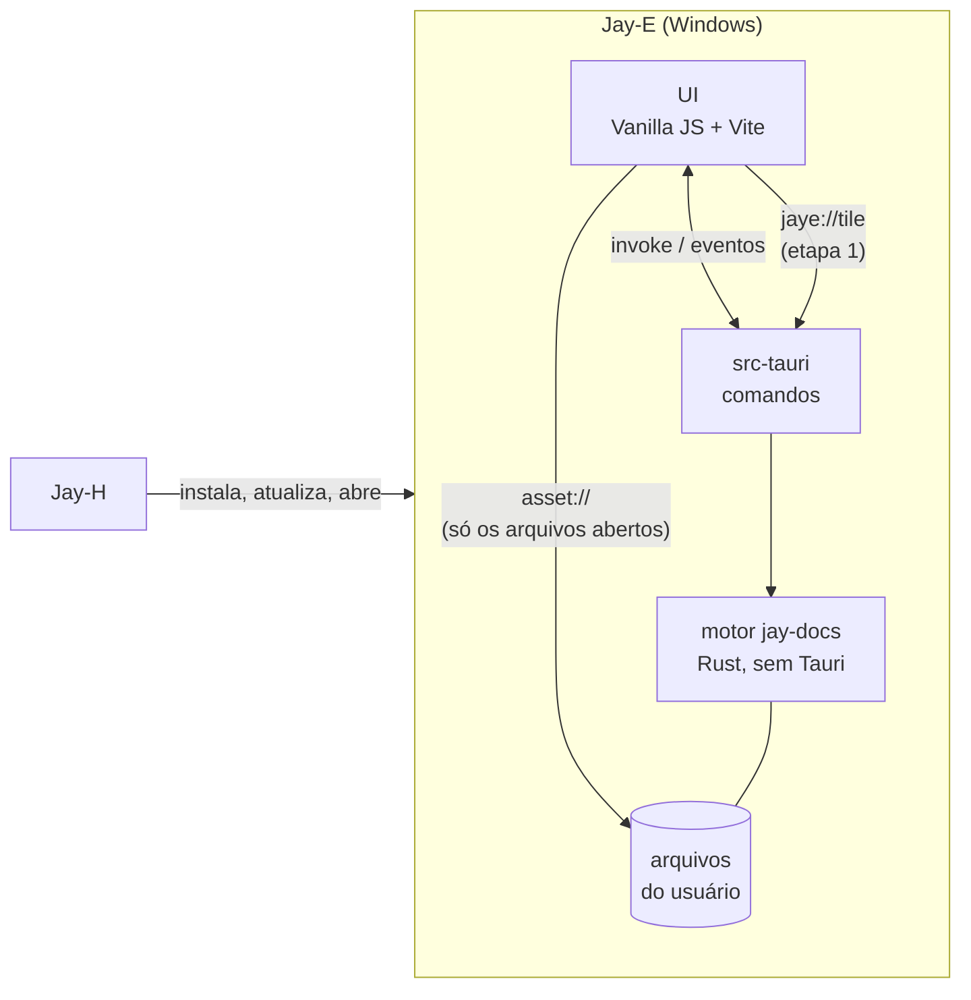
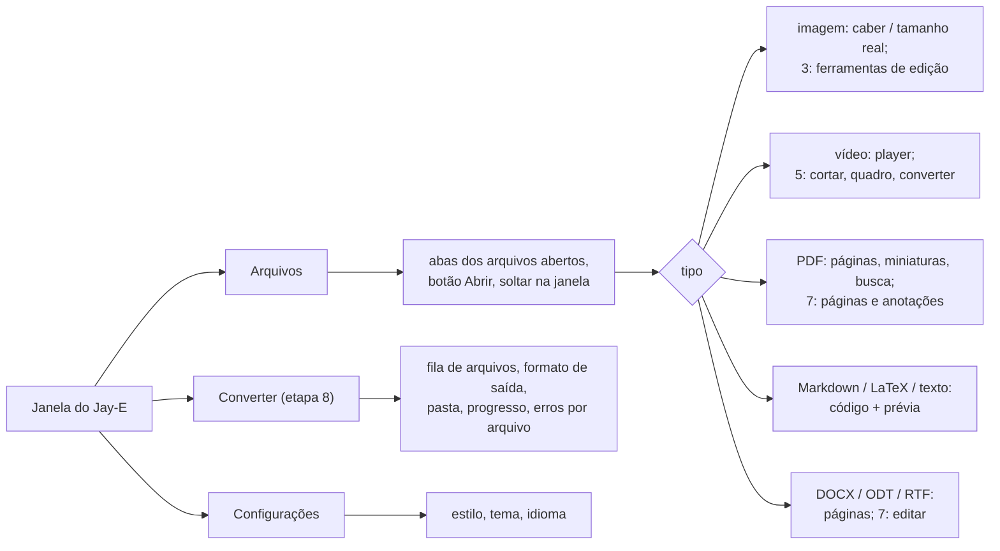
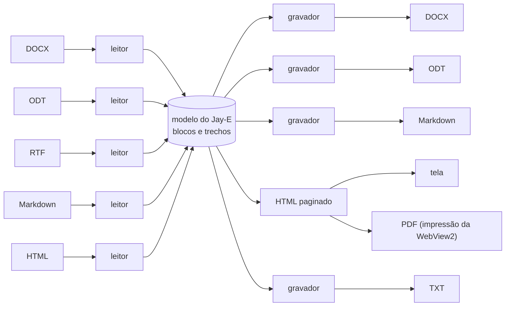

# Jay-E — Arquitetura

O editor e leitor de arquivos da linha Jay: **documentos** (PDF, DOCX, ODT, RTF, Markdown, LaTeX, texto), **imagens** e **vídeos**, com **conversão** entre formatos. Leve, rápido para abrir e desenhar, e Rust primeiro. Windows primeiro, como o resto da linha.

Escrito em 2026-11-06, a partir do Jay-A 0.1.0 e do Jay-H 0.1.0, e do estudo do LibreOffice, ONLYOFFICE, MarkText, PhotoCraft e Kdenlive em [`REFERENCIAS.md`](REFERENCIAS.md). A etapa 0 está pronta. Licença: **MIT** (D1).

## 1. Visão geral



- **Abrir:** pelo botão Abrir (Ctrl+O), arrastando para a janela, pela linha de comando ("Abrir com" do Windows) ou por um segundo `jay-e.exe arquivo`, que entrega o arquivo à janela já aberta. Quem pega o caminho é sempre o Rust; a página **nunca manda um caminho** (seção 7).
- **Ler o que a WebView2 já lê rápido:** imagens comuns, vídeo (MP4/H.264, WebM/VP9/AV1), áudio e texto vêm direto do disco pelo protocolo `asset` do Tauri, com decodificação de hardware e busca por intervalo (`Range`), sem passar pelo Rust. É a etapa 0.
- **O resto passa pelo motor:** PDF em tiles desenhados no Rust, documentos lidos para um modelo interno, imagens editadas e vídeos cortados por comandos do `jay-docs`.
- Áudio só toca: editar áudio é do Jay-A.

### Requisitos funcionais

| # | Requisito | Etapa |
|---|---|---|
| RF-0 | Abrir pelo diálogo, arrastando, pela linha de comando e por um segundo lançamento; várias abas de arquivo; o tipo vem do conteúdo | 0 ✅ |
| RF-1 | Ver imagens (PNG, JPEG, GIF, WebP, BMP, ICO, SVG, AVIF), vídeo, áudio e texto | 0 ✅ |
| RF-P1 | Ler PDF: rolar, zoom (largura, página, livre), miniaturas, ir para página, buscar texto, selecionar e copiar, links internos | 1 |
| RF-M1 | Markdown: editar o código com prévia ao lado, CommonMark + GFM (tabelas, tarefas, notas de rodapé), fórmulas, exportar HTML e PDF | 2 |
| RF-I1 | Editar imagens: cortar, girar, espelhar, redimensionar, brilho/contraste/saturação; desfazer; salvar como | 3 |
| RF-I2 | Converter imagens em lote: PNG, JPEG, WebP, AVIF, BMP, TIFF, GIF, ICO, QOI, com qualidade e tamanho | 3 |
| RF-D1 | Ler DOCX, ODT e RTF em páginas: texto, estilos, listas, tabelas, imagens, cabeçalho e rodapé | 4 |
| RF-D2 | Converter documentos: DOCX/ODT/RTF/Markdown/HTML/TXT entre si e para PDF | 4 / 8 |
| RF-V1 | Vídeo: cortar e juntar sem recodificar, extrair um quadro como imagem, miniaturas na barra de tempo | 5 |
| RF-V2 | Converter vídeo (MP4/H.264 + AAC; tamanho, qualidade, só o áudio) | 5 |
| RF-L1 | LaTeX: editar com realce, compilar para PDF e ver ao lado, prévia de fórmulas | 6 |
| RF-D3 | Editar DOCX e ODT: texto, negrito/itálico, títulos, listas, tabelas simples, imagens; salvar sem perder o que o Jay-E não entende | 7 |
| RF-P2 | Editar PDF: juntar, separar, reordenar, girar e apagar páginas; anotar (destaque, nota, desenho); preencher formulário | 7 |
| RF-C1 | Uma tela de conversão em lote para todos os tipos, com fila, progresso, cancelar e sem sobrescrever sem perguntar | 8 |
| RF-A1 | Os três estilos e os temas do Jay-C, inglês e português, instância única | 0 ✅ |

### Requisitos não funcionais

| # | Requisito | Como medir |
|---|---|---|
| RNF-1 Abrir rápido | Janela pronta em menos de **500 ms**; a primeira página de um PDF de 100 páginas em menos de **150 ms** depois de abrir; uma imagem de 24 MP visível em menos de **300 ms** | tempo do clique até o primeiro quadro, pela depuração remota (performance.now) |
| RNF-2 Rolar liso | Rolar um PDF de 1 000 páginas a **60 quadros/s** sem página em branco por mais de 100 ms; memória do cache de tiles limitada (256 MB padrão) | trace do DevTools; memória do processo |
| RNF-3 Leve | Instalador de até **15 MB** com o motor de PDF; nada de LibreOffice, FFmpeg ou TeX no instalador (o que for opcional é baixado só quando usado) | o `.exe` do instalador |
| RNF-4 Rust primeiro | Leitura, desenho, conversão e edição no Rust; a página só mostra e manda comandos. Biblioteca em C/C++ só quando não houver em Rust com qualidade (PDFium, Media Foundation), e isolada atrás de um módulo | revisão |
| RNF-5 Não perder dados | Salvar é atômico (`.tmp` e renomear); a mesma codificação e fim de linha; nunca sobrescrever o original sem pedir; aviso se outro programa mudou o arquivo; o que o Jay-E não entende num DOCX/ODT é mantido | testes de ida e volta (abrir → salvar → comparar) |
| RNF-6 Entrada não confiável | Todo arquivo é hostil: limites de tamanho, de pixels (ex.: 256 MP), de páginas, de profundidade de XML e de descompressão (bomba ZIP); HTML de documento limpo antes de entrar na página; nada roda script de um documento | arquivos corrompidos e malformados nos testes de cada leitor |
| RNF-7 Robustez | Arquivo corrompido ou sem suporte vira um aviso naquela aba; nada derruba o app | os testes de cada etapa |
| RNF-8 Plataforma | Windows 10 2004 ou mais novo, x64, WebView2 | — |
| RNF-9 Licença | O Jay-E é **MIT**. Dependências permissivas (MIT, BSD, Apache, MPL por arquivo, Zlib); LGPL só como biblioteca trocável. Código GPL/AGPL (Kdenlive, ONLYOFFICE) não entra | `cargo tree` e `package-lock.json` revisados a cada dependência nova |
| RNF-10 Acessibilidade e idioma | Tudo pelo teclado, com rótulos para leitor de tela; contraste dos estilos do Jay-C; todo texto em inglês e em português | `npm test` (o teste de traduções) |

## 2. Decisões técnicas

| Tema | Escolha | Motivo |
|---|---|---|
| Shell e UI | **Tauri v2 + Vanilla JS + Vite**, como a linha | Mesmo stack e estética. Copiados do Jay-H: `styles/theme.css` (Calmo/Neon/Suave), a base do `app.css`, `ui/dom.js`, `ui/tabs.js`, `ui/theme.js`, `core/i18n.js`, `core/style.js`, `store/settings.js`, `scripts/cdp-eval.mjs`, a fonte Inter, o lobo e os ícones do Jay-C. |
| Motor | Crate Rust **`jay-docs`**, sem Tauri | Testes com `cargo test` sem compilar o app, como o `jay-audio` do Jay-A. Os comandos Tauri ficam em `src-tauri`. |
| Detecção de tipo | **Própria** (`detect.rs`, ~150 linhas) pelos primeiros 4 KB | A ideia de tipo separado de filtro do LibreOffice. Não vale uma dependência (`infer`) para assinaturas fixas, e assim o ZIP de DOCX/ODT e o texto Markdown/LaTeX são decididos do jeito do Jay-E. |
| Servir arquivos à página | **Protocolo `asset` do Tauri, escopo vazio**; o Rust libera cada arquivo aberto (`asset_protocol_scope().allow_file`) | Já faz `Range` (busca no vídeo) e não copia bytes pelo IPC. A página não consegue ler nada que a pessoa não abriu. |
| Tiles (PDF, imagens grandes) | Protocolo próprio **`jaye://`** (`register_asynchronous_uri_scheme_protocol`), uma URL por tile: documento, página, zoom, x, y | A WebView2 recebe PNG/BGRA prontos, com cache do navegador; nada de base64 no IPC. A ideia do `paintTile` do LibreOfficeKit. Etapa 1. |
| PDF (ler e desenhar) | **PDFium** via `pdfium-render` (MIT/Apache; PDFium BSD-3, ~6 MB) — spike S1 contra o **hayro** (Rust puro, MIT/Apache) | O PDFium é o mesmo do Chrome e do LibreOffice: rápido e fiel. O hayro é Rust puro, mas ainda novo. Medir os dois na mesma pilha de PDFs (velocidade, fidelidade, memória) e escolher. |
| PDF (editar páginas) | **`lopdf`** (MIT, Rust puro) | Juntar, separar, reordenar, girar, apagar: é mexer na árvore de objetos, sem desenhar. |
| Markdown | **`pulldown-cmark`** (MIT) → HTML, limpo por **`ammonia`** (MIT/Apache); fórmulas com **KaTeX** (MIT) na página | Rust, rápido e testado contra a especificação CommonMark. O HTML limpo antes de chegar à página (RNF-6). |
| Editor de código (Markdown, LaTeX, texto) | **CodeMirror 6** (MIT) | Leve (~150 KB), acessível, aguenta arquivos grandes por virtualização. Escrever um editor de texto não vale. |
| Documentos | **Modelo interno próprio** + leitores com `quick-xml` (MIT) e `zip` (MIT); visualização em HTML paginado na WebView2 | A estrela do ONLYOFFICE (seção 6). Sem LibreOffice (300 MB) nem motor de layout próprio: o HTML da WebView2 já faz fontes, bidi e quebra de linha. |
| Documento → PDF | **Impressão da WebView2** (`PrintToPdfAsync`, via `webview2-com`) sobre o HTML do modelo | Como o `printToPDF` do MarkText: nenhuma biblioteca nova, mesma página que se vê. |
| LaTeX | **Tectonic** (MIT; motor XeTeX), **baixado na primeira vez** que a pessoa compila (D6) | Instalar TeX no instalador quebraria o RNF-3. O Tectonic baixa só os pacotes que o documento usa. Alternativa: usar o MiKTeX/TeX Live que já estiver instalado. |
| Imagens | **`image`** + **`zune-jpeg`** + **`image-webp`** + **`fast_image_resize`** (MIT/Apache) | Rust, os mesmos codecs do PhotoCraft. AVIF: decodificar pela WebView2 e codificar com `ravif` (BSD, Rust) — spike S3. |
| Vídeo (ver) | **`<video>` da WebView2** | Decodificação de hardware, de graça. HEVC precisa da extensão do Windows: sem ela, o Jay-E avisa. |
| Vídeo (cortar, juntar) | Cópia de stream, sem recodificar: MP4 com o **`mp4`** (MIT) / próprio, WebM/MKV com `matroska` — spike S4 | Instantâneo e sem perda; corta no keyframe mais próximo (avisado na tela). |
| Vídeo (converter) | **Media Foundation** do Windows (`windows` crate, MIT/Apache) — D3 | Já vem no Windows: H.264, AAC, MP4, com aceleração. 0 MB no instalador. FFmpeg só como download opcional, se o usuário quiser formatos que o Media Foundation não faz. |
| Desfazer | **Pares de comandos** (fazer, desfazer) por documento, juntando digitação de até 1 s, com a seleção junto | Kdenlive (`undohelper.hpp`) e MarkText (`history`). |
| Tarefas longas | Fila no Rust, uma por núcleo, progresso por `Channel`, cancelar apaga o `.tmp` | Kdenlive (`jobs/`), igual à conversão do Jay-A. |
| Instância única | `tauri-plugin-single-instance`, que entrega os arquivos do segundo lançamento | "Abrir com" num arquivo com o Jay-E aberto abre uma aba, não outra janela. |
| Diálogo de arquivo | `tauri-plugin-dialog`, **chamado pelo Rust** | Sem permissão de diálogo para a página. |
| Bandeja | **Não** | Nada roda em segundo plano: fechar a janela fecha o app. |
| Porta do Vite | **5177** | Jay-C usa 5173, Jay-A 5175, Jay-H 5176: os quatro rodam em dev ao mesmo tempo. Depuração remota na **9226**. |
| Configurações | `localStorage`, chave `jaye.settings` | Só preferências da interface (tema, estilo, idioma), como o Jay-H. |

## 3. Estrutura do repositório

```
Jay-E/
├─ package.json                  # npm workspaces: frontend
├─ LICENSE                       # MIT
├─ docs/ARQUITETURA.md, docs/REFERENCIAS.md
├─ crates/jay-docs/              # motor: sem Tauri, testável com cargo test
│  └─ src/
│     ├─ lib.rs
│     ├─ detect.rs               # 0 ✅: tipo pelo conteúdo
│     ├─ pdf/                    # 1: documento, páginas, tiles, texto, busca; 7: editar páginas (lopdf)
│     ├─ markdown.rs             # 2: Markdown → HTML limpo
│     ├─ text.rs                 # 2: codificação, fim de linha, gravação atômica, vigiar
│     ├─ image/                  # 3: decodificar com limites, operações, codificar
│     ├─ doc/                    # 4: model.rs (o modelo), docx.rs, odt.rs, rtf.rs, html.rs, md.rs
│     ├─ video/                  # 5: sondar, cortar e juntar por cópia, Media Foundation
│     ├─ latex.rs                # 6: Tectonic
│     └─ jobs.rs                 # 5/8: fila de tarefas
├─ scripts/cdp-eval.mjs          # roda JS dentro do app (depuração remota na 9226)
└─ frontend/
   ├─ index.html, vite.config.js, package.json
   ├─ src/
   │  ├─ main.js
   │  ├─ styles/                 # theme.css e app.css (base do Jay-C)
   │  ├─ core/                   # i18n.js, style.js; files.js (a ponte com o files.rs)
   │  ├─ ui/                     # dom.js, icons.js, tabs.js, theme.js (do Jay-C); app-shell.js,
   │  │                          # files.js (abas de arquivo), viewers.js (um visualizador por tipo)
   │  ├─ locales/pt-BR.js
   │  └─ store/settings.js
   └─ src-tauri/
      ├─ tauri.conf.json         # productName "Jay-E", identifier io.github.tyxmatty.jaye
      ├─ icons/                  # os do Jay-C
      └─ src/main.rs, files.rs   # abrir (diálogo, soltar, linha de comando), instância única
```

## 4. Interface



- Uma aba por arquivo aberto; abrir o mesmo arquivo de novo volta à aba dele. Setas trocam de aba, Ctrl+W fecha, Ctrl+O abre.
- Cada visualizador tem a barra de ferramentas dele em cima, com as mesmas posições (zoom à direita, salvar/exportar no fim).

## 5. Desenho rápido

- **O que a WebView2 já faz, ela faz:** imagem, vídeo e áudio vão do disco para a tag por `asset://`, sem cópia no Rust. Por isso a etapa 0 já abre fotos e vídeos grandes na hora.
- **PDF em tiles** (etapa 1): a página pede ao Rust só os tiles das páginas visíveis (mais uma de folga em cada lado), no zoom atual, por URL `jaye://tile/<doc>/<página>/<zoom>/<x>/<y>`. Enquanto o tile não chega, a página mostra a miniatura esticada (nunca branco). Zoom com a roda primeiro estica o que já tem e pede os tiles nítidos ao parar. Cache LRU de tiles no Rust com limite de memória, e o cache HTTP da WebView2 por cima.
- **Desenho fora da thread principal:** cada documento PDF tem uma thread de desenho; um pedido de tile que saiu da tela é cancelado antes de começar.
- **Imagens enormes** (acima de 32 MP, etapa 3) usam o mesmo caminho de tiles, com uma pirâmide de reduções.
- **Documentos** (etapa 4): o modelo vira HTML uma vez, e a página só pagina o que está perto da tela (`content-visibility: auto`).

## 6. Documentos: o modelo no meio



- **Modelo:** blocos (parágrafo, título 1–6, item de lista, tabela, imagem, quebra de página, código, fórmula, citação) com trechos de texto (negrito, itálico, sublinhado, tachado, código, link, cor, tamanho, fonte) e estilos com nome. Igual ao estado em JSON do Muya, com o que o DOCX precisa a mais.
- **Cada leitor** é um tokenizador do formato que chama um mapeador comum (`writerfilter` do LibreOffice), com limites de entrada (tamanho descompactado, profundidade de XML, número de partes).
- **Ida e volta sem perda** (etapa 7): o leitor de DOCX/ODT guarda as partes e os elementos que não entende; o gravador escreve o modelo de volta **só onde mudou** e copia o resto byte a byte. Teste: abrir e salvar sem editar dá um arquivo equivalente (mesmo `document.xml` canônico).
- **Fidelidade:** o Jay-E não promete página igual ao Word (seria o motor de layout do ONLYOFFICE). Promete o conteúdo, os estilos e a ordem certos, e a paginação aproximada (risco 3).

## 7. Segurança

- **A página nunca manda um caminho.** O diálogo, o soltar e a linha de comando são todos tratados no Rust (`files.rs`), que libera no protocolo `asset` só aquele arquivo. Mesmo que um documento conseguisse rodar script na página, ela só leria o que a pessoa abriu.
- **Nada de script de documento:** CSP sem `unsafe-eval` nem scripts de fora; o HTML que sai do Markdown e do DOCX passa pelo `ammonia` no Rust; SVG abre em `` (que não roda script), nunca embutido no DOM.
- **Limites de entrada** (RNF-6): por leitor, como os `MAX_*` dos codecs do PhotoCraft. Um erro de leitura vira o aviso daquela aba.
- **Parser num processo à parte** para PDF e documentos (D5): um PDF que derruba o PDFium derrubaria a janela inteira. Avaliar depois do spike S1 (custo de IPC contra o risco).
- **Downloads opcionais** (Tectonic, FFmpeg se entrar): só de endereços fixos no código, com SHA-256 conferido, como os instaladores no Jay-H.
- **Salvar:** atômico, e nunca por cima do original sem a pessoa pedir.

## 8. Etapas

Cada etapa termina com algo testável.

| # | Etapa | Pronto quando |
|---|---|---|
| 0 ✅ | Scaffold: janela, estilos, tema, idioma, instância única; abrir pelo diálogo, soltando, pela linha de comando e por um segundo lançamento; detecção do tipo; abas; imagem, vídeo, áudio e texto pela WebView2 | `npm test` e `cargo test` passam; no app, uma foto, um vídeo e um `.md` abrem, cada um na sua aba ✅ |
| 1 | Leitor de PDF (S1): tiles pelo `jaye://`, só as páginas visíveis, cache, zoom, miniaturas, ir para página, buscar e copiar texto, links | um PDF de 1 000 páginas rola liso (RNF-2); a primeira página em < 150 ms (RNF-1); um PDF corrompido mostra o aviso |
| 2 | Markdown: CodeMirror + prévia do `pulldown-cmark` limpa pelo `ammonia`, rolagem sincronizada, KaTeX; salvar seguro (codificação, fim de linha, atômico, vigiar); exportar HTML e PDF | abrir, editar e salvar um `.md` em CP1252 com CRLF mantém os dois; `<script>` no Markdown não roda; o PDF exportado abre no leitor da etapa 1 |
| 3 | Imagens: editar (cortar, girar, espelhar, redimensionar, ajustes) sem destruir, com desfazer; converter em lote (S3); imagens enormes em tiles | 10 imagens mistas viram WebP e AVIF; uma bomba de descompressão é recusada; uma foto de 100 MP abre em tiles |
| 4 | Documentos: o modelo; leitores de DOCX, ODT, RTF, HTML e Markdown; visualização paginada; exportar para PDF, Markdown, HTML e TXT | um DOCX com títulos, listas, tabela e imagem aparece com tudo; DOCX → Markdown → DOCX mantém o texto e os títulos |
| 5 | Vídeo (S4): cortar e juntar por cópia, extrair quadro, miniaturas na barra de tempo; converter pelo Media Foundation, com fila e cancelar | cortar 10 s de um MP4 de 1 GB leva < 2 s e toca; converter um WebM em MP4 toca no player |
| 6 | LaTeX: CodeMirror + compilar com o Tectonic (baixado na primeira vez, SHA-256), o PDF ao lado no leitor da etapa 1, erros na linha certa | um artigo com fórmulas e bibliografia compila; um erro de sintaxe aponta a linha |
| 7 | Edição: DOCX e ODT (texto, estilos, listas, tabelas simples, imagens) com ida e volta sem perda; PDF: juntar, separar, reordenar, girar, apagar páginas, anotações, formulários | abrir e salvar um DOCX sem editar dá o mesmo `document.xml` canônico; editado, abre no Word e no LibreOffice; dois PDFs juntados abrem em ambos |
| 8 | Converter: tela de lote para todos os tipos, com fila, progresso, cancelar e perguntar antes de sobrescrever | lote de 20 arquivos mistos; um corrompido falha sozinho e os outros saem |
| 9 | Release: instalador NSIS em `%LOCALAPPDATA%\Jay-E`, associações de arquivo ("Abrir com"), o Jay-E no catálogo do Jay-H | instalar numa máquina limpa, abrir um PDF com dois cliques; o Jay-H instala e atualiza o Jay-E |

**Etapa 0, medido (2026-11-06):**
- **Testes:** `npm test` (6: traduções, texto UTF-8/UTF-16, tamanhos), `cargo test` no `jay-docs` (8: assinaturas, MP4/MOV/AVIF/HEIC pela marca, WebM/MKV, ODT pelo `mimetype`, DOCX pela extensão, texto que começa como assinatura — "BMW…", "ID3 …" — continua texto, UTF-16 com BOM, binário) e no `src-tauri` (1: caminhos da linha de comando).
- **No app de dev, pela depuração remota:** um segundo `jay-e.exe` com 7 arquivos abriu 7 abas na janela que já estava aberta. PNG (128×2048) cabe na janela e o clique mostra o tamanho real; MP4 de 16 s toca (`readyState` 4); `.md` aparece como texto; PDF e DOCX dizem a etapa do visualizador; um binário diz "não abre esse tipo"; um arquivo que não existe mostra o erro do Windows. As URLs são `http://asset.localhost/…`, liberadas uma a uma pelo Rust.
- **Não visto:** o diálogo Abrir e o soltar na janela (não dá para automatizar pela depuração remota; usam o mesmo `files::open` do segundo lançamento). Numa primeira rodada, a aba do `doc.docx` apareceu com o vídeo de outra aba; o arquivo estava sendo regravado durante o teste, e na repetição tudo bateu. Fica de olho.

## 9. Riscos e spikes

| # | Spike | Pronto quando |
|---|---|---|
| S1 | PDFium (`pdfium-render`) contra hayro: tempo da primeira página, tiles por segundo, memória e fidelidade numa pilha de 30 PDFs (texto, digitalizados, formulários, fontes estranhas, 1 000 páginas) | uma tabela com os números e a escolha; tamanho no instalador (RNF-3) |
| S2 | `PrintToPdfAsync` da WebView2 a partir do Tauri (`webview2-com`): margens, cabeçalho, quebras de página CSS | um Markdown e um DOCX viram PDF com as quebras certas |
| S3 | AVIF e HEIC: decodificar (WebView2? `dav1d`?) e codificar (`ravif`) sem C pesado | uma foto do iPhone (HEIC) abre; um PNG vira AVIF |
| S4 | Corte sem recodificar em MP4 e WebM em Rust, e o Media Foundation para converter | um corte toca no player e no VLC; o Media Foundation converte um MOV em MP4 |
| S5 | Tectonic: tamanho do download, tempo da primeira compilação, funcionar sem internet depois | um artigo compila offline na segunda vez |

Riscos:
1. **Escopo enorme.** "Editor de tudo" é LibreOffice + Kdenlive + PhotoCraft. O plano corta de propósito: sem planilhas e apresentações (D2), vídeo de uma trilha só, imagem sem camadas. Cada etapa entrega um leitor útil antes do editor.
2. **PDFium é C++.** Rust primeiro, mas não há leitor de PDF em Rust puro tão rápido e fiel quanto (S1 decide). Ele fica atrás do módulo `pdf/`, para trocar depois sem mexer na UI.
3. **Fidelidade do DOCX.** Sem o motor de layout do ONLYOFFICE, documentos complexos (caixas de texto ancoradas, colunas, campos) saem diferentes do Word. A leitura avisa quando o documento tem algo que o Jay-E não desenha.
4. **Codecs de vídeo.** O Media Foundation não faz VP9/AV1 de saída e o HEVC depende da extensão da Microsoft. Formatos fora disso: download opcional do FFmpeg (D3) ou "não suportado".
5. **Pasta no OneDrive.** Como no Jay-A e no Jay-H, o build do Rust vai para fora dele pelo `.cargo/config.toml` local.
6. **Código copiado por engano.** Ler o LibreOffice, o ONLYOFFICE e o Kdenlive é permitido; copiar trechos não (RNF-9).

## 10. Decisões em aberto

| # | Pergunta | Opções (recomendada primeiro) |
|---|---|---|
| D1 ✅ | Licença | **MIT**, como a linha. LibreOffice, ONLYOFFICE e Kdenlive só como estudo. |
| D2 | Planilhas (XLSX/ODS/CSV) e apresentações (PPTX/ODP) | **(a)** fora do v1: abrir mostra "não suportado" · (b) só leitura, depois da etapa 8 (o modelo de blocos não serve; seria um modelo de células) |
| D3 | Motor de conversão de vídeo | **(a)** Media Foundation (0 MB, só Windows, H.264/HEVC/AAC) · (b) FFmpeg baixado sob demanda (~80 MB, todos os formatos) · (c) os dois: MF primeiro, FFmpeg opcional |
| D4 | Editor de Markdown | **(a)** código + prévia na etapa 2, WYSIWYG por blocos (como o Muya) depois · (b) WYSIWYG desde o começo |
| D5 | PDFium e leitores num processo à parte | **(a)** decidir depois do S1, medindo o custo · (b) sempre à parte · (c) no mesmo processo |
| D6 | De onde vem o TeX | **(a)** Tectonic baixado na primeira compilação · (b) usar o MiKTeX/TeX Live instalado, se houver, e o Tectonic se não · (c) só o instalado |
| D7 | Versão em inglês desta documentação | depois, como o `ARQUITETURA.en.md` do Jay-C |
