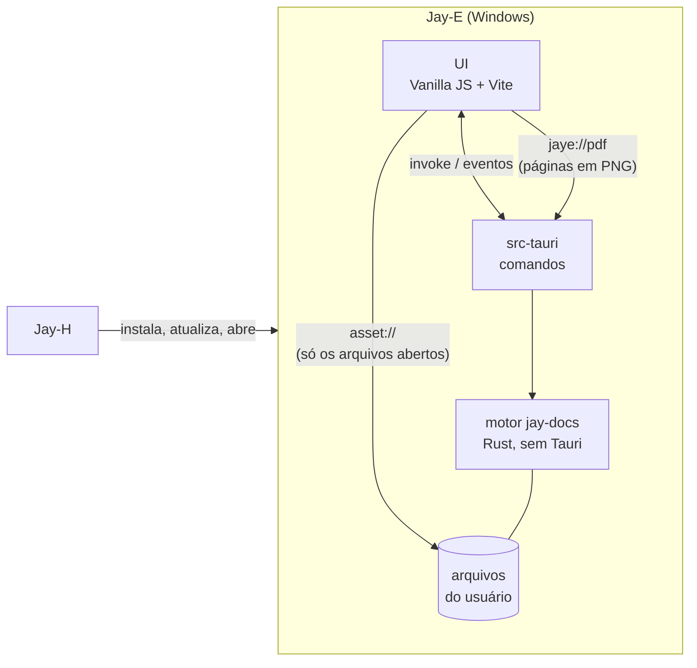
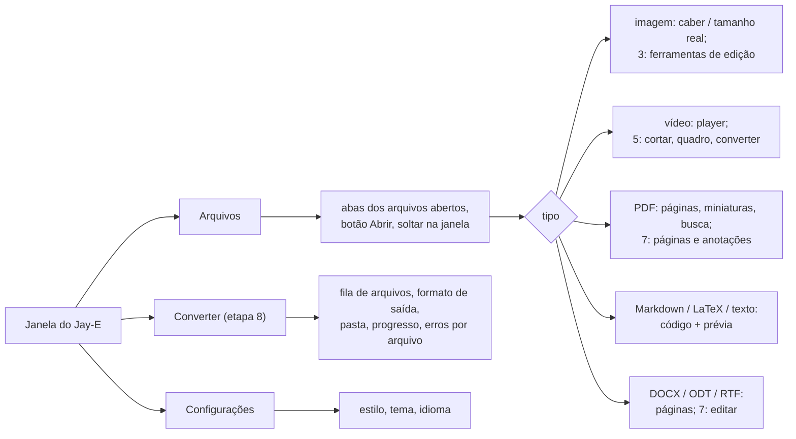
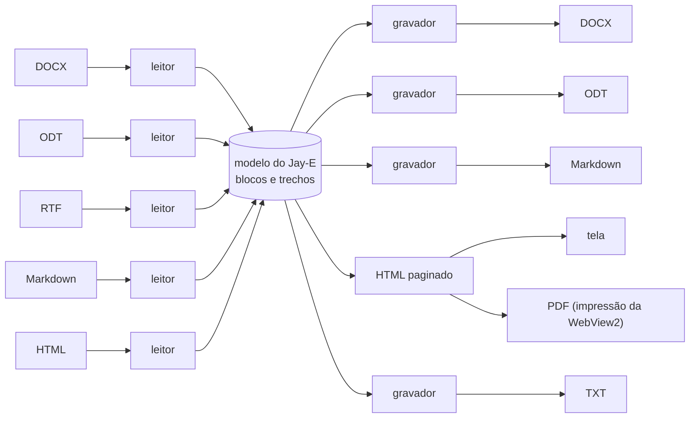

# Jay-E — Arquitetura

O editor e leitor de arquivos da linha Jay: **documentos** (PDF, DOCX, ODT, RTF, Markdown, LaTeX, texto), **imagens** e **vídeos**, com **conversão** entre formatos. Leve, rápido para abrir e desenhar, e Rust primeiro. Windows primeiro, como o resto da linha.

Escrito em 2026-11-06, a partir do Jay-A 0.1.0 e do Jay-H 0.1.0, e do estudo do LibreOffice, ONLYOFFICE, MarkText, PhotoCraft e Kdenlive em [`REFERENCIAS.md`](REFERENCIAS.md). As etapas 0 a 4 estão prontas. Licença: **MIT** (D1).

## 1. Visão geral



- **Abrir:** pelo botão Abrir (Ctrl+O), arrastando para a janela, pela linha de comando ("Abrir com" do Windows) ou por um segundo `jay-e.exe arquivo`, que entrega o arquivo à janela já aberta. Quem pega o caminho é sempre o Rust; a página **nunca manda um caminho** (seção 7).
- **Ler o que a WebView2 já lê rápido:** imagens comuns, vídeo (MP4/H.264, WebM/VP9/AV1), áudio e texto vêm direto do disco pelo protocolo `asset` do Tauri, com decodificação de hardware e busca por intervalo (`Range`), sem passar pelo Rust. É a etapa 0.
- **O resto passa pelo motor:** PDF desenhado no Rust, documentos lidos para um modelo interno, imagens editadas e vídeos cortados por comandos do `jay-docs`.
- Áudio só toca: editar áudio é do Jay-A.

### Requisitos funcionais

| # | Requisito | Etapa |
|---|---|---|
| RF-0 | Abrir pelo diálogo, arrastando, pela linha de comando e por um segundo lançamento; várias abas de arquivo; o tipo vem do conteúdo | 0 ✅ |
| RF-1 | Ver imagens (PNG, JPEG, GIF, WebP, BMP, ICO, SVG, AVIF), vídeo, áudio e texto | 0 ✅ |
| RF-P1 | Ler PDF: rolar, zoom (largura, página, livre), miniaturas, ir para página, buscar texto, selecionar e copiar, links internos e externos, PDF com senha | 1 ✅ |
| RF-M1 | Markdown: editar o código com prévia ao lado, CommonMark + GFM (tabelas, tarefas, notas de rodapé), fórmulas, exportar HTML e PDF | 2 ✅ |
| RF-I1 | Editar imagens: cortar, girar, espelhar, brilho/contraste/saturação; desfazer e refazer; salvar como (redimensionar entra ao salvar, pelo "lado maior") | 3 ✅ |
| RF-I2 | Converter imagens em lote: PNG, JPEG, WebP, AVIF, BMP, TIFF, GIF, ICO, QOI, com qualidade e tamanho | 3 ✅ |
| RF-D1 | Ler DOCX, ODT e RTF numa folha A4: texto, títulos, negrito/itálico, listas, tabelas, imagens, links, quebras de página (cabeçalho e rodapé ficam para depois) | 4 ✅ |
| RF-D2 | Converter documentos: DOCX/ODT/RTF/Markdown para DOCX, Markdown, HTML, TXT e PDF (ler HTML fica para a 8) | 4 ✅ / 8 |
| RF-V1 | Vídeo: cortar e juntar sem recodificar, extrair um quadro como imagem, miniaturas na barra de tempo | 5 |
| RF-V2 | Converter vídeo (MP4/H.264 + AAC; tamanho, qualidade, só o áudio) | 5 |
| RF-L1 | LaTeX: editar com realce, compilar para PDF e ver ao lado, prévia de fórmulas | 6 |
| RF-D3 | Editar DOCX e ODT: texto, negrito/itálico, títulos, listas, tabelas simples, imagens; salvar sem perder o que o Jay-E não entende | 7 |
| RF-P2 | Editar PDF: juntar, separar, reordenar, girar e apagar páginas; anotar (destaque, nota, desenho); preencher formulário | 7 |
| RF-C1 | Uma tela de conversão em lote para todos os tipos, com fila, progresso, cancelar e sem sobrescrever sem perguntar | 8 |
| RF-A1 | Os três estilos e os temas do Jay-C, inglês e português, instância única | 0 ✅ |

### Requisitos não funcionais

| # | Requisito | Como medir |
|---|---|---|
| RNF-1 Abrir rápido | Janela pronta em menos de **500 ms**; a primeira página de um PDF de 100 páginas em menos de **150 ms** depois de abrir; uma imagem de 24 MP visível em menos de **300 ms** | tempo do clique até o primeiro quadro, pela depuração remota (performance.now) |
| RNF-2 Rolar liso | Rolar um PDF de 1 000 páginas a **60 quadros/s** sem página em branco por mais de 100 ms; memória do cache de tiles limitada (256 MB padrão) | trace do DevTools; memória do processo |
| RNF-3 Leve | Instalador de até **15 MB**; nada de LibreOffice, FFmpeg ou TeX no instalador (o que for opcional é baixado só quando usado) | o `.exe` do instalador |
| RNF-4 Rust primeiro | Leitura, desenho, conversão e edição no Rust; a página só mostra e manda comandos. Biblioteca em C/C++ só quando não houver em Rust com qualidade (ex.: Media Foundation), e isolada atrás de um módulo | revisão |
| RNF-5 Não perder dados | Salvar é atômico (`.tmp` e renomear); a mesma codificação e fim de linha; nunca sobrescrever o original sem pedir; aviso se outro programa mudou o arquivo; o que o Jay-E não entende num DOCX/ODT é mantido | testes de ida e volta (abrir → salvar → comparar) |
| RNF-6 Entrada não confiável | Todo arquivo é hostil: limites de tamanho, de pixels (ex.: 256 MP), de páginas, de profundidade de XML e de descompressão (bomba ZIP); HTML de documento limpo antes de entrar na página; nada roda script de um documento | arquivos corrompidos e malformados nos testes de cada leitor |
| RNF-7 Robustez | Arquivo corrompido ou sem suporte vira um aviso naquela aba; nada derruba o app | os testes de cada etapa |
| RNF-8 Plataforma | Windows 10 2004 ou mais novo, x64, WebView2 | — |
| RNF-9 Licença | O Jay-E é **MIT**. Dependências permissivas (MIT, BSD, Apache, MPL por arquivo, Zlib); LGPL só como biblioteca trocável. Código GPL/AGPL (Kdenlive, ONLYOFFICE) não entra | `cargo tree` e `package-lock.json` revisados a cada dependência nova |
| RNF-10 Acessibilidade e idioma | Tudo pelo teclado, com rótulos para leitor de tela; contraste dos estilos do Jay-C; todo texto em inglês e em português | `npm test` (o teste de traduções) |

## 2. Decisões técnicas

| Tema | Escolha | Motivo |
|---|---|---|
| Shell e UI | **Tauri v2 + Vanilla JS + Vite**, como a linha | Mesmo stack e estética. Copiados do Jay-H: `styles/theme.css` (Calmo/Neon/Suave), a base do `app.css`, `ui/dom.js`, `ui/tabs.js`, `ui/theme.js`, `core/i18n.js`, `core/style.js`, `store/settings.js`, `scripts/cdp-eval.mjs`, a fonte Inter, o lobo e os ícones do Jay-C. |
| Motor | Crate Rust **`jay-docs`**, sem Tauri | Testes com `cargo test` sem compilar o app, como o `jay-audio` do Jay-A. Os comandos Tauri ficam em `src-tauri`. |
| Detecção de tipo | **Própria** (`detect.rs`, ~150 linhas) pelos primeiros 4 KB | A ideia de tipo separado de filtro do LibreOffice. Não vale uma dependência (`infer`) para assinaturas fixas, e assim o ZIP de DOCX/ODT e o texto Markdown/LaTeX são decididos do jeito do Jay-E. |
| Servir arquivos à página | **Protocolo `asset` do Tauri, escopo vazio**; o Rust libera cada arquivo aberto (`asset_protocol_scope().allow_file`) | Já faz `Range` (busca no vídeo) e não copia bytes pelo IPC. A página não consegue ler nada que a pessoa não abriu. |
| Páginas desenhadas (PDF; imagens grandes na etapa 3) | Protocolo próprio **`jaye://`** (`register_asynchronous_uri_scheme_protocol`), uma URL por página: `pdf/<doc>/<página>/<largura>`. O corpo é um **PNG rápido** (filtro Up, modo mais rápido do fdeflate), decodificado na página por `createImageBitmap`, fora da thread principal | Medido: o protocolo move ~14 ms por MB, e uma página de 1 350 px em RGBA tem 10 MB (146 ms). Em PNG fica com ~0,8 MB e custa 6 ms para comprimir. Nada de base64 no IPC. A ideia do `paintTile` do LibreOfficeKit, por página inteira por enquanto. |
| PDF (ler e desenhar) | **hayro** 0.9 (Rust puro, `unsafe` proibido, MIT/Apache), com as 14 fontes padrão e os CMaps embutidos | Spike S1 (seção 8): mesma velocidade e mesma aparência que o PDFium nos PDFs de teste, sem a DLL de 7,8 MB, e abre PDF truncado. Texto e links saem do próprio interpretador (um `Device` que junta os glifos). O PDFium fica como plano B atrás do `pdf.rs`. |
| PDF (editar páginas) | **`lopdf`** (MIT, Rust puro) | Juntar, separar, reordenar, girar, apagar: é mexer na árvore de objetos, sem desenhar. |
| Markdown | **`pulldown-cmark`** (MIT) → HTML, limpo por **`ammonia`** (MIT/Apache); fórmulas em **MathML Core** pelo **`math-core`** (MIT), que a WebView2 desenha sozinha | Tudo no Rust, sem KaTeX (JS + fontes) na página. As fórmulas entram depois da limpeza (o `ammonia` tiraria o MathML), cada uma gerada pelo `math-core`, que escapa o texto (testado com `	ext{}`). |
| Editor de código (Markdown, LaTeX, texto) | **CodeMirror 6** (MIT) com a gramática do **`@lezer/markdown`** direto | O `@codemirror/lang-markdown` traria os modos de HTML, CSS e JS junto (o pacote do editor ia a 574 KB); sem ele, 352 KB, carregados só quando um texto abre. O app inicia com 19 KB de JS. |
| Documentos | **Modelo interno próprio** (`jay_docs::doc`) + leitores com **`quick-xml`** (MIT) e **`zip`** (MIT, só deflate em Rust) para DOCX e ODT, leitor de RTF próprio; visualização em HTML numa folha A4 na WebView2; gravadores de DOCX, Markdown, HTML e TXT | A estrela do ONLYOFFICE (seção 6). Sem LibreOffice (300 MB) nem motor de layout próprio: o HTML da WebView2 já faz fontes, bidi e quebra de linha. O XML vira uma árvore pequena com limites (profundidade 512, 5 milhões de nós, nenhuma entidade de DTD expandida); cada parte do ZIP tem no máximo 256 MB descompactada. |
| Documento → PDF | **`window.print()`** sobre a prévia, com um CSS de impressão: o diálogo da WebView2 já tem "Salvar como PDF" | Zero código nativo. O `PrintToPdfAsync` (salvar direto, sem diálogo) fica para a etapa 4 se fizer falta (S2). |
| LaTeX | **Tectonic** (MIT; motor XeTeX), **baixado na primeira vez** que a pessoa compila (D6) | Instalar TeX no instalador quebraria o RNF-3. O Tectonic baixa só os pacotes que o documento usa. Alternativa: usar o MiKTeX/TeX Live que já estiver instalado. |
| Imagens | Decodificar: **`image`** 0.25 (PNG, JPEG pelo `zune-jpeg`, GIF, WebP pelo `image-webp`, BMP, TIFF, ICO, QOI), Rust puro, com limites. Codificar: o próprio `image`, **`webp`** (libwebp, C, BSD) para WebP com perda e **`ravif`** (rav1e, Rust, BSD) para AVIF | Arquivo do usuário é entrada hostil, então tudo que **lê** é Rust. A libwebp só **codifica** pixels nossos: não há WebP com perda em Rust com licença compatível (o `zenwebp` é AGPL). O `ravif` vai sem o assembly do rav1e (pediria `nasm`): AVIF fica lento (2,7 s numa foto de 5,8 MP). AVIF, HEIC e SVG não são lidos pelo Rust: AVIF e SVG abrem no visualizador da WebView2, sem edição; HEIC não abre (S3). Redimensionar com o `image` (Lanczos3 ao salvar, `thumbnail` na prévia), sem o `fast_image_resize`: bastou. |
| Vídeo (ver) | **`<video>` da WebView2** | Decodificação de hardware, de graça. HEVC precisa da extensão do Windows: sem ela, o Jay-E avisa. |
| Vídeo (cortar, juntar) | Cópia de stream, sem recodificar: MP4 com o **`mp4`** (MIT) / próprio, WebM/MKV com `matroska` — spike S4 | Instantâneo e sem perda; corta no keyframe mais próximo (avisado na tela). |
| Vídeo (converter) | **Media Foundation** do Windows (`windows` crate, MIT/Apache) — D3 | Já vem no Windows: H.264, AAC, MP4, com aceleração. 0 MB no instalador. FFmpeg só como download opcional, se o usuário quiser formatos que o Media Foundation não faz. |
| Desfazer | **Pares de comandos** (fazer, desfazer) por documento, juntando digitação de até 1 s, com a seleção junto | Kdenlive (`undohelper.hpp`) e MarkText (`history`). |
| Tarefas longas | Fila no Rust, uma por núcleo, progresso por `Channel`, cancelar apaga o `.tmp` | Kdenlive (`jobs/`), igual à conversão do Jay-A. |
| Instância única | `tauri-plugin-single-instance`, que entrega os arquivos do segundo lançamento | "Abrir com" num arquivo com o Jay-E aberto abre uma aba, não outra janela. |
| Diálogo de arquivo | `tauri-plugin-dialog`, **chamado pelo Rust** | Sem permissão de diálogo para a página. |
| Bandeja | **Não** | Nada roda em segundo plano: fechar a janela fecha o app. |
| Porta do Vite | **5177** | Jay-C usa 5173, Jay-A 5175, Jay-H 5176: os quatro rodam em dev ao mesmo tempo. Depuração remota na **9226**. |
| Configurações | `localStorage`, chave `jaye.settings` | Só preferências da interface (tema, estilo, idioma), como o Jay-H. |

## 3. Estrutura do repositório

```
Jay-E/
├─ package.json                  # npm workspaces: frontend
├─ LICENSE                       # MIT
├─ docs/ARQUITETURA.md, docs/REFERENCIAS.md
├─ crates/jay-docs/              # motor: sem Tauri, testável com cargo test
│  └─ src/
│     ├─ lib.rs
│     ├─ detect.rs               # 0 ✅: tipo pelo conteúdo
│     ├─ pdf/                    # 1: documento, páginas, tiles, texto, busca; 7: editar páginas (lopdf)
│     ├─ markdown.rs             # 2 ✅: Markdown → HTML limpo, fórmulas em MathML, marcas de linha
│     ├─ text.rs                 # 2 ✅: codificação, fim de linha, gravação atômica, carimbo
│     ├─ image.rs                # 3 ✅: decodificar com limites, edições, ajustes, codificar, converter
│     ├─ doc/                    # 4 ✅: mod.rs (o modelo), xml.rs, docx.rs (ler e gravar), odt.rs, rtf.rs,
│     │                          # markdown.rs (ler e gravar), html.rs, text.rs
│     ├─ video/                  # 5: sondar, cortar e juntar por cópia, Media Foundation
│     ├─ latex.rs                # 6: Tectonic
│     └─ jobs.rs                 # 5/8: fila de tarefas
├─ scripts/cdp-eval.mjs          # roda JS dentro do app (depuração remota na 9226)
└─ frontend/
   ├─ index.html, vite.config.js, package.json
   ├─ src/
   │  ├─ main.js
   │  ├─ styles/                 # theme.css e app.css (base do Jay-C)
   │  ├─ core/                   # i18n.js, style.js; files.js, pdf.js, text.js (pontes com o Rust)
   │  ├─ ui/                     # dom.js, icons.js, tabs.js, theme.js (do Jay-C); app-shell.js,
   │  │                          # files.js (abas), viewers.js (um por tipo), pdf-viewer.js, text-editor.js
   │  ├─ locales/pt-BR.js
   │  └─ store/settings.js
   └─ src-tauri/
      ├─ tauri.conf.json         # productName "Jay-E", identifier io.github.tyxmatty.jaye
      ├─ icons/                  # os do Jay-C
      └─ src/main.rs, files.rs   # abrir (diálogo, soltar, linha de comando), instância única
         pdf.rs, text.rs         # comandos do PDF e do texto/Markdown; o protocolo jaye://
```

## 4. Interface



- Uma aba por arquivo aberto; abrir o mesmo arquivo de novo volta à aba dele. Setas trocam de aba, Ctrl+W fecha, Ctrl+O abre.
- Cada visualizador tem a barra de ferramentas dele em cima, com as mesmas posições (zoom à direita, salvar/exportar no fim).

## 5. Desenho rápido

- **O que a WebView2 já faz, ela faz:** imagem, vídeo e áudio vão do disco para a tag por `asset://`, sem cópia no Rust. Por isso a etapa 0 já abre fotos e vídeos grandes na hora.
- **PDF** (etapa 1 ✅): cada página tem desde o começo um espaço do tamanho certo, então a barra de rolagem já nasce certa; só as páginas na tela (e uma de folga) são pedidas, no zoom atual, por `jaye://pdf/<doc>/<página>/<largura>`. As que ficam a mais de 4 páginas da tela devolvem a memória. O zoom muda uma variável CSS: a imagem velha estica na hora e a nítida chega 150 ms depois do gesto parar. Texto, links e destaques da busca são camadas por cima, em pontos vezes `--scale`, e não são refeitos no zoom.
- **Desenho fora da thread principal:** cada PDF aberto tem duas threads no Rust, uma que desenha e outra que tira texto, links e faz a busca (uma busca longa não atrasa o desenho). Os pedidos são atendidos do mais novo para o mais velho, e o pedido de uma página que saiu da tela (a página avisa quais estão visíveis) é pulado antes de começar.
- *shortcut: uma imagem por página, com no máximo 4 096 px de largura e 25 Mpx; acima disso (zoom de ~400% numa tela grande) a página estica e perde nitidez. Tiles quando isso fizer falta.*
- **Imagens enormes** (acima de 32 MP, etapa 3) usam o mesmo caminho de tiles, com uma pirâmide de reduções.
- **Documentos** (etapa 4): o modelo vira HTML uma vez, e a página só pagina o que está perto da tela (`content-visibility: auto`).

## 6. Documentos: o modelo no meio



- **Modelo:** blocos (parágrafo, título 1–6, item de lista, tabela, imagem, quebra de página, código, fórmula, citação) com trechos de texto (negrito, itálico, sublinhado, tachado, código, link, cor, tamanho, fonte) e estilos com nome. Igual ao estado em JSON do Muya, com o que o DOCX precisa a mais.
- **Cada leitor** é um tokenizador do formato que chama um mapeador comum (`writerfilter` do LibreOffice), com limites de entrada (tamanho descompactado, profundidade de XML, número de partes).
- **Ida e volta sem perda** (etapa 7): o leitor de DOCX/ODT guarda as partes e os elementos que não entende; o gravador escreve o modelo de volta **só onde mudou** e copia o resto byte a byte. Teste: abrir e salvar sem editar dá um arquivo equivalente (mesmo `document.xml` canônico).
- **Fidelidade:** o Jay-E não promete página igual ao Word (seria o motor de layout do ONLYOFFICE). Promete o conteúdo, a estrutura e a ordem certos (risco 3).
- **Como ficou na etapa 4:** os títulos vêm do *nome* do estilo ("heading 1"; nos arquivos do Word em português o id é "Ttulo1", e o nome continua "heading 1") ou do nível de tópico; listas pela numeração do parágrafo ou do estilo ("List Number"), numeradas ou não pelo `numFmt`; inserções do controle de alterações entram, exclusões não (como aceitas). No ODT, os estilos automáticos e nomeados com herança (`parent-style-name`, no máximo 32 níveis). No RTF, a folha de estilos, `\outlinelevel`, listas por `\ls`/`\ilvl` (numeradas quando o `\listtext` tem número), tabelas por `\cell`/`\row`, `\uN`, `\'hh` em Windows-1252.
- *shortcut: uma folha contínua, sem paginar; só as quebras de página explícitas separam folhas na tela (na impressão, a paginação é a da WebView2). Fontes, tamanhos, cores, caixas de texto, notas, cabeçalhos e rodapés e células mescladas não entram no modelo. Imagens dentro de RTF não são lidas.*

## 7. Segurança

- **A página nunca manda um caminho.** O diálogo, o soltar e a linha de comando são todos tratados no Rust (`files.rs`), que libera no protocolo `asset` só aquele arquivo. Mesmo que um documento conseguisse rodar script na página, ela só leria o que a pessoa abriu.
- **Nada de script de documento:** CSP sem `unsafe-eval` nem scripts de fora; o HTML que sai do Markdown e do DOCX passa pelo `ammonia` no Rust; SVG abre em `` (que não roda script), nunca embutido no DOM.
- **Limites de entrada** (RNF-6): por leitor, como os `MAX_*` dos codecs do PhotoCraft. Um erro de leitura vira o aviso daquela aba.
- **PDF malicioso:** o hayro é Rust seguro (`unsafe` proibido), então um PDF não corrompe memória; o pior é um pânico, que cada pedido captura (`catch_unwind`; o release passou de `panic = "abort"` para `"unwind"` por isso) e vira página em branco. Sobra o risco de um PDF que prende o interpretador num laço: trava só aquela thread daquele documento (D5).
- **Links de PDF:** só `http`, `https` e `mailto` saem do app (conferido no motor e de novo no comando `open_link`); `file:`, `javascript:` e o resto são ignorados.
- **Comandos que recebem caminho** (`pdf_open`, `text_open`, `text_save`, `markdown_render`…) só aceitam arquivos que a pessoa abriu (`OpenedPaths` em `files.rs`).
- **Imagens no Markdown:** só arquivos de imagem na pasta do `.md` ou abaixo dela, liberados um a um no protocolo `asset`. Imagens da web não carregam (a CSP só deixa `asset:`): nada de pixel de rastreio. Uma `` escrita em HTML cru perde o endereço na limpeza.
- **Links na prévia** nunca navegam a janela: `http`, `https` e `mailto` abrem no navegador; o resto é ignorado.
- **Não perder edição:** fechar uma aba ou a janela com algo não salvo pergunta antes (texto e imagem).
- **Documentos:** o HTML da tela é gerado pelo `jay_docs::doc::html`, que escapa todo texto e só mantém links `http`, `https` e `mailto`; as imagens são servidas pelo `jaye://` a partir da memória, como estão no arquivo (num ``, que não roda script nem de um SVG). Exportar usa o diálogo de salvar; as imagens de um Markdown exportado ganham outro prefixo se o nome já existir na pasta.
- **Imagens:** decodificadas em Rust, com no máximo 300 megapixels, 65 535 px de lado e 3 GB de memória para o decodificador; a orientação EXIF é aplicada. O original nunca muda: "Salvar como" usa o diálogo (que pergunta antes de substituir) e a conversão em lote escreve `nome (2).ext` em vez de sobrescrever. Os metadados (EXIF, GPS) não são copiados para o arquivo novo.
- **Downloads opcionais** (Tectonic, FFmpeg se entrar): só de endereços fixos no código, com SHA-256 conferido, como os instaladores no Jay-H.
- **Salvar:** atômico, e nunca por cima do original sem a pessoa pedir.

## 8. Etapas

Cada etapa termina com algo testável.

| # | Etapa | Pronto quando |
|---|---|---|
| 0 ✅ | Scaffold: janela, estilos, tema, idioma, instância única; abrir pelo diálogo, soltando, pela linha de comando e por um segundo lançamento; detecção do tipo; abas; imagem, vídeo, áudio e texto pela WebView2 | `npm test` e `cargo test` passam; no app, uma foto, um vídeo e um `.md` abrem, cada um na sua aba ✅ |
| 1 ✅ | Leitor de PDF (S1): páginas pelo `jaye://`, só as visíveis, zoom, miniaturas, ir para página, buscar e copiar texto, links, senha | um PDF de 1 000 páginas rola liso (RNF-2); a primeira página em < 150 ms (RNF-1); um PDF corrompido mostra o aviso |
| 2 ✅ | Markdown: CodeMirror + prévia do `pulldown-cmark` limpa pelo `ammonia`, rolagem sincronizada, KaTeX; salvar seguro (codificação, fim de linha, atômico, vigiar); exportar HTML e PDF | abrir, editar e salvar um `.md` em CP1252 com CRLF mantém os dois; `<script>` no Markdown não roda; o PDF exportado abre no leitor da etapa 1 |
| 3 ✅ | Imagens: editar (cortar, girar, espelhar, redimensionar, ajustes) sem destruir, com desfazer; converter em lote (S3); imagens enormes em tiles | 10 imagens mistas viram WebP e AVIF; uma bomba de descompressão é recusada; uma foto de 100 MP abre em tiles |
| 4 ✅ | Documentos: o modelo; leitores de DOCX, ODT, RTF, HTML e Markdown; visualização paginada; exportar para PDF, Markdown, HTML e TXT | um DOCX com títulos, listas, tabela e imagem aparece com tudo; DOCX → Markdown → DOCX mantém o texto e os títulos |
| 5 | Vídeo (S4): cortar e juntar por cópia, extrair quadro, miniaturas na barra de tempo; converter pelo Media Foundation, com fila e cancelar | cortar 10 s de um MP4 de 1 GB leva < 2 s e toca; converter um WebM em MP4 toca no player |
| 6 | LaTeX: CodeMirror + compilar com o Tectonic (baixado na primeira vez, SHA-256), o PDF ao lado no leitor da etapa 1, erros na linha certa | um artigo com fórmulas e bibliografia compila; um erro de sintaxe aponta a linha |
| 7 | Edição: DOCX e ODT (texto, estilos, listas, tabelas simples, imagens) com ida e volta sem perda; PDF: juntar, separar, reordenar, girar, apagar páginas, anotações, formulários | abrir e salvar um DOCX sem editar dá o mesmo `document.xml` canônico; editado, abre no Word e no LibreOffice; dois PDFs juntados abrem em ambos |
| 8 | Converter: tela de lote para todos os tipos, com fila, progresso, cancelar e perguntar antes de sobrescrever | lote de 20 arquivos mistos; um corrompido falha sozinho e os outros saem |
| 9 | Release: instalador NSIS em `%LOCALAPPDATA%\Jay-E`, associações de arquivo ("Abrir com"), o Jay-E no catálogo do Jay-H | instalar numa máquina limpa, abrir um PDF com dois cliques; o Jay-H instala e atualiza o Jay-E |

**Etapa 0, medido (2026-11-06):**
- **Testes:** `npm test` (6: traduções, texto UTF-8/UTF-16, tamanhos), `cargo test` no `jay-docs` (8: assinaturas, MP4/MOV/AVIF/HEIC pela marca, WebM/MKV, ODT pelo `mimetype`, DOCX pela extensão, texto que começa como assinatura — "BMW…", "ID3 …" — continua texto, UTF-16 com BOM, binário) e no `src-tauri` (1: caminhos da linha de comando).
- **No app de dev, pela depuração remota:** um segundo `jay-e.exe` com 7 arquivos abriu 7 abas na janela que já estava aberta. PNG (128×2048) cabe na janela e o clique mostra o tamanho real; MP4 de 16 s toca (`readyState` 4); `.md` aparece como texto; PDF e DOCX dizem a etapa do visualizador; um binário diz "não abre esse tipo"; um arquivo que não existe mostra o erro do Windows. As URLs são `http://asset.localhost/…`, liberadas uma a uma pelo Rust.
- **Não visto:** o diálogo Abrir e o soltar na janela (não dá para automatizar pela depuração remota; usam o mesmo `files::open` do segundo lançamento). Numa primeira rodada, a aba do `doc.docx` apareceu com o vídeo de outra aba; o arquivo estava sendo regravado durante o teste, e na repetição tudo bateu. Fica de olho.

**Spike S1 (2026-11-06):** PDFium (`pdfium-render` 0.9.5 com o PDFium `chromium/8138` de bblanchon/pdfium-binaries, SHA-256 conferido) contra hayro 0.9.0, build release, cada um no seu processo, página a 1 240 px de largura (A4 a ~150%), Ryzen 5 5600G:

| PDF | Páginas | PDFium: abrir / 1ª página / média | hayro: abrir / 1ª página / média |
|---|---|---|---|
| Currículo (Word → PDF) | 2 | 0,9 / 16,5 / 6,0 ms | 1,0 / 16,5 / 5,4 ms |
| "Attention Is All You Need" (arXiv, LaTeX) | 15 | 1,2 / 38,3 / 23,3 ms | 1,9 / 12,0 / 23,5 ms |
| Norma PDF 1.7 (ISO 32000, 22 MB) | 756 | 16,0 / 4,7 / 8,1 ms | 20,9 / 3,6 / 6,2 ms |
| Sintético, 1 000 páginas de texto | 1 000 | 1,1 / 8,2 / 7,6 ms | 5,4 / 7,7 / 7,2 ms |
| Sintético "digitalizado" (imagem de 2 480×3 508 por página, 26 MB) | 3 | 0,7 / 57,1 / 55,6 ms | 8,8 / 40,5 / 40,0 ms |
| O de 1 000 páginas cortado num terço | — | **não abre** (`FormatError`) | abre 336 páginas |
| Pico de memória do processo | | 63 MB | 52 MB |

- **Aparência:** a 1ª página do artigo e da norma saiu igual nos dois, comparada a olho.
- **Tamanho:** o PDFium seria uma `pdfium.dll` de 7,8 MB no instalador; o hayro entra no `.exe`.
- **Escolha: hayro.** Rust puro e sem `unsafe`, mesma velocidade e aparência, abre PDF truncado e lê PDF com senha (RC4/AES). Texto, links e busca foram escritos sobre ele (o PDFium os teria prontos).
- **Não testado no S1:** formulários preenchíveis, transparência complexa, fontes CJK não embutidas, um PDF com senha de verdade.

**Etapa 1, medido (2026-11-06):**
- **Testes:** `cargo test` no `jay-docs` (17: os 8 da detecção e 9 do PDF — abrir e desenhar, o PNG, limites do bitmap, páginas longe da tela puladas mas miniaturas não, linhas de texto com posição, links internos/externos/nomeados com o `file:` recusado, busca página a página até o fim, busca nova cancela a velha, busca sem diferenciar maiúsculas, PDF quebrado e truncado) e no `src-tauri` (2); `npm test` (6).
- **Texto:** o primeiro jeito de separar palavras (vão maior que ¼ em) juntava as palavras do artigo do arXiv ("Providedproperattribution"), porque o TeX ajusta o espaço entre palavras por posição; com 0,12 em saiu certo.
- **Transferência:** em RGBA cru, uma página de 1 350 px (10 MB) levava 146 ms para chegar à página, e a 1ª página abria em 270–620 ms. Em PNG rápido (6 ms para comprimir, ~0,8 MB), caiu para o que está abaixo.
- **No app de dev (`npm run dev`), pela depuração remota, do clique na aba até a 1ª página desenhada,** contando abrir o PDF: norma de 756 páginas 123 ms, sintético de 1 000 páginas 118 ms, truncado 79 ms, artigo do arXiv 177 ms, "digitalizado" 158 ms. A meta de 150 ms (RNF-1) passa em 3 dos 5; o build de dev otimiza as dependências, mas não o próprio app. Falta medir no release.
- **Rolagem (RNF-2):** as 100 primeiras páginas do PDF de 1 000 em 4 s: 72 quadros/s em média, o quadro mais longo com 50 ms, nenhuma página visível em branco por mais de 50 ms; no fim, só 7 páginas seguiam com imagem na memória.
- **Busca:** "cross-reference" na norma de 756 páginas: 1º resultado em 93 ms, todas as páginas em 1,5 s, 220 resultados.
- **Seleção e links:** selecionar uma linha do artigo copia o texto certo, com a seleção em cima da linha desenhada, também em 200%; um link de citação levou à página 11.
- **Visto no print:** miniaturas com a página atual marcada, destaques da busca alinhados ao texto, página nítida em 200% (canvas de 1 632 px para 1 632 px de CSS).
- **Não visto:** o formulário de senha (falta um PDF com senha de usuário), um link externo abrindo o navegador, o tema claro no leitor, o leitor de tela nas páginas.

**Etapa 2, medido (2026-11-06):**
- **Testes:** `cargo test` no `jay-docs` (28): texto (5: as cinco codificações e um Shift-JIS lido como 1252 voltam byte a byte; editar mantém codificação e CRLF; caractere que não cabe é recusado sem tocar no arquivo nem deixar `.tmp`; arquivo mudado por fora não é sobrescrito sem `force`; o carimbo cabe num número JS), Markdown (5: CommonMark/GFM, marcas de linha, `<script>`/`onerror`/`javascript:`/`<iframe>`/`style`/campo de formulário barrados, fórmulas em MathML com HTML dentro escapado e fórmula quebrada como código, imagens só pelo filtro), detecção (8) e PDF (10). `src-tauri` (4: imagens só da pasta do `.md`, URL igual à do `convertFileSrc`). `npm test` (5).
- **No app de dev, pela depuração remota:**
  - **Abrir** um `.md` de 4 KB até a prévia pronta: 96 ms. Digitar até a prévia mudar: 158 ms (120 ms de espera de propósito).
  - **Prévia:** fórmula na linha e em bloco em MathML, lista de tarefas, tabela, imagem local carregada; a imagem com `../` de fora da pasta e a `` não carregam; `<script>` e o link `javascript:` não aparecem; nenhum código rodou.
  - **Rolagem sincronizada:** com o editor no "Parágrafo 33", a prévia mostra a Seção 34 logo abaixo do topo. A primeira versão ficava duas seções adiantada (o `offsetTop` das marcas era medido a partir de outro elemento).
  - **CP1252 com CRLF:** abre como "Windows-1252 · CRLF"; acrescentar "Fim com ç." e salvar com Ctrl+S grava `e7` e `0d 0a`, com o resto byte a byte igual. Acrescentar "日本" e salvar mostra "não cabe em Windows-1252" com "Salvar em UTF-8", e o arquivo fica como estava.
  - **Mudado por outro programa:** sem edição aqui, recarrega sozinho em até 3 s (e o fim de linha passa a CRLF, como o arquivo novo); com edição, pergunta "Recarregar o do disco" ou "Ficar com o meu".
  - **Exportar PDF:** com o `window.print` trocado por nada, o botão monta só a prévia para impressão com o nome do arquivo como título; o PDF gerado (pela depuração remota, no modo de impressão) tem 10 páginas e abre no leitor da etapa 1, com texto e fórmulas.
- **Defeitos achados e corrigidos no caminho:**
  - A detecção da etapa 0 exigia UTF-8: um `.md` em CP1252 abria como binário. Agora é texto se não tem NUL e quase nenhum caractere de controle.
  - O carimbo do arquivo em nanossegundos (~1,8×10¹⁸) passava de 2⁵³ e mudava na ida e volta pelo JavaScript: o segundo salvamento acusava "mudou no disco". Agora é em microssegundos.
  - O PDF do Chromium usa fontes Type 3, e o `pdf.rs` da etapa 1 chutava a largura delas: o texto saía "R elatório". Agora usa a largura da fonte (com teste que falha no código antigo).
  - Um script da etapa 0 tinha gravado bytes NUL de verdade dentro do `detect.rs`; trocados pelos escapes.
- **Não visto:** o "Exportar HTML" (abre o diálogo de salvar, que não dá para automatizar; o HTML é o mesmo do `to_html` testado), o diálogo de impressão de verdade, a confirmação ao fechar com edição não salva, o tema claro no editor, um arquivo de 50 MB no editor.

**Spike S3 (2026-11-06):** a foto "Earthrise" da NASA (2 400×2 400, domínio público, Wikimedia), build release, qualidade 80:

| Formato | Tempo | Tamanho |
|---|---|---|
| decodificar o JPEG | 14 ms | — |
| JPEG | 100 ms | 347 KB |
| WebP (libwebp) | 247 ms | 93 KB |
| AVIF (ravif, sem assembly) | 2,7 s | 82 KB |
| PNG | 35 ms | 1,9 MB |
| QOI | 26 ms | 2,0 MB |
| GIF (256 cores) | 3,8 s | 1,0 MB |

A mesma foto ampliada para 10 000×10 000 (100 MP, JPEG de 3,9 MB): **decodifica em 275 ms**, e a prévia de 2 048 px sai em 406 ms.

**Etapa 3, medido (2026-11-06):**
- **Testes:** `cargo test` no `jay-docs` (36; os 8 novos: girar, espelhar e cortar, também numa resolução diferente; cortes que saem da imagem ou com NaN; brilho/contraste/saturação iguais aos filtros CSS, alfa intacto; os 9 formatos com e sem alfa indo e voltando; o lado maior encolhe mas não aumenta; nunca sobrescrever, sem `.tmp` sobrando; a bomba de 60 000×60 000 recusada pelo cabeçalho; orientação EXIF 6 vira 20×40) e no `src-tauri` (6).
- **Lote (RF-I2):** 10 imagens (PNG, JPEG, WebP, BMP, TIFF, GIF, ICO, QOI, a foto e a de 100 MP) mais a bomba, pelo mesmo `convert_file` do app (`cargo run --release --example convert`): para WebP em 4,3 s, para AVIF em 41,6 s (quase tudo na de 100 MP); a bomba falha sozinha ("60000 × 60000") e as outras saem.
- **No app de dev, pela depuração remota:** 13 arquivos abertos de uma vez. Os 9 formatos que o Rust lê abrem no editor em 40–230 ms; a foto de 100 MP em 991 ms; AVIF e SVG abrem no visualizador da WebView2; a bomba mostra "grande demais (60000 × 60000)".
  - **Na foto de 100 MP:** girar 144 ms até a prévia nova, cortar pelo teclado (Shift+setas e Enter) 83 ms, ficando 5 000×8 000; brilho 83 ms; desfazer volta o tamanho; no 100% a região nítida chega em 209 ms com 920×500 pixels para 921×501 de CSS (1:1).
  - **Diálogo:** qualidade só para JPEG, WebP e AVIF; "sem perda" só para WebP; os botões "Salvar esta imagem como…" e "Converter todas as imagens abertas (3)…".
- **Defeitos achados e corrigidos no caminho:**
  - O ICO que o próprio Jay-E gerava de uma imagem sem transparência não abria (o PNG dentro de um ícone tem de ser RGBA). O teste de formatos só usava imagem com alfa; agora roda com e sem, e falha no código antigo.
  - O slider de ajuste só guardava o desfazer se o gesto começasse com mouse ou tecla; mudado por outro meio (um leitor de tela), o desfazer pulava o ajuste.
  - O escurecimento fora da área de corte não aparecia: o Chromium descarta uma sombra tão grande quando nada a recorta. A camada do corte agora recorta (`overflow: hidden`).
  - Um `cargo fmt` meu reformatou o crate inteiro (a linha Jay não usa `rustfmt`); desfeito nos arquivos antigos, o `image.rs` novo ficou formatado.
- **Tamanho:** o `jay-e.exe` release (com hayro, rav1e, libwebp e o resto) tem 16,2 MB; comprimido com LZMA (o do instalador NSIS), 4,6 MB. Dentro do RNF-3 (15 MB de instalador), ainda sem medir o instalador de verdade.
- **Não visto:** os diálogos de salvar e de escolher pasta (não dá para automatizar; o lote foi medido pelo exemplo), o progresso e o "Parar" do lote no app, o tema claro no editor de imagem, perfis de cor ICC (ignorados: a imagem sai em sRGB como os números do arquivo).

**Etapa 4, medido (2026-11-06):**
- **Testes:** `cargo test` no `jay-docs` (53; os 17 novos: juntar trechos, XML com entidades, `CDATA`, bomba de entidades sem expandir e profundidade recusada; HTML escapado, sem `javascript:`; DOCX gravado e lido de volta igual (títulos, link, quebra, tab, lista aninhada numerada dentro de marcadores, tabela com imagem, código, quebra de página); ZIP sem `word/document.xml`; estilo localizado "Ttulo1", lista do Word, inserção aceita e exclusão fora; ODT com estilos, listas por nível, tabela e link; RTF parecido com o do Word (folha de estilos, `\u8364`, listas, tabela) e RTF hostil (100 000 grupos, cortado no meio); Markdown lido, gravado e lido de novo igual; imagens do Markdown viram arquivos; texto puro) e no `src-tauri` (7: base64 igual ao padrão).
- **Arquivos reais:** 5 DOCX gerados pelo Word (do projeto `python-docx`, MIT), 2 ODT e 4 RTF de teste do LibreOffice (MPL), só para teste local, fora do repositório. Todos abrem em 0,5–3,3 ms no `cargo run --release --example doc_probe`. Os 5 DOCX fazem **DOCX → Markdown → DOCX com os mesmos títulos e o mesmo texto**. O primeiro teste achou que listas definidas no *estilo* do parágrafo ("List Number") saíam como parágrafo comum; corrigido.
- **No Word de verdade:** um DOCX gravado pelo Jay-E (títulos, link, lista com subitem, lista numerada, tabela, imagem, quebra de página) aberto no Word 2016+ (por automação, só leitura): 2 páginas, os títulos como H1/H2, a lista numerada "1.", 3 itens na lista com o subitem, tabela 2×3, 1 imagem, o link certo.
- **No app de dev, pela depuração remota:** 6 documentos (DOCX do Word e do Jay-E, ODT e RTF do LibreOffice) abrem em 10–34 ms com títulos, listas, tabelas, as imagens pelo `jaye://` e as quebras de página. "Exportar PDF" (com o `window.print` trocado) gera um PDF de 2 páginas, a quebra respeitada, lido pelo leitor da etapa 1.
- **Defeitos achados e corrigidos no caminho:** um parágrafo só com a quebra de página voltava como "parágrafo vazio + quebra"; no RTF, o negrito de `{\b …}` era gravado depois de o grupo fechar e perdia o negrito.
- **Não visto:** documentos salvos pelo Word em ODT e RTF (a automação do Word travou num diálogo invisível ao salvar; os arquivos de teste vieram do LibreOffice), os diálogos de exportar DOCX, Markdown, HTML e TXT (o conteúdo de cada gravador é o testado), um documento grande (centenas de páginas), o tema claro.

## 9. Riscos e spikes

| # | Spike | Pronto quando |
|---|---|---|
| S1 ✅ | PDFium (`pdfium-render`) contra hayro | feito com 6 PDFs em vez de 30 (seção 8, "Spike S1"). Escolha: hayro |
| S2 | `PrintToPdfAsync` da WebView2 a partir do Tauri (`webview2-com`), para salvar PDF sem o diálogo | só se a etapa 4 precisar; a etapa 2 usa `window.print()` |
| S3 ✅ | AVIF, WebP com perda e HEIC | feito: ver "Spike S3" na seção 8. AVIF codifica (ravif, sem assembly); WebP com perda pela libwebp; HEIC fica de fora (só há libheif, LGPL, com libde265, e a WebView2 também não mostra) |
| S4 | Corte sem recodificar em MP4 e WebM em Rust, e o Media Foundation para converter | um corte toca no player e no VLC; o Media Foundation converte um MOV em MP4 |
| S5 | Tectonic: tamanho do download, tempo da primeira compilação, funcionar sem internet depois | um artigo compila offline na segunda vez |

Riscos:
1. **Escopo enorme.** "Editor de tudo" é LibreOffice + Kdenlive + PhotoCraft. O plano corta de propósito: sem planilhas e apresentações (D2), vídeo de uma trilha só, imagem sem camadas. Cada etapa entrega um leitor útil antes do editor.
2. **O hayro é novo** (0.9), e o próprio autor lista o que falta: modos de mistura, grupos de transparência isolados e *knockout*, máscara por cor. Num PDF que use isso, o desenho sai diferente. O S1 só teve 6 PDFs; se aparecerem falhas, o PDFium entra no mesmo `pdf.rs` (a interface não muda).
3. **Fidelidade do DOCX.** Sem o motor de layout do ONLYOFFICE, documentos complexos (caixas de texto ancoradas, colunas, campos) saem diferentes do Word. A leitura avisa quando o documento tem algo que o Jay-E não desenha.
4. **Codecs de vídeo.** O Media Foundation não faz VP9/AV1 de saída e o HEVC depende da extensão da Microsoft. Formatos fora disso: download opcional do FFmpeg (D3) ou "não suportado".
5. **Pasta no OneDrive.** Como no Jay-A e no Jay-H, o build do Rust vai para fora dele pelo `.cargo/config.toml` local.
6. **Código copiado por engano.** Ler o LibreOffice, o ONLYOFFICE e o Kdenlive é permitido; copiar trechos não (RNF-9).

## 10. Decisões em aberto

| # | Pergunta | Opções (recomendada primeiro) |
|---|---|---|
| D1 ✅ | Licença | **MIT**, como a linha. LibreOffice, ONLYOFFICE e Kdenlive só como estudo. |
| D2 | Planilhas (XLSX/ODS/CSV) e apresentações (PPTX/ODP) | **(a)** fora do v1: abrir mostra "não suportado" · (b) só leitura, depois da etapa 8 (o modelo de blocos não serve; seria um modelo de células) |
| D3 | Motor de conversão de vídeo | **(a)** Media Foundation (0 MB, só Windows, H.264/HEVC/AAC) · (b) FFmpeg baixado sob demanda (~80 MB, todos os formatos) · (c) os dois: MF primeiro, FFmpeg opcional |
| D4 ✅ | Editor de Markdown | **(a)**, feito na etapa 2: código + prévia (com os modos Código, Lado a lado e Prévia). WYSIWYG por blocos, como o Muya, depois, se fizer falta |
| D5 | Leitores num processo à parte | Com o hayro (Rust seguro, pânicos capturados): **(a)** no mesmo processo, uma thread por documento · (b) à parte, só se aparecer PDF que prenda o interpretador |
| D6 | De onde vem o TeX | **(a)** Tectonic baixado na primeira compilação · (b) usar o MiKTeX/TeX Live instalado, se houver, e o Tectonic se não · (c) só o instalado |
| D7 | Versão em inglês desta documentação | depois, como o `ARQUITETURA.en.md` do Jay-C |
